这里为你重新整合了包含**全部 25 张原始论文插图及时间统计表**的完整版深度导读文档。所有的图片路径均严格保留了你原 Markdown 文档中的相对路径（`./figs/fig01.png` 至 `./figs/fig25.png`），你可以直接将其保存为 `.md` 文件放在你原有的文件夹下，图片即可完美渲染显示。

---

# 从“感知”到“定位”：《VINS-Mono》全景深度导读与公式精解（全彩插图版）

> **原论文：** *VINS-Mono: A Robust and Versatile Monocular Visual-Inertial State Estimator* (IEEE T-RO 2018)
> **作者：** Tong Qin（秦通）、Peiliang Li（李沛良）、Shaojie Shen（沈劭劼）—— 香港科技大学电子与计算机工程学系
> **开源代码：** [PC/ROS 版](https://github.com/HKUST-Aerial-Robotics/VINS-Mono) | [iOS 移动版](https://github.com/HKUST-Aerial-Robotics/VINS-Mobile)

---

## 导读：感知工程师如何理解“定位（状态估计）”？

在进入正文前，我们先完成一次**思维模式的切换**：

*   **感知的思维（Perception）：** 输入当前一帧或几帧图像，通过前向推理（如 CNN/Transformer），输出“画面里有什么物体、像素深度是多少、车道线在哪”。这是一种**对外界环境的理解**。
*   **定位的思维（Localization / State Estimation）：** 外界环境只是我的“参照物”。我的核心目标是算出**“我自己（相机/机器人）在三维世界坐标系下的精确运动状态”**——包括我的 3D 位置 $(x,y,z)$、3D 速度 $(v_x,v_y,v_z)$、以及 3D 姿态角（滚转 Roll、俯仰 Pitch、偏航 Yaw）。
*   **优化的本质：** 在定位里没有现成的 Ground Truth 供你训练。我们靠的是**“找矛盾（构建残差 Residual）”**——用运动传感器（IMU）推算我走了多远，再用视觉传感器（相机）看周围特征点移动了多少像素。把所有传感器测量值和我们猜测的自身状态放在一起构建一个巨大的 **Loss 函数（非线性最小二乘问题）**，然后用类似梯度下降的二阶优化算法（如高斯-牛顿法 / Ceres Solver）不断实时微调我们对自身状态的猜测，直到所有传感器的数据严丝合缝、不再打架为止！

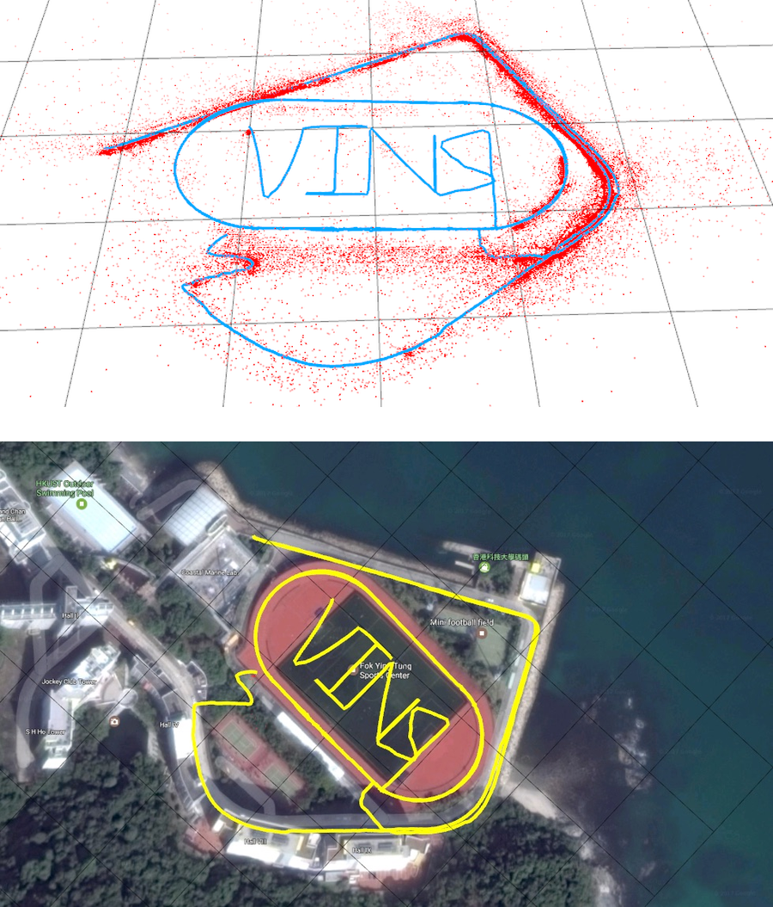

**图 1.** 所提出单目视觉惯性状态估计器的室外实验结果。数据由手持单目相机-IMU 套件在正常步行条件下采集。轨迹包含场地内两圈完整圆周以及附近车道上的两段半圆，总长度 2.5 km。实验视频见多媒体附件。(a) 轨迹（蓝）与特征位置（红）；(b) 叠加在 Google Map 上以便视觉对比的轨迹。

---

## 第一章：核心痛点与系统全景（对应论文 摘要 ~ 第 III 节）

### 1.1 为什么用“单目相机 + IMU”？（尺度的缺失与找回）
如果只用一个普通单目摄像头（Monocular Camera）做定位，会面临一个致命的物理缺陷——**尺度不确定性（Scale Ambiguity）**。
想象你在照片里看到一栋房子，如果不知道房子的真实尺寸，你根本分不清它是“10米外的一栋真房子”还是“0.1米外的一个沙盘模型”。纯单目视觉只能算出相对的几何形状（比如“我往前走了一步，特征点往后退了一步”），但这一步到底是 1 米还是 1 厘米，单目相机完全不知道。

为了找回真实的**物理度量尺度（Metric Scale，单位：米）**，VINS-Mono 引入了一个极其廉价的芯片——**IMU（惯性测量单元，手机里都有）**。
*   **IMU 能干嘛？** 它包含**加速度计**（测三轴线加速度 $m/s^2$）和**陀螺仪**（测三轴角速度 $rad/s$）。
*   **优势互补：**
    1.  **找回物理尺度：** 加速度对时间积分一次是真实速度（$m/s$），积分两次就是真实的物理位移（米）！把 IMU 的真实米制位移和单目相机的无尺度轨迹对齐，就能算出真实的物理尺度。
    2.  **锁死水平姿态（滚转角 Roll 与俯仰角 Pitch）：** 地球有重力（$g \approx 9.81\text{ m/s}^2$，永远垂直地面朝下）。加速度计随时能感受到重力的方向，就像一个电子铅垂线，让你永远知道哪边是绝对的“正下方”，因此机器人的滚转角（左右歪）和俯仰角（前后仰）是**绝对可观、永远不会累积漂移**的！
    3.  **互相兜底：** 相机遇到白墙、夜晚、剧烈晃动（运动模糊）会跟丢特征点，此时靠 IMU 短时间积分续命；而 IMU 积分超过几秒钟位置就会因为噪声平方级爆炸漂移，此时靠相机的视觉观测把 IMU 拽住。

### 1.2 先锋问答：感知与定位的碰撞

> **💡 深度探讨 1：论文说“缺乏直接距离测量会在初始化、优化等方面带来显著挑战”。如果我直接用感知里的【单目深度估计（Monocular Depth Estimation）】网络给出每个像素的距离，会提升效果吗？能改善哪些问题？**
> *   **什么是这里的“尺度”？** 这里的尺度指的是纯视觉算出来的“虚拟几何世界（无单位）”与“真实物理世界（米）”之间的全局缩放比例因子 $s$。
> *   **引入单目深度估计绝对能提升效果，且是目前学术界（如 DeepVINS、DROID-SLAM）的前沿方向！具体能改善：**
>     1.  **实现“静止/匀速”秒级初始化（最大改善）：** 原版 VINS-Mono 想要算出尺度 $s$，必须要求设备在启动时做加减速晃动（需要加速度激励，如果静止或匀速直线运动，加速度为0，IMU 就没法提供尺度约束）。如果用现在的度量深度估计大模型（如 Depth Anything V2 Metric / ZoeDepth）直接预测出特征点离相机多少米，系统在**完全静止或匀速行驶**时就能瞬间完成初始化！
>     2.  **攻克退化运动场景：** 当车辆在长直道匀速行驶，或者原地纯旋转转弯时，传统单目 VINS 的尺度会迅速发散漂移，有深度估计网络兜底就能强行稳住尺度。
> *   **为什么工业界还没完全用单目深度取代 IMU 算尺度？**
>     因为神经网络预测的深度存在 **Domain Gap（域泛化误差）** 和 **时间不一致性（Temporal Inconsistency）**。比如从室内走到室外，网络预测的“1米”真实物理距离可能是“1.3米”；而且前后两帧对同一个点的深度预测会闪烁跳变。在 VINS 极度精密的后端优化中，5% 的深度尺度跳变就会和 IMU 严格的牛顿力学积分产生剧烈冲突，导致优化器发散崩溃。因此目前主流方案是将深度网络的预测作为一个带较大不确定性（大方差）的软约束先验，用来辅助初始化和抑制退化，而不是盲目信任它。

> **💡 基础概念扫盲（第二、三节常见术语）：**
> *   **松耦合（Loosely-coupled）vs. 紧耦合（Tightly-coupled）：**
>     *   **松耦合：** 视觉自己算出一套相机 3D 位姿，IMU 自己积分算出一套位姿，最后用卡尔曼滤波（EKF）把两个位姿结果简单加权平均一下。缺点是视觉算位姿时没用 IMU 信息，遇到白墙直接崩。
>     *   **紧耦合（VINS-Mono采用）：** 把视觉最原始的二维像素坐标和 IMU 最原始的预积分测量直接扔进**同一个大 Loss 函数**里联合优化，让两个传感器在最底层互相约束、互相纠错。
>     
> *   **间接法（Indirect）vs. 直接法（Direct，最小化光度误差）：**
>     *   **间接法（VINS-Mono采用）：** 分两步，先在图像上提取角点并跨帧匹配，然后算**几何重投影误差**（预测的像素坐标 $(u',v')$ 减去实际匹配的像素坐标 $(u,v)$ 的几何距离）。鲁棒、抗光照变化。
>     *   **直接法（最小化光度误差 Photometric Error）：** 不提特征点！假设空间同一个点在不同帧里的像素亮度值（灰度 $I$）不变。直接把第一帧的像素按估计的位姿投到第二帧，用两个位置的**像素灰度值相减**：$Loss = I_1(u,v) - I_2(u',v')$，顺着图像亮度的梯度方向直接优化相机位姿。
>     
> *   **自举（Bootstrapping）：**
>     原意是“拽着自己的鞋带把自己提起来”，计算机里指“开机自启动”。因为紧耦合 VINS 是一个高度非线性的优化问题（Loss 曲面全是坑），如果开机时给一堆全 0 或随机的初始状态，优化器会立刻陷入错误的局部最优甚至算出 `NaN`。**不依赖外部设备、仅靠传感器自己在开机前几秒的数据算出一套八九不离十的初始状态（位置、速度、重力、尺度），把核心非线性优化器成功启动的过程，就叫“自举（即系统初始化）”。**
>     
> *   **为什么说“当视觉特征远离传感器套件时，会导致不可靠的初始化”？**
>     可用双目视差测距公式 $Z = \frac{f \cdot B}{d}$ 理解。在单目 VINS 初始化时，相机移动的距离相当于基线 $B$。如果特征点离相机非常远（比如都在几十米外的远山或大楼上，深度 $Z$ 极大），那么当你拿着相机移动一两米时，这些远处的点在图像上的移动（视差 $d$）会非常小（可能只有一两个像素），信噪比极低。区区 0.5 个像素的检测噪声，反映到三维空间里就是几十米的深度误差。基于这种极不准的 3D 点去和 IMU 对齐算尺度，算出来的初始值完全是错的。
>     
>     疑问：解释双目视差测距公式，并解释每个变量的含义是什么。

### 1.3 VINS-Mono 系统全景流水线（对应论文图 2）
整个 VINS-Mono 就像一条分工明确的四车间流水线（运行在 3 个并发线程中）：
1.  **第一车间：测量预处理（第 IV 节，线程1）：** 相机进来提角点、用光流跟踪；IMU 进来做“预积分”打包。
2.  **第二车间：估计器初始化（第 V 节）：** 开机时运行一次。先纯视觉算个无尺度轨迹，再跟 IMU 预积分对齐，一把算出真实尺度 $s$、重力方向、初始速度和陀螺仪零偏。
3.  **第三车间：紧耦合滑动窗口 VIO（第 VI 节，线程2）：** 系统的心脏。维护最近 10 个关键帧的滑动窗口，联合优化视觉重投影残差、IMU 残差和边缘化先验，实时输出高精度位姿。
4.  **第四车间：重定位与全局位姿图优化（第 VII、VIII 节，线程3）：** 消除长期累积漂移。用词袋模型认出曾经来过的老地方（回环检测），先把当前窗口拽回正确位置（重定位），再在后台把整条历史轨迹拉扯平滑（4自由度位姿图优化）。

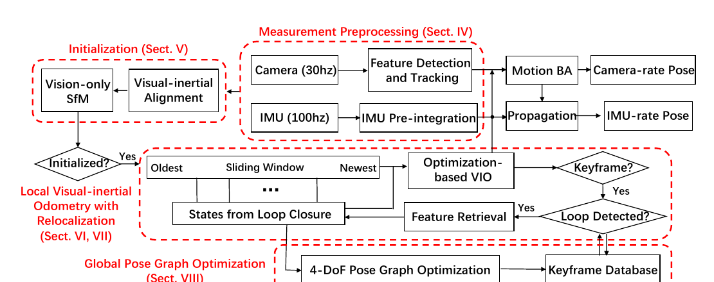

**图 2.** 所提出单目视觉惯性状态估计器完整流水线的框图。

### 1.4 坐标系与数学记号约定（看懂公式的钥匙）
*   $(\cdot)^w$：**世界坐标系（World Frame）**。固定在地面上，规定重力的方向严格沿着世界系的 $z$ 轴（即重力向量固定为 $\mathbf{g}^w = [0, 0, g]^\top$）。
*   $(\cdot)^b$：**体坐标系（Body Frame）**。固定在我们的设备上，本文直接把 **IMU 芯片的坐标系**定义为体坐标系。$b_k$ 表示拍第 $k$ 张照片那一瞬间，IMU 所在的坐标系。
*   $(\cdot)^c$：**相机坐标系（Camera Frame）**。$c_k$ 表示拍第 $k$ 张照片那一瞬间，相机镜头所在的坐标系。
*   **旋转与平移表示：** 旋转同时用 $3 \times 3$ 旋转矩阵 $\mathbf{R}$ 和四维哈密顿四元数 $\mathbf{q}$ 表示（向量做旋转时写 $\mathbf{R}\mathbf{v}$ 方便，放在状态向量里被优化时用 $\mathbf{q}$ 方便）。$\mathbf{p}^w_{b_k}$ 和 $\mathbf{q}^w_{b_k}$ 表示把一个点从第 $k$ 帧的 IMU 系 ($b_k$) 变换到世界系 ($w$) 的平移向量和旋转四元数。
*   $\otimes$：四元数乘法（作用等同于旋转矩阵相乘）。
*   $(\hat{\cdot})$：头上带尖帽的量，代表含有噪声的**传感器实际测量值**或**当前估计值**。

---

## 第二章：测量预处理（对应论文第 IV 节）

这一章负责把高频、带噪的原始相机图像和 IMU 数据洗干净、打包好，喂给后面的优化器。

### 2.1 视觉处理前端（第 IV-A 节）：又快又匀地跟踪角点

每来一帧新图像（比如 30Hz），视觉前端按顺序执行以下 5 步：

#### 第一步：KLT 稀疏光流跟踪现有特征
*   **特征是什么？** 是 **Shi-Tomasi 角点（Corner）**。白墙没梯度，直线边缘顺着线滑分不清，只有两个边缘交汇的“角点”在各个方向移动都有明显梯度。注意：前端为了极致的速度（仅需 5ms），**只提取角点的 $(u,v)$ 像素坐标，不提取描述子（如 ORB/SIFT）！**
*   **KLT 稀疏光流（Sparse Optical Flow）是怎么实现的？作用是什么？**
    *   **作用：** 已知上一帧图像里 150 个角点的坐标，在当前新图像里快速找出这 150 个点移动到了什么新坐标，从而形成跨帧的“特征点轨迹（Track）”。“稀疏”指只算这 150 个点，不像 FlowNet 那样算全图每个像素。
    *   **实现原理：** 基于三个假设：①同一个点跨帧亮度不变；②相邻帧运动很小；③角点周围的小邻域（如 $5\times 5$ 像素窗口）一起做相同运动。利用一阶泰勒展开，将窗口内的亮度差转化为关于像素位移 $(\Delta u, \Delta v)$ 的线性方程：$I_x \Delta u + I_y \Delta v = -\Delta I_t$（$I_x, I_y$ 是图像空间梯度，$\Delta I_t$ 是前后帧时间灰度差）。窗口内 25 个像素提供 25 个方程，用最小二乘法直接解出 2 个未知数 $(\Delta u, \Delta v)$。为了应对相机快速晃动的大位移，工程上会配合**图像金字塔**（先在缩小几倍的模糊图上算大位移，再一层层放大到原图算精细位移）。
    
    疑问：KLT是什么？

#### 第二步：补齐新角点并强制“均匀分布”
如果光流跟丢了一部分点（比如剩 100 个），我们需要调用 Shi-Tomasi 检测器再新抓 50 个角点，维持总点数在 100~300 之间。
*   **疑问解答：“检测器通过在两相邻特征之间设置最小像素间隔来强制均匀特征分布”，这是什么意思？工程上怎么做？**
    *   **为什么要均匀：** 如果画面左边是一棵纹理丰富的树，右边是一面白墙上有几个插座。如果不加限制，检测器会把 300 个角点全部密密麻麻扎堆在左边的树叶上，右边一个点都不给。这会导致算出来的相机 3D 姿态严重偏向一边（几何约束退化）。
    *   **工程实现（类似感知里的 NMS 非极大值抑制，极其巧妙）：**
        1. 创建一个与图像同尺寸的纯白掩码图 `Mask`（像素值全为 255）。
        2. 把当前已经成功跟踪的 100 个老特征点（优先保留被跟踪帧数最长的长寿点）填入列表，并在 `Mask` 上这些老点的坐标位置，画**半径为 $R$（例如 30 像素）的纯黑实心圆（置为 0）**。
        3. 调用角点检测器，限制它**只允许在 `Mask` 的白色区域内**寻找候选新角点，并将所有找到的候选点按“角点响应强度（Corner Response，即角点质量）”从高到低排序。
        4. 遍历排序后的候选点：挑出第 1 个质量最好的点加入特征列表，然后**立刻在 `Mask` 上以它为中心也画一个半径 30 像素的黑圆**（这就把它周围 30 像素内的其他候选点全部屏蔽掉了）；接着往下遍历，如果某个候选点所在位置已经变成黑色了就直接跳过，如果在白色区域就收录并继续画黑圆……直到凑够数量为止！这样全图的特征点之间至少隔开 30 像素，实现了完美的均匀分布。

#### 第三步：去畸变与单位球面投影
把二维特征像素坐标通过相机内参和畸变参数去畸变，然后在通过外点剔除后反投影到半径为 1 的**单位球面（Unit Sphere）**上。

疑问：详细解释这个步骤是怎么做的？

#### 第四步：带基础矩阵（Fundamental Matrix）的 RANSAC 外点剔除
*   **疑问解答：外点剔除使用带基础矩阵模型的 RANSAC，具体怎么做的？**
    *   **为什么要剔除：** 光流跟踪很容易出错（比如跟到了画面里走动的路人身上，或者遇到反光、遮挡跳到了别的点上），这些错误匹配叫**外点（Outliers）**，如果不剔除，一个外点就能把后面的位姿优化拽飞。
    *   **对极几何原理：** 如果场景是静态的，同一个 3D 点在上一帧的去畸变像素点 $p_1=[u_1, v_1, 1]^\top$ 和当前帧的像素点 $p_2=[u_2, v_2, 1]^\top$，必须严格满足对极几何方程：$p_2^\top \mathbf{F} p_1 = 0$。其中 $\mathbf{F}$ 是一个 $3\times 3$ 的**基础矩阵（Fundamental Matrix）**。几何意义上，$\mathbf{F} p_1$ 会在当前帧图像上画出一条线（极线 Epipolar Line），正确的匹配点 $p_2$ 必须严格落在这条线上！
    *   **RANSAC（随机抽样一致）具体步骤：**
        1. 从当前跟踪成功的 150 对匹配点中，随机抽取 **8 对点**（八点法），列出线性方程组解算出一个候选的基础矩阵 $\mathbf{F}$。
        2. 用这个 $\mathbf{F}$ 去测试剩下的 142 对点：计算每个实际跟踪点 $p_2$ 到极线 $\mathbf{F} p_1$ 的几何像素距离。如果距离小于阈值（如 1 个像素），说明这对点符合该几何模型，投一票赞成票（记为**内点 Inlier**）。
        3. 重复上述随机抽样几十次，选出得票最多（内点数量最多）的那个 $\mathbf{F}$ 作为最终正确的几何模型。凡是不支持该模型的点（离极线很远的点），全部判定为光流跟错的**外点**，直接从跟踪列表里删掉！

#### 第五步：关键帧（Keyframe）选择策略
并不是每一帧图像都要送进后端做昂贵的非线性优化，我们只挑有代表性的“关键帧”。VINS 有两个挑选准则（满足其一即成为新关键帧）：
1.  **跟踪质量准则：** 如果当前帧被成功跟踪的特征点数量跌破某个阈值（说明相机转得太快，老特征点快跟丢光了），立刻把当前帧设为关键帧，避免特征轨迹完全丢失。
2.  **平均视差（Parallax）准则：** 如果当前帧与最新关键帧之间，所有被跟踪特征点的平均移动距离（视差）超过某阈值，将该帧视为新关键帧。

> **💡 疑问解答：视差是什么？为什么说“特征在纯旋转运动中无法被三角化”？旋转补偿是怎么回事？**
> *   **什么是视差（Parallax）：** 你伸出一根手指放在眼前，先闭左眼用右眼看，再闭右眼用左眼看，你会发现手指相对于背景墙的位置发生了左右跳动——这个像素移动量就叫**视差**。在单目相机里，靠的是相机在 $t_1$ 和 $t_2$ 时刻移动到不同位置拍照，来形成双目一样的视差。
> *   **为什么纯旋转无法三角化（测距）？**
>     **三角化（Triangulation）** 是指从两个不同位置观察同一个点，利用两条视线交汇构成的三角形来算出该点的深度距离 $Z$（公式：$Z = \frac{f \cdot B}{d}$，其中 $B$ 是两次拍照相机光心移动的平移距离，即基线）。
>     如果相机做**纯旋转**（比如你站在原地不动，只是扭头转相机），相机光心的位置完全没变，基线长度 **$B = 0$**！从光心射向空间点的两条视线是完全重合的一条线，根本构不成三角形！虽然因为你扭头，画面里的像素从左边移到了右边（产生了巨大的虚假像素视差），但无论这棵树离你是 1 米还是 1000 米，只要你扭头 10 度，它在画面里划过的角度都是一模一样的 10 度。**没有平移，就永远算不出深度！**
>
> 疑问：你这里说的纯旋转，指的是沿着相机的光心旋转，还是yaw角的旋转，如果是yaw角的旋转，我理解基线B不等于0 ，沿着光心的旋转，那才是**$B = 0$**，是这样吗？
>
> *   **陀螺仪旋转补偿：** 为了防止相机原地扭头时，系统被巨大的虚假像素移动欺骗而错误地插入无法三角化的关键帧，VINS 在算像素移动量时，先用两帧之间 IMU 陀螺仪测量的短期积分来补偿旋转，只看剩下由**纯平移带来的真实有效视差**。注意该旋转补偿仅用于关键帧选择，不参与 VINS 公式中的旋转计算；因此即使陀螺仪有大噪声或偏置，也只会带来次优的关键帧选择，不会直接影响状态估计质量。
>
> 疑问：先用两帧之间 IMU 陀螺仪测量的短期积分来补偿旋转。这里是怎么补偿的？

---

### 2.2 IMU 预积分（第 IV-B 节）：SLAM 界的算力救星

这是整篇论文数学推导最密集的一节。别怕，我们先搞懂“为什么要搞预积分”，再一行行拆解公式。

#### 1. 核心痛点：为什么不能直接积分 IMU？（回答你的疑问：预积分要解决什么问题？）
IMU 的频率很高（比如 200Hz），而相机只有 20Hz，意味着两帧图像 $[t_k, t_{k+1}]$ 之间夹着 10 个 IMU 原始测量数据。
我们先看 IMU 的原始陀螺仪与加速度计测量模型**公式 (1)** 和偏置模型**公式 (2)**：
$$
\begin{aligned}
\hat{\mathbf{a}}_t &= \mathbf{a}_t + \mathbf{b}_{a_t} + \mathbf{R}^t_w \mathbf{g}^w + \mathbf{n}_a \\
\hat{\boldsymbol{\omega}}_t &= \boldsymbol{\omega}_t + \mathbf{b}_{w_t} + \mathbf{n}_w .
\end{aligned}
\tag{1}
$$
$$
\dot{\mathbf{b}}_{a_t} = \mathbf{n}_{b_a}, \qquad \dot{\mathbf{b}}_{w_t} = \mathbf{n}_{b_w}.
\tag{2}
$$
*   **公式 (1) 含义：** 在体坐标系中测量的加速度计读数 $\hat{\mathbf{a}}_t$，结合了抵消重力的力 $\mathbf{R}^t_w \mathbf{g}^w$ 与平台真实运动加速度 $\mathbf{a}_t$，并受加速度偏置 $\mathbf{b}_{a_t}$ 和高斯白噪声 $\mathbf{n}_a \sim \mathcal{N}(\mathbf{0}, \sigma_a^2)$ 影响。陀螺仪读数 $\hat{\boldsymbol{\omega}}_t$ 同理（受陀螺仪偏置 $\mathbf{b}_{w_t}$ 和高斯白噪声 $\mathbf{n}_w \sim \mathcal{N}(\mathbf{0}, \sigma_w^2)$ 影响，不受重力影响）。
*   **公式 (2) 含义：** 加速度偏置与陀螺仪偏置建模为**随机游走（Random Walk）**，其时间导数为高斯白噪声：$\mathbf{n}_{b_a} \sim \mathcal{N}(\mathbf{0}, \sigma_{b_a}^2)$，$\mathbf{n}_{b_w} \sim \mathcal{N}(\mathbf{0}, \sigma_{b_w}^2)$。

> **💡 疑问解答：什么是偏置（Bias）？好的、昂贵的 IMU 能自动校准偏置吗？**
> *   **什么是偏置（零偏）：** 当 IMU 完全静止且不受力时，理想输出应该是 $0$，但实际输出总有一个非零底数（比如 $0.02\text{ rad/s}$），这就是偏置。
> *   **好 IMU 能自动校准吗？不能！** 偏置分为“开机常值偏置”和“随芯片发热、机械应力实时变化的温漂/随机游走偏置”。哪怕是几十万人民币的军工级光纤 IMU，出厂时只能在温箱里标定静态温度曲线；一旦装上飞机通电发热，偏置依然会随时间随机游走。因为算位置要对加速度做**二次时间积分**（位移误差 = $\frac{1}{2} b_a t^2$），哪怕极其微小的残余偏置，积分几十秒也会飘出几十米远！所以任何高精度 VIO 系统，都必须在算法里结合视觉观测**在线实时估计并扣除 IMU 偏置**。

现在，给定对应于图像帧 $b_k$ 与 $b_{k+1}$ 的两个时刻，位置、速度与姿态状态可由时间区间 $[t_k, t_{k+1}]$ 内的惯性测量在**世界坐标系 $w$** 中传播，写出**公式 (3)** 与**公式 (4)**：
$$
\begin{aligned}
\mathbf{p}^w_{b_{k+1}} &= \mathbf{p}^w_{b_k} + \mathbf{v}^w_{b_k}\Delta t_k + \iint_{t\in[t_k,t_{k+1}]}\big(\mathbf{R}^w_t(\hat{\mathbf{a}}_t - \mathbf{b}_{a_t} - \mathbf{n}_a) - \mathbf{g}^w\big)\,dt^2 \\
\mathbf{v}^w_{b_{k+1}} &= \mathbf{v}^w_{b_k} + \int_{t\in[t_k,t_{k+1}]}\big(\mathbf{R}^w_t(\hat{\mathbf{a}}_t - \mathbf{b}_{a_t} - \mathbf{n}_a) - \mathbf{g}^w\big)\,dt \\
\mathbf{q}^w_{b_{k+1}} &= \mathbf{q}^w_{b_k} \otimes \int_{t\in[t_k,t_{k+1}]}\frac{1}{2}\boldsymbol{\Omega}(\hat{\boldsymbol{\omega}}_t - \mathbf{b}_{w_t} - \mathbf{n}_w)\mathbf{q}^{b_k}_{t}\,dt,
\end{aligned}
\tag{3}
$$
其中
$$
\boldsymbol{\Omega}(\boldsymbol{\omega})=\begin{bmatrix}-\lfloor\boldsymbol{\omega}\rfloor_\times & \boldsymbol{\omega}\\ -\boldsymbol{\omega}^\top & 0\end{bmatrix},\quad
\lfloor\boldsymbol{\omega}\rfloor_\times=\begin{bmatrix}0 & -\omega_z & \omega_y\\ \omega_z & 0 & -\omega_x\\ -\omega_y & \omega_x & 0\end{bmatrix}.
\tag{4}
$$
*(注：公式(4)中的 $\boldsymbol{\Omega}(\boldsymbol{\omega})$ 和反对称矩阵 $\lfloor\boldsymbol{\omega}\rfloor_\times$ 只是把三维角速度向量写成 $4\times 4$ 矩阵以便与四元数相乘求导的标准数学工具)*。

**🚨 算力灾难在哪里？请紧盯公式 (3) 积分号里面的 $\mathbf{R}^w_t$！**
在公式 (3) 中，为了在积分里减掉世界系的重力 $\mathbf{g}^w$，我们必须把每一时刻 $t$ 的 IMU 加速度乘上 $\mathbf{R}^w_t$（即 $t$ 时刻 IMU 在**世界坐标系**下的绝对姿态），先转到世界系再积分。
可是，后端的非线性优化器（Ceres）在工作时，每一轮迭代都会微调第 $k$ 帧的世界姿态 $\mathbf{R}^w_{b_k}$、位置 $\mathbf{p}^w_{b_k}$ 和速度 $\mathbf{v}^w_{b_k}$！一旦起点状态被优化器改了一点点，从 $t_k$ 到 $t_{k+1}$ 之间所有中间时刻的世界姿态 $\mathbf{R}^w_t$ 全都跟着变了！
这意味着：**优化器每走一步梯度下降调整位姿时，都需要在它们之间把成百上千个高频 IMU 数据全部重新传播积分一遍！** 这种传播策略计算代价高昂，为避免再传播，我们采用**预积分算法**。

#### 2. 破局之道：坐标系变换（公式 5 ~ 7）
怎么解决重复积分？**既然世界系姿态 $\mathbf{R}^w_{b_k}$ 老是变，那我就不在世界系下积分了！我将参考坐标系从世界坐标系改为局部坐标系 $b_k$！**

我们在公式 (3) 的等号两边，同时左乘 $\mathbf{R}^{b_k}_w$（即把所有世界系向量旋转到第 $k$ 帧的体坐标系 $b_k$ 下），利用旋转矩阵拆分性质 $\mathbf{R}^{b_k}_w \mathbf{R}^w_t = \mathbf{R}^{b_k}_t$，把所有跟起点状态 $(\mathbf{p}^w_{b_k}, \mathbf{v}^w_{b_k}, \mathbf{q}^w_{b_k})$ 和重力 $\mathbf{g}^w$ 有关的项全部剥离到积分号外面，仅预积分与线加速度 $\hat{\mathbf{a}}$ 和角速度 $\hat{\boldsymbol{\omega}}$ 相关的部分，这就得到了**公式 (5)** 和**公式 (6)**：
$$
\begin{aligned}
\mathbf{R}^{b_k}_w\mathbf{p}^w_{b_{k+1}} &= \mathbf{R}^{b_k}_w\big(\mathbf{p}^w_{b_k}+\mathbf{v}^w_{b_k}\Delta t_k-\frac{1}{2}\mathbf{g}^w\Delta t_k^2\big)+\boldsymbol{\alpha}^{b_k}_{b_{k+1}} \\
\mathbf{R}^{b_k}_w\mathbf{v}^w_{b_{k+1}} &= \mathbf{R}^{b_k}_w\big(\mathbf{v}^w_{b_k}-\mathbf{g}^w\Delta t_k\big)+\boldsymbol{\beta}^{b_k}_{b_{k+1}} \\
\mathbf{q}^{b_k}_w\otimes\mathbf{q}^w_{b_{k+1}} &= \boldsymbol{\gamma}^{b_k}_{b_{k+1}},
\end{aligned}
\tag{5}
$$

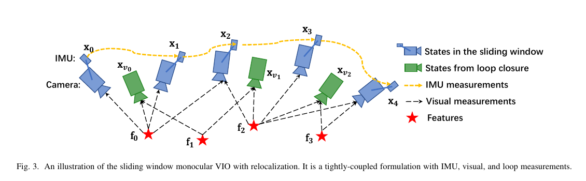

**图 3.** 带重定位的滑动窗口单目 VIO 示意。它是与 IMU、视觉与回环测量紧耦合的公式。

其中，唯一留在积分号里面的三个量就是**预积分项（Pre-integration terms）公式 (6)**：
$$
\begin{aligned}
\boldsymbol{\alpha}^{b_k}_{b_{k+1}} &= \iint_{t\in[t_k,t_{k+1}]}\mathbf{R}^{b_k}_t(\hat{\mathbf{a}}_t-\mathbf{b}_{a_t}-\mathbf{n}_a)\,dt^2 \\
\boldsymbol{\beta}^{b_k}_{b_{k+1}} &= \int_{t\in[t_k,t_{k+1}]}\mathbf{R}^{b_k}_t(\hat{\mathbf{a}}_t-\mathbf{b}_{a_t}-\mathbf{n}_a)\,dt \\
\boldsymbol{\gamma}^{b_k}_{b_{k+1}} &= \int_{t\in[t_k,t_{k+1}]}\frac{1}{2}\boldsymbol{\Omega}(\hat{\boldsymbol{\omega}}_t-\mathbf{b}_{w_t}-\mathbf{n}_w)\boldsymbol{\gamma}^{b_k}_t\,dt.
\end{aligned}
\tag{6}
$$
而在计算机离散时间实现中（相邻两个 IMU 测量 $i$ 与 $i+1$ 之间时间间隔为 $\delta t$，代码中实际使用中点积分，此处以欧拉积分演示），开始时 $\boldsymbol{\alpha}^{b_k}_{b_k}, \boldsymbol{\beta}^{b_k}_{b_k}$ 为 $\mathbf{0}$，$\boldsymbol{\gamma}^{b_k}_{b_k}$ 为单位四元数，将未知的噪声项 $\mathbf{n}_a, \mathbf{n}_w$ 视为零，一步步累加传播均值，即得到**公式 (7)**：
$$
\begin{aligned}
\hat{\boldsymbol{\alpha}}^{b_k}_{i+1} &= \hat{\boldsymbol{\alpha}}^{b_k}_{i}+\hat{\boldsymbol{\beta}}^{b_k}_{i}\delta t+\frac{1}{2}\mathbf{R}(\hat{\boldsymbol{\gamma}}^{b_k}_{i})(\hat{\mathbf{a}}_i-\mathbf{b}_{a_i})\delta t^2 \\
\hat{\boldsymbol{\beta}}^{b_k}_{i+1} &= \hat{\boldsymbol{\beta}}^{b_k}_{i}+\mathbf{R}(\hat{\boldsymbol{\gamma}}^{b_k}_{i})(\hat{\mathbf{a}}_i-\mathbf{b}_{a_i})\delta t \\
\hat{\boldsymbol{\gamma}}^{b_k}_{i+1} &= \hat{\boldsymbol{\gamma}}^{b_k}_{i}\otimes\begin{bmatrix}1\\ \tfrac{1}{2}(\hat{\boldsymbol{\omega}}_i-\mathbf{b}_{w_i})\delta t\end{bmatrix}.
\end{aligned}
\tag{7}
$$

> **💡 疑问解答：公式 (6) 和 (7) 计算出来的 $\hat{\boldsymbol{\alpha}}, \hat{\boldsymbol{\beta}}, \hat{\boldsymbol{\gamma}}$ 到底是什么物理含义？为什么能解决重复积分问题？**
> *   **三个变量的物理含义：** 它们代表在拍第 $k$ 张照片到拍第 $k+1$ 张照片这短短的区间内，**假设宇宙中没有重力，且以第 $k$ 帧的局部坐标系 $b_k$ 为参考系来看**，纯靠 IMU 测量推算出来的：
>     1.  $\hat{\boldsymbol{\alpha}}^{b_k}_{b_{k+1}}$：相对**位置变化量**（位移增量）；
>     2.  $\hat{\boldsymbol{\beta}}^{b_k}_{b_{k+1}}$：相对**速度变化量**（速度增量）；
>     3.  $\hat{\boldsymbol{\gamma}}^{b_k}_{b_{k+1}}$：相对**旋转四元数**（姿态变化量，即 $\mathbf{R}^{b_k}_t$）。
> *   **为什么能解决重复积分问题：** 你看公式 (6) 和 (7) 的右边，里面还有世界系位姿 $\mathbf{p}^w_{b_k}, \mathbf{q}^w_{b_k}$ 和速度 $\mathbf{v}^w_{b_k}$ 吗？**完全没有了！** 它们仅通过以 $b_k$ 为参考坐标系的 IMU 测量即可获得，不与 $b_k$ 和 $b_{k+1}$ 中的其他位姿、速度状态相关！这意味着，无论后端优化器怎么修改第 $k$ 帧和第 $k+1$ 帧的世界位姿，这三个预积分量 $\hat{\boldsymbol{\alpha}}, \hat{\boldsymbol{\beta}}, \hat{\boldsymbol{\gamma}}$ **在前端收到数据时算好一次就固定了，后端优化时直接拿来用，实现了 $O(1)$ 的零重复积分开销！**
>
> 疑问：公式(5)(6)(7)是怎么得到的，没有看明白。

#### 3. 完美闭环：偏置微调的一阶泰勒近似与协方差传播（公式 8 ~ 13）
公式 (7) 里虽然没有了位姿和速度，但还与 **IMU 偏置 $\mathbf{b}_a, \mathbf{b}_w$** 相关。如果优化器改了偏置估计，难道又要重新积分？

**VINS-Mono 的做法（公式 12）：当偏置估计改变较小时，坚决不重新积分！直接通过它们关于偏置的一阶近似（泰勒展开）来调整 $\boldsymbol{\alpha}, \boldsymbol{\beta}, \boldsymbol{\gamma}$，只有改变很大时才做再传播！**
为了做泰勒展开并传递噪声协方差，由于四维旋转四元数 $\boldsymbol{\gamma}^{b_k}_t$ 过参数化，我们先将其误差定义为均值附近的三维小扰动 $\delta\boldsymbol{\theta}^{b_k}_t$，写出**公式 (8)**：
$$
\boldsymbol{\gamma}^{b_k}_t \approx \hat{\boldsymbol{\gamma}}^{b_k}_t \otimes\begin{bmatrix}1\\ \tfrac{1}{2}\delta\boldsymbol{\theta}^{b_k}_t\end{bmatrix},
\tag{8}
$$
然后推导预积分误差项的连续时间线性化动力学方程**公式 (9)**：
$$
\begin{bmatrix}
\delta\dot{\boldsymbol{\alpha}}^{b_k}_t \\
\delta\dot{\boldsymbol{\beta}}^{b_k}_t \\
\delta\dot{\boldsymbol{\theta}}^{b_k}_t \\
\delta\dot{\mathbf{b}}_{a_t} \\
\delta\dot{\mathbf{b}}_{w_t}
\end{bmatrix}
=
\begin{bmatrix}
\mathbf{0} & \mathbf{I} & \mathbf{0} & \mathbf{0} & \mathbf{0} \\
\mathbf{0} & \mathbf{0} & -\mathbf{R}^{b_k}_t\lfloor\hat{\mathbf{a}}_t-\mathbf{b}_{a_t}\rfloor_\times & -\mathbf{R}^{b_k}_t & \mathbf{0} \\
\mathbf{0} & \mathbf{0} & -\lfloor\hat{\boldsymbol{\omega}}_t-\mathbf{b}_{w_t}\rfloor_\times & \mathbf{0} & -\mathbf{I} \\
\mathbf{0} & \mathbf{0} & \mathbf{0} & \mathbf{0} & \mathbf{0} \\
\mathbf{0} & \mathbf{0} & \mathbf{0} & \mathbf{0} & \mathbf{0}
\end{bmatrix}
\begin{bmatrix}
\delta\boldsymbol{\alpha}^{b_k}_t \\
\delta\boldsymbol{\beta}^{b_k}_t \\
\delta\boldsymbol{\theta}^{b_k}_t \\
\delta\mathbf{b}_{a_t} \\
\delta\mathbf{b}_{w_t}
\end{bmatrix}
+
\begin{bmatrix}
\mathbf{0} & \mathbf{0} & \mathbf{0} & \mathbf{0} \\
-\mathbf{R}^{b_k}_t & \mathbf{0} & \mathbf{0} & \mathbf{0} \\
\mathbf{0} & -\mathbf{I} & \mathbf{0} & \mathbf{0} \\
\mathbf{0} & \mathbf{0} & \mathbf{I} & \mathbf{0} \\
\mathbf{0} & \mathbf{0} & \mathbf{0} & \mathbf{I}
\end{bmatrix}
\begin{bmatrix}
\mathbf{n}_a \\ \mathbf{n}_w \\ \mathbf{n}_{b_a} \\ \mathbf{n}_{b_w}
\end{bmatrix}
= \mathbf{F}_t\delta\mathbf{z}^{b_k}_t + \mathbf{G}_t\mathbf{n}_t.
\tag{9}
$$
由此，在递推计算公式 (7) 的同时，从初始值 $\mathbf{P}^{b_k}_{b_k}=\mathbf{0}$ 和 $\mathbf{J}_{b_k}=\mathbf{I}$ 出发，一步步递归更新两个矩阵：
1.  **协方差矩阵 $\mathbf{P}^{b_k}_{b_{k+1}}$（公式 10，其中 $\mathbf{Q}$ 为噪声 $(\sigma_a^2,\sigma_w^2,\sigma_{b_a}^2,\sigma_{b_w}^2)$ 的对角协方差矩阵）：**
    $$
    \mathbf{P}^{b_k}_{t+\delta t}=(\mathbf{I}+\mathbf{F}_t\delta t)\mathbf{P}^{b_k}_t(\mathbf{I}+\mathbf{F}_t\delta t)^\top+(\mathbf{G}_t\delta t)\mathbf{Q}(\mathbf{G}_t\delta t)^\top,\quad t\in[k,k+1],
    \tag{10}
    $$
2.  **一阶雅可比矩阵 $\mathbf{J}_{b_{k+1}}$（公式 11，记录误差状态 $\delta\mathbf{z}^{b_k}_{b_{k+1}}$ 对初始状态 $\delta\mathbf{z}^{b_k}_{b_k}$ 的偏导数）：**
    $$
    \mathbf{J}_{t+\delta t}=(\mathbf{I}+\mathbf{F}_t\delta t)\mathbf{J}_t,\quad t\in[k,k+1].
    \tag{11}
    $$

从大雅可比矩阵 $\mathbf{J}_{b_{k+1}}$ 中取出对应分块（如 $\mathbf{J}^\alpha_{b_a} = \frac{\delta \boldsymbol{\alpha}^{b_k}_{b_{k+1}}}{\delta \mathbf{b}_{a_k}}$），当后端优化器把偏置微调了 $\delta \mathbf{b}_{a_k}$ 和 $\delta \mathbf{b}_{w_k}$ 时，直接用一阶近似**公式 (12)** 校正预积分结果，而不是再传播：
$$
\begin{aligned}
\boldsymbol{\alpha}^{b_k}_{b_{k+1}} &\approx \hat{\boldsymbol{\alpha}}^{b_k}_{b_{k+1}}+\mathbf{J}^\alpha_{b_a}\delta\mathbf{b}_{a_k}+\mathbf{J}^\alpha_{b_w}\delta\mathbf{b}_{w_k} \\
\boldsymbol{\beta}^{b_k}_{b_{k+1}} &\approx \hat{\boldsymbol{\beta}}^{b_k}_{b_{k+1}}+\mathbf{J}^\beta_{b_a}\delta\mathbf{b}_{a_k}+\mathbf{J}^\beta_{b_w}\delta\mathbf{b}_{w_k} \\
\boldsymbol{\gamma}^{b_k}_{b_{k+1}} &\approx \hat{\boldsymbol{\gamma}}^{b_k}_{b_{k+1}}\otimes\begin{bmatrix}1\\ \tfrac{1}{2}\mathbf{J}^\gamma_{b_w}\delta\mathbf{b}_{w_k}\end{bmatrix}.
\end{aligned}
\tag{12}
$$
最后，把公式 (5) 整理成带有对应协方差 $\mathbf{P}^{b_k}_{b_{k+1}}$ 的 **IMU 测量模型公式 (13)**：
$$
\begin{bmatrix}
\hat{\boldsymbol{\alpha}}^{b_k}_{b_{k+1}} \\
\hat{\boldsymbol{\beta}}^{b_k}_{b_{k+1}} \\
\hat{\boldsymbol{\gamma}}^{b_k}_{b_{k+1}} \\
\mathbf{0} \\
\mathbf{0}
\end{bmatrix}
=
\begin{bmatrix}
\mathbf{R}^{b_k}_w\big(\mathbf{p}^w_{b_{k+1}}-\mathbf{p}^w_{b_k}+\tfrac{1}{2}\mathbf{g}^w\Delta t_k^2-\mathbf{v}^w_{b_k}\Delta t_k\big) \\
\mathbf{R}^{b_k}_w\big(\mathbf{v}^w_{b_{k+1}}+\mathbf{g}^w\Delta t_k-\mathbf{v}^w_{b_k}\big) \\
\mathbf{q}^{b_k}_w\otimes\mathbf{q}^w_{b_{k+1}} \\
\mathbf{b}_{a_{b_{k+1}}}-\mathbf{b}_{a_{b_k}} \\
\mathbf{b}_{w_{b_{k+1}}}-\mathbf{b}_{w_{b_k}}
\end{bmatrix}.
\tag{13}
$$

> **💡 总结卡片：IMU 预积分全景（回答你的综合疑问）**
> *   **输入：** 两帧图像时间戳 $[t_k, t_{k+1}]$ 之间的所有高频原始 IMU 读数 $(\hat{\mathbf{a}}_i, \hat{\boldsymbol{\omega}}_i)$、当前偏置估计值 $(\mathbf{b}_{a_k}, \mathbf{b}_{w_k})$、IMU 硬件噪声参数 $\mathbf{Q}$。
> *   **输出：** ①三个相对运动预积分均值 $(\hat{\boldsymbol{\alpha}}, \hat{\boldsymbol{\beta}}, \hat{\boldsymbol{\gamma}})$；② $15\times 15$ 协方差矩阵 $\mathbf{P}^{b_k}_{b_{k+1}}$；③对偏置的雅可比矩阵 $\mathbf{J}_{b_{k+1}}$。
> *   **优点：** 把两帧之间几十次高频 IMU 积分压缩成 1 个等效的相对运动约束，且与世界系位姿解耦，配合偏置一阶泰勒近似，彻底消灭了后端迭代优化时的重复积分，节省了海量算力。
> *   **缺点：** 它是**一阶线性近似**。当载体发生极高动态的剧烈旋转，或者初始偏置估计错得太离谱时，一阶泰勒近似会引入线性化截断误差，导致滚转与俯仰角估计精度轻微下降。

---

## 第三章：估计器初始化（对应论文第 V 节）—— 破冰自举

### 3.1 为什么初始化这么难？总体思路是什么？
> **💡 疑问解答：初始化要解决的问题是什么？需要求哪些初始值？这里怎么做的？**
> *   **面临的死锁困境：** 单目紧耦合 VIO 是高度非线性系统。单目相机没有尺度 $s$，需要 IMU 给尺度；但 IMU 加速度计测出来的读数里混杂着巨大的地球重力 $\mathbf{g} \approx 9.81\text{ m/s}^2$，如果不先知道设备相对于水平地面的姿态（即重力方向），就没法从 IMU 里抠掉重力来算位移尺度！同时运动中初始化还面临大偏置污染，这就是单目 VINS 最脆弱的步骤。
> *   **需要求出的初始值清单：** 滑动窗口内所有帧的 3D 位姿、3D 特征点位置、每一帧的速度 $\mathbf{v}_k$、陀螺仪偏置 $\mathbf{b}_w$、重力方向向量 $\mathbf{g}^{c_0}$、以及把纯视觉轨迹放大到真实“米”的**度量尺度因子 $s$**。
> *   **VINS-Mono 的破局思路（松耦合视觉惯性对齐，对应论文图 4）：**
>     既然混在一起解不开，那就**先分头算，再对齐**！
>     1. **滑动窗口纯视觉 SfM（第 V-A 节）：** 先完全不管 IMU，只用滑动窗口里的图像，算出一套“形状完全正确、但尺度不确定”的相机位姿图与特征位置。
>     2. **视觉-惯性对齐（第 V-B 节）：** 将度量 IMU 预积分与纯视觉 SfM 结果对齐，像拼图一样依次解出：陀螺仪偏置 $\to$ 速度、重力向量与尺度 $s$ $\to$ 重力幅度精化！
>     *(注：为什么初始化时忽略加速度计偏置 $\mathbf{b}_a$？因为加速度计偏置与重力耦合，且重力向量幅度相对平台动力学很大，加上初始化阶段很短，这些偏置项很难被观测到，留到第四章紧耦合 VIO 里在线标定即可。)*

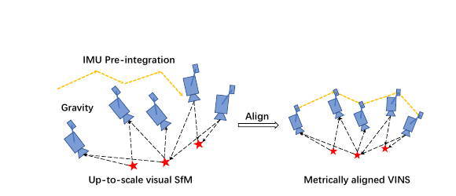

**图 4.** 用于估计器初始化的视觉惯性对齐过程示意。

### 3.2 第一步：滑动窗口纯视觉 SfM（第 V-A 节）
在滑动窗口（维护有限帧以限制计算复杂度）里，首先检查最新帧与所有先前帧之间的特征对应。若能在最新帧与窗口中任一其他帧之间找到稳定特征跟踪（超过 30 个被跟踪特征）与充分视差（超过 20 个旋转补偿像素）：
1.  **用五点算法（Five-point algorithm）恢复这两帧之间的相对旋转与尺度不确定平移：**
    > **💡 疑问解答：五点算法是什么？**
    > 前面讲外点剔除时提到了针对像素坐标的“八点法求基础矩阵 $\mathbf{F}$”。而在相机内参已知的情况下，把像素坐标转成归一化相机平面坐标后，两帧之间的几何约束矩阵简化为**本质矩阵（Essential Matrix, $\mathbf{E} = \lfloor\mathbf{t}\rfloor_\times \mathbf{R}$）**。因为三维旋转 $\mathbf{R}$ 有 3 个自由度，三维平移 $\mathbf{t}$ 有 3 个自由度，但单目没有绝对尺度（我们可以随便规定两帧之间的距离 $\|\mathbf{t}\| = 1$），扣掉 1 个尺度自由度后，两帧之间的相对运动一共只有 $3 + 3 - 1 = \mathbf{5}$ **个自由度**！因此，最少只需要 **5 对匹配特征点**，就能通过求解代数多项式方程算出两帧之间的相对旋转和无尺度平移。这就是著名的 Nistér 五点算法。
2.  **三角化与 PnP 扩展到全窗口：** 任意设定尺度并三角化这两帧中观测到的所有特征；基于这些三角化特征，执行透视 $n$ 点（**PnP**）方法估计窗口中所有其他帧的位姿；最后应用全局完整光束法平差（Full BA）最小化所有特征观测的总重投影误差。
3.  **坐标变换到 IMU 系（公式 14）：**
    由于尚不知晓世界坐标系，我们将第一相机帧 $(\cdot)^{c_0}$ 设为 SfM 的参考坐标系。所有帧位姿 $(\bar{\mathbf{p}}^{c_0}_{c_k},\mathbf{q}^{c_0}_{c_k})$（头上带横杠 $\bar{\mathbf{p}}$ 代表无尺度的虚拟单位）与特征位置均相对于 $(\cdot)^{c_0}$ 表示。利用粗略的相机-IMU 外参 $(\mathbf{p}^b_c, \mathbf{q}^b_c)$ 和未知的**尺度参数 $s$**，将位姿从相机坐标系变换到体（IMU）坐标系**公式 (14)**：
    $$
    \begin{aligned}
    \mathbf{q}^{c_0}_{b_k} &= \mathbf{q}^{c_0}_{c_k}\otimes(\mathbf{q}^b_c)^{-1} \\
    s\bar{\mathbf{p}}^{c_0}_{b_k} &= s\bar{\mathbf{p}}^{c_0}_{c_k}-\mathbf{R}^{c_0}_{b_k}\mathbf{p}^b_c,
    \end{aligned}
    \tag{14}
    $$

### 3.3 第二步：视觉惯性对齐（第 V-B 节）—— 逐个攻破物理状态

#### 1) 陀螺仪偏置标定（公式 15）
$$
\begin{aligned}
\min_{\delta\mathbf{b}_w}\sum_{k\in\mathcal{B}}&\left\|\mathbf{q}^{c_0\,-1}_{b_{k+1}}\otimes\mathbf{q}^{c_0}_{b_k}\otimes\boldsymbol{\gamma}^{b_k}_{b_{k+1}}\right\|^2 \\
\boldsymbol{\gamma}^{b_k}_{b_{k+1}}&\approx\hat{\boldsymbol{\gamma}}^{b_k}_{b_{k+1}}\otimes\begin{bmatrix}1\\ \tfrac{1}{2}\mathbf{J}^\gamma_{b_w}\delta\mathbf{b}_w\end{bmatrix},
\end{aligned}
\tag{15}
$$
> **💡 疑问解答：公式 (15) 是在做什么？公式含义是什么？**
> *   **一句话总结：** 这是一个“对表”公式——拿视觉 SfM 算出来的准确旋转，去校准 IMU 陀螺仪的旋转偏置 $\delta\mathbf{b}_w$！
> *   **拆解看：** 对窗口里任意两连续帧 $b_k$ 和 $b_{k+1}$，我们有两个渠道知道它俩之间转了多少度：
>     1. **视觉渠道：** 纯视觉 SfM 算出来的 $\mathbf{q}^{c_0}_{b_k}$ 和 $\mathbf{q}^{c_0}_{b_{k+1}}$。其中 $\mathbf{q}^{c_0\,-1}_{b_{k+1}}\otimes\mathbf{q}^{c_0}_{b_k}$ 代表**由视觉算出的从 $b_{k+1}$ 转回 $b_k$ 的相对旋转**。
>     2. **IMU 渠道：** IMU 预积分算出来的 $\boldsymbol{\gamma}^{b_k}_{b_{k+1}}$，代表**由陀螺仪算出的从 $b_k$ 转到 $b_{k+1}$ 的相对旋转**（第二行用一阶近似把未知的陀螺仪偏置修正量 $\delta\mathbf{b}_w$ 带了进去）。
> *   **怎么对表：** 如果陀螺仪没有偏置，那么“顺着转过去（$\boldsymbol{\gamma}^{b_k}_{b_{k+1}}$）”再“倒着转回来（$\mathbf{q}^{c_0\,-1}_{b_{k+1}}\otimes\mathbf{q}^{c_0}_{b_k}$）”，两个旋转相乘正好完全抵消，结果应该等于**恒等四元数 $[1, 0, 0, 0]^\top$**（即三维虚部全为 $\mathbf{0}$）！
>     现在因为陀螺仪有偏置，乘起来虚部不为 0。我们就最小化窗口内所有帧这项乘积的模长平方和，一举解出陀螺仪偏置的初始标定 $\mathbf{b}_w$！随后立刻用新的陀螺仪偏置重新传播所有 IMU 预积分项 $\hat{\boldsymbol{\alpha}}^{b_k}_{b_{k+1}}$、$\hat{\boldsymbol{\beta}}^{b_k}_{b_{k+1}}$ 与 $\hat{\boldsymbol{\gamma}}^{b_k}_{b_{k+1}}$。

#### 2) 速度、重力向量与度量尺度线性初始化（公式 16 ~ 20）
陀螺仪偏置初始化后，继续初始化导航所需的其他基本状态，即速度、重力向量与度量尺度。

> **💡 疑问解答：这部分计算公式到底是怎么做的？请详细讲解 (16)-(20) 的公式到底在做什么，含义是什么？**
> 千万别被大矩阵吓到！这 5 个公式合在一起，本质上就是初中数学里的**“列一元一次线性方程组解应用题（$\mathbf{H} \cdot \mathcal{X}_I = \hat{\mathbf{z}}$）”**！我们来一步步看：

*   **首先看公式 (16) —— 定义我们要解的“未知数向量 $\mathcal{X}_I$”：**
    $$
    \mathcal{X}_I=\left[\mathbf{v}^{b_0}_{b_0},\mathbf{v}^{b_1}_{b_1},\cdots,\mathbf{v}^{b_n}_{b_n},\mathbf{g}^{c_0},s\right],
    \tag{16}
    $$
    这里面打包了三类未知数：①拍摄第 $k$ 幅图像时体坐标系中的 3D 速度 $\mathbf{v}^{b_k}_{b_k}$；②在 $c_0$ 坐标系中的 3D 重力向量 $\mathbf{g}^{c_0}$；③将单目 SfM 缩放到度量单位（米）的 1 维尺度参数 $s$。

*   **接着看公式 (17) —— 把物理定律写出来（把前面的预积分公式 (5) 换到参考坐标系 $c_0$ 下）：**
    $$
    \begin{aligned}
    \boldsymbol{\alpha}^{b_k}_{b_{k+1}}&=\mathbf{R}^{b_k}_{c_0}\Big(s(\bar{\mathbf{p}}^{c_0}_{b_{k+1}}-\bar{\mathbf{p}}^{c_0}_{b_k})+\frac{1}{2}\mathbf{g}^{c_0}\Delta t_k^2-\mathbf{R}^{c_0}_{b_k}\mathbf{v}^{b_k}_{b_k}\Delta t_k\Big) \\
    \boldsymbol{\beta}^{b_k}_{b_{k+1}}&=\mathbf{R}^{b_k}_{c_0}\Big(\mathbf{R}^{c_0}_{b_{k+1}}\mathbf{v}^{b_{k+1}}_{b_{k+1}}+\mathbf{g}^{c_0}\Delta t_k-\mathbf{R}^{c_0}_{b_k}\mathbf{v}^{b_k}_{b_k}\Big).
    \end{aligned}
    \tag{17}
    $$
    *(注：原中文翻译稿在公式17第一行漏印了 $\frac{1}{2}$，已按原版英文PDF第7页补齐)*。
    你看括号里面是什么？就是高中物理的匀加速运动公式！
    第一行：两帧之间的真实物理位移 $s(\bar{\mathbf{p}}^{c_0}_{b_{k+1}}-\bar{\mathbf{p}}^{c_0}_{b_k})$ = 初速度位移 $\mathbf{v}\Delta t$ - 重力位移 $\frac{1}{2}\mathbf{g}\Delta t^2$ + 除重力外的加速度位移 $\boldsymbol{\alpha}$。
    第二行：末速度 $\mathbf{v}_{k+1}$ - 初速度 $\mathbf{v}_k$ = -重力速度变化 $\mathbf{g}\Delta t$ + 除重力外的速度增量 $\boldsymbol{\beta}$。

*   **再看公式 (18) 和 (19) —— 代入外参并移项，整理成“已知数 = 系数矩阵 × 未知数”的标准形式！**
    将公式 (14) 的外参关系 $s\bar{\mathbf{p}}^{c_0}_{b_k} = s\bar{\mathbf{p}}^{c_0}_{c_k}-\mathbf{R}^{c_0}_{b_k}\mathbf{p}^b_c$ 代入公式 (17) 的第一行，然后**把不含未知数的已知项全部移到等号左边记为 $\hat{\mathbf{z}}^{b_k}_{b_{k+1}}$，把含有未知数 $\left[\mathbf{v}^{b_k}_{b_k}, \mathbf{v}^{b_{k+1}}_{b_{k+1}}, \mathbf{g}^{c_0}, s\right]$ 的项提取系数矩阵 $\mathbf{H}^{b_k}_{b_{k+1}}$ 放到等号右边**，就组合成了如下线性测量模型**公式 (18)** 和 **公式 (19)**：
    $$
    \hat{\mathbf{z}}^{b_k}_{b_{k+1}}=\begin{bmatrix}\hat{\boldsymbol{\alpha}}^{b_k}_{b_{k+1}}-\mathbf{p}^b_c+\mathbf{R}^{b_k}_{c_0}\mathbf{R}^{c_0}_{b_{k+1}}\mathbf{p}^b_c\\\hat{\boldsymbol{\beta}}^{b_k}_{b_{k+1}}\end{bmatrix}=\mathbf{H}^{b_k}_{b_{k+1}}\mathcal{X}_I+\mathbf{n}^{b_k}_{b_{k+1}}
    \tag{18}
    $$
    $$
    \mathbf{H}^{b_k}_{b_{k+1}}=\begin{bmatrix}
    -\mathbf{I}\Delta t_k & \mathbf{0} & \tfrac{1}{2}\mathbf{R}^{b_k}_{c_0}\Delta t_k^2 & \mathbf{R}^{b_k}_{c_0}(\bar{\mathbf{p}}^{c_0}_{c_{k+1}}-\bar{\mathbf{p}}^{c_0}_{c_k}) \\
    -\mathbf{I} & \mathbf{R}^{b_k}_{c_0}\mathbf{R}^{c_0}_{b_{k+1}} & \mathbf{R}^{b_k}_{c_0}\Delta t_k & \mathbf{0}
    \end{bmatrix}.
    \tag{19}
    $$
    可以看到，$\mathbf{R}^{c_0}_{b_k}$、$\mathbf{R}^{c_0}_{b_{k+1}}$、$\bar{\mathbf{p}}^{c_0}_{c_k}$、$\bar{\mathbf{p}}^{c_0}_{c_{k+1}}$ 全部来自尺度不确定的单目视觉 SfM（已知数），$\Delta t_k$ 为两连续帧之间的时间间隔（已知数）。

*   **最后看公式 (20) —— 一行代码解线性最小二乘：**
    $$
    \min_{\mathcal{X}_I}\sum_{k\in\mathcal{B}}\left\|\hat{\mathbf{z}}^{b_k}_{b_{k+1}}-\mathbf{H}^{b_k}_{b_{k+1}}\mathcal{X}_I\right\|^2,
    \tag{20}
    $$
    因为所有的未知数 $\mathcal{X}_I$ 在方程里全都是一次方，把窗口里所有相邻两帧的 $\mathbf{H}$ 拼成一个大矩阵，直接用线性最小二乘公式 $\mathcal{X}_I = (\mathbf{H}^\top\mathbf{H})^{-1}\mathbf{H}^\top\hat{\mathbf{z}}$，瞬间就能算出窗口中每一帧的体坐标系速度、视觉参考坐标系 $(\cdot)^{c_0}$ 中的重力向量，以及尺度参数 $s$！

#### 3) 重力精化与完成初始化（第 V-B.3 & 4 节，对应论文图 5 与算法 1）

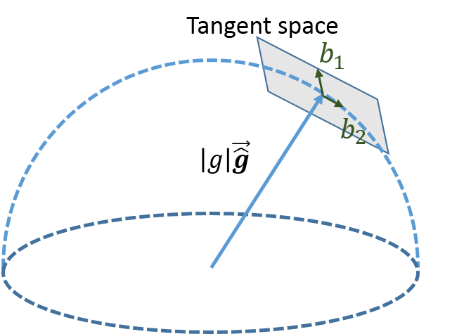

**图 5.** 重力的 2 DOF 参数化示意。由于重力幅度已知，$\mathbf{g}$ 位于半径 $g\approx 9.81\,\mathrm{m/s}^2$ 的球面上。重力在当前估计附近参数化为 $g\cdot\hat{\bar{\mathbf{g}}}+w_1\mathbf{b}_1+w_2\mathbf{b}_2$，其中 $\mathbf{b}_1$ 与 $\mathbf{b}_2$ 为张成切空间的两个正交基。

**算法 1：寻找 $\mathbf{b}_1$ 与 $\mathbf{b}_2$**
```text
if ĝ̄ ≠ [1, 0, 0] then
    b₁ ← normalize(ĝ̄ × [1, 0, 0]);
else
    b₁ ← normalize(ĝ̄ × [0, 0, 1]);
end
b₂ ← ĝ̄ × b₁;
```

> **💡 疑问解答：重力不是一直垂直于地面吗，这里为什么还要重新估计其方向？“这导致重力向量仅剩 2 DOF”，这里的 2 DOF 是哪些方向？算法 1 表示什么意思？**
> *   **为什么还要估计重力的方向？**
>     物理世界里的重力当然永远垂直于水平地面朝下！**但是，当你刚把手机/无人机开机拿在手里时，相机镜头很可能是歪着的（比如往上仰了 30 度）！**
>     请记住：在初始化阶段，我们还不知道“水平地面（世界系 $w$）”在哪里，我们是以**开机第一帧相机的歪斜坐标系 $(\cdot)^{c_0}$** 作为临时参考系的！在歪了 30 度的相机看来，垂直于地面的重力向量就是斜着指向后下方的。
>     所以，**“在 $c_0$ 系下估计重力向量 $\mathbf{g}^{c_0}$ 的方向”，本质上就是在通过重力这根铅垂线，反推“开机第一帧相机相对于水平地面到底歪了多少度（求滚转角 Roll 和俯仰角 Pitch）”！**
> *   **为什么要做“重力精化”？什么是“仅剩 2 DOF（两个自由度）”？**
>     在上一小节公式 (20) 解线性方程组时，为了保持方程是纯线性的，我们把 $\mathbf{g}^{c_0} = [g_x, g_y, g_z]^\top$ 当成了完全自由的 3 个未知数去解，**没有约束其幅度（模长）必须等于已知的重力大小 $g \approx 9.81\text{ m/s}^2$**。
>     在三维空间中，一个向量本来有 3 个自由度（方向 2 个 + 长度 1 个）。现在既然它的幅度 $g$ 已知，那么这个重力向量的箭头尖端就只能在一个**半径为 $g \approx 9.81\text{ m/s}^2$ 的球面上**移动（见图 5）！在球面上移动，不能沿着半径方向伸长缩短，只能在其**切空间（切平面 Tangent Space）**上沿着两个正交基向量 $\mathbf{b}_1$ 和 $\mathbf{b}_2$ 的方向产生微小位移 $w_1$ 和 $w_2$（即参数化为 $g\cdot\hat{\bar{\mathbf{g}}} + w_1\mathbf{b}_1 + w_2\mathbf{b}_2$）。这就是**“仅剩 2 DOF（切平面上的两个正交方向自由度）”**的含义！
> *   **算法 1（寻找切平面正交基 $\mathbf{b}_1$ 与 $\mathbf{b}_2$）是什么意思？**
>     既然我们要让当前估计的重力方向单位向量 $\hat{\bar{\mathbf{g}}}$ 在球面切平面上微调，我们就必须先在切平面上找两个长度都为 1、互相垂直、且都垂直于半径 $\hat{\bar{\mathbf{g}}}$ 的正交基向量 $\mathbf{b}_1$ 和 $\mathbf{b}_2$。
>     算法 1 就是利用**向量叉积（Cross Product, $\times$，两个向量叉乘的结果一定同时垂直于这两个向量）**来找 $\mathbf{b}_1, \mathbf{b}_2$：
>     1. 随便抓一个固定向量 $[1, 0, 0]^\top$ 跟 $\hat{\bar{\mathbf{g}}}$ 做叉乘并归一化，结果自然垂直于 $\hat{\bar{\mathbf{g}}}$，把它作为第一个切平面基向量 $\mathbf{b}_1$。（加 `if` 判断是为了防止万一 $\hat{\bar{\mathbf{g}}}$ 刚好等于 $[1, 0, 0]^\top$ 导致叉乘为 0，如果是就换 $[0, 0, 1]^\top$ 来叉乘）。
>     2. 直接用半径 $\hat{\bar{\mathbf{g}}}$ 和刚算出来的 $\mathbf{b}_1$ 再做一次叉乘（$\mathbf{b}_2 \leftarrow \hat{\bar{\mathbf{g}}} \times \mathbf{b}_1$），就得到了同时垂直于它俩的第二个切平面基向量 $\mathbf{b}_2$！
>     将 (17) 中的 $\mathbf{g}$ 替换为 $g\cdot\hat{\bar{\mathbf{g}}} + w_1\mathbf{b}_1 + w_2\mathbf{b}_2$，并与其他状态变量一起迭代求解 $w_1$ 与 $w_2$ 直至 $\hat{\mathbf{g}}$ 收敛。

*   **完成初始化（第 V-B.4 节）：**
    精化重力向量后，通过将重力旋转到 $z$ 轴得到世界坐标系与相机坐标系 $c_0$ 之间的旋转 $\mathbf{q}^w_{c_0}$。然后将所有变量从参考坐标系 $(\cdot)^{c_0}$ 旋转到世界坐标系 $(\cdot)^w$，体坐标系速度也旋转到世界坐标系，来自视觉 SfM 的平移分量按尺度 $s$ 缩放到度量单位（米）。至此，初始化流程完成，所有度量值馈入紧耦合单目 VIO。

---

## 第四章：紧耦合单目 VIO（对应论文第 VI 节）—— 核心状态估计引擎

估计器初始化之后，系统进入基于滑动窗口的紧耦合单目 VIO 进行高精度鲁棒状态估计（滑动窗口公式示意参见前文图 3）。

### 4.1 滑动窗口问题表述（第 VI-A 节，公式 21 ~ 23）
滑动窗口中的完整状态向量定义为**公式 (21)**：
$$
\begin{aligned}
\mathcal{X} &= \left[\mathbf{x}_0,\mathbf{x}_1,\cdots,\mathbf{x}_n,\mathbf{x}^b_c,\lambda_0,\lambda_1,\cdots,\lambda_m\right] \\
\mathbf{x}_k &= \left[\mathbf{p}^w_{b_k},\mathbf{v}^w_{b_k},\mathbf{q}^w_{b_k},\mathbf{b}_a,\mathbf{b}_g\right],\quad k\in[0,n] \\
\mathbf{x}^b_c &= \left[\mathbf{p}^b_c,\mathbf{q}^b_c\right],
\end{aligned}
\tag{21}
$$

> **💡 疑问解答：VIO 输出的到底是什么？**
> 看公式 (21)，VIO 每次优化迭代后，同时更新并输出以下三部分状态（其中 $n$ 为关键帧总数，$m$ 为滑动窗口中特征总数）：
> 1.  **捕获第 $k$ 幅图像时的 IMU 状态 $\mathbf{x}_k$（最核心的导航输出）：** 包含世界坐标系中 IMU 的 **3D 位置 $\mathbf{p}^w_{b_k}$、3D 速度 $\mathbf{v}^w_{b_k}$、3D 姿态 $\mathbf{q}^w_{b_k}$**，以及 IMU 体坐标系中的 **加速度偏置 $\mathbf{b}_a$ 与陀螺仪偏置 $\mathbf{b}_g$**。
> 2.  **相机-IMU 外参 $\mathbf{x}^b_c$：** 相机相对于 IMU 的安装平移 $\mathbf{p}^b_c$ 和旋转 $\mathbf{q}^b_c$（实现在线外参自标定）。
> 3.  **局部 3D 特征逆深度 $\lambda_l$：** 第 $l$ 个特征从其首次观测起的距离倒数 $\lambda_l = 1 / Z_l$。

我们使用视觉惯性光束法平差（Bundle Adjustment）公式，最小化先验与所有测量残差的马氏范数之和，以获得最大后验估计**公式 (22)** 与 Huber 范数定义**公式 (23)**：
$$
\min_{\mathcal{X}}\left\{\underbrace{\left\|\mathbf{r}_p-\mathbf{H}_p\mathcal{X}\right\|^2}_{\text{① 边缘化先验残差}} + \underbrace{\sum_{k\in\mathcal{B}}\left\|\mathbf{r}_{\mathcal{B}}(\hat{\mathbf{z}}^{b_k}_{b_{k+1}},\mathcal{X})\right\|^2_{\mathbf{P}^{b_k}_{b_{k+1}}}}_{\text{② IMU 预积分测量残差}} + \underbrace{\sum_{(l,j)\in\mathcal{C}}\rho\left(\left\|\mathbf{r}_{\mathcal{C}}(\hat{\mathbf{z}}^{c_j}_l,\mathcal{X})\right\|^2_{\mathbf{P}^{c_j}_l}\right)}_{\text{③ 视觉重投影测量残差}}\right\},
\tag{22}
$$
其中 Huber 范数定义为：
$$
\rho(s)=\begin{cases}1,& s\ge 1,\\ 2\sqrt{s}-1,& s \lt 1.\end{cases}
\tag{23}
$$
这里 $\mathcal{B}$ 为所有 IMU 测量的集合，$\mathcal{C}$ 为在当前滑动窗口中至少被观测两次的特征集合，$\{\mathbf{r}_p,\mathbf{H}_p\}$ 为来自边缘化的先验信息。系统使用谷歌开源的 **Ceres Solver** 求解该非线性问题。

---

### 4.2 IMU 测量残差精解（第 VI-B 节，公式 24）
考虑滑动窗口中两连续帧 $b_k$ 与 $b_{k+1}$ 之间的 IMU 测量，根据公式 (13) 定义的 IMU 测量模型，预积分 IMU 测量的残差定义为**公式 (24)**：
$$
\mathbf{r}_{\mathcal{B}}(\hat{\mathbf{z}}^{b_k}_{b_{k+1}},\mathcal{X})=\begin{bmatrix}\delta\boldsymbol{\alpha}^{b_k}_{b_{k+1}}\\ \delta\boldsymbol{\beta}^{b_k}_{b_{k+1}}\\ \delta\boldsymbol{\theta}^{b_k}_{b_{k+1}}\\ \delta\mathbf{b}_a\\ \delta\mathbf{b}_g\end{bmatrix}
=
\begin{bmatrix}
\mathbf{R}^{b_k}_w\big(\mathbf{p}^w_{b_{k+1}}-\mathbf{p}^w_{b_k}+\tfrac{1}{2}\mathbf{g}^w\Delta t_k^2-\mathbf{v}^w_{b_k}\Delta t_k\big)-\hat{\boldsymbol{\alpha}}^{b_k}_{b_{k+1}} \\
\mathbf{R}^{b_k}_w\big(\mathbf{v}^w_{b_{k+1}}+\mathbf{g}^w\Delta t_k-\mathbf{v}^w_{b_k}\big)-\hat{\boldsymbol{\beta}}^{b_k}_{b_{k+1}} \\
2\left[\mathbf{q}^{w\,-1}_{b_k}\otimes\mathbf{q}^w_{b_{k+1}}\otimes(\hat{\boldsymbol{\gamma}}^{b_k}_{b_{k+1}})^{-1}\right]_{xyz} \\
\mathbf{b}_{a_{b_{k+1}}}-\mathbf{b}_{a_{b_k}} \\
\mathbf{b}_{w_{b_{k+1}}}-\mathbf{b}_{w_{b_k}}
\end{bmatrix}.
\tag{24}
$$

> **💡 疑问解答：公式 (24) 表达什么含义？请逐行解释公式。**
> 在状态估计里，**残差（Residual）永远等于“根据当前猜测的状态算出的理论预测值”减去“传感器的实际测量值”**（即 `Loss = Pred - Meas`）。
> 公式 (24) 就是直接把第二章结尾的公式 (13) 等号右边的状态预测项减去等号左边的预积分测量项！共 5 行（15 维向量）：
> 1.  **第 1 行（位置残差 $\delta\boldsymbol{\alpha}^{b_k}_{b_{k+1}}$）：** 减号左边是用待优化的第 $k$ 帧和第 $k+1$ 帧的世界位置 $\mathbf{p}$、速度 $\mathbf{v}$ 反推出来的局部系位移增量（预测值）；减号右边 $\hat{\boldsymbol{\alpha}}^{b_k}_{b_{k+1}}$ 是 IMU 预积分算出来的位移增量（测量值，内部已用公式12根据当前偏置做了实时一阶校正）。如果状态猜得准，两者相减应为 $\mathbf{0}$。
> 2.  **第 2 行（速度残差 $\delta\boldsymbol{\beta}^{b_k}_{b_{k+1}}$）：** 减号左边是用待优化的两帧世界速度反推出来的局部系速度变化量（预测值）；减去右边的 IMU 预积分速度测量值 $\hat{\boldsymbol{\beta}}^{b_k}_{b_{k+1}}$。
> 3.  **第 3 行（姿态旋转残差 $\delta\boldsymbol{\theta}^{b_k}_{b_{k+1}}$）：** $\mathbf{q}^{w\,-1}_{b_k}\otimes\mathbf{q}^w_{b_{k+1}}$ 是待优化的两帧世界姿态之间的相对旋转（预测值），乘上 IMU 预积分旋转测量值 $(\hat{\boldsymbol{\gamma}}^{b_k}_{b_{k+1}})^{-1}$ 的逆。如果预测和测量一致，相乘结果是单位四元数 $[1, 0, 0, 0]^\top$。因为四元数微扰满足 $\delta \mathbf{q} \approx [1, \frac{1}{2}\delta\boldsymbol{\theta}]^\top$，所以提取四元数的向量部分 $[\cdot]_{xyz}$ 再乘以 $2$，就得到了四元数的三维误差状态表示 $\delta\boldsymbol{\theta}^{b_k}_{b_{k+1}}$！
> 4.  **第 4、5 行（加速度计与陀螺仪偏置残差 $\delta\mathbf{b}_a, \delta\mathbf{b}_g$）：** 物理模型假设在两帧的极短时间内偏置变化率是均值为 0 的高斯白噪声。所以直接用后一帧的偏置减去前一帧的偏置作为残差，包含在残差项中以进行在线校正并限制偏置跳变。

---

### 4.3 视觉测量残差精解（第 VI-C 节，公式 25 与论文图 6）
与在广义图像平面上定义重投影误差的传统针孔相机模型不同，我们在**单位球**上定义相机测量残差。考虑首次在第 $i$ 幅图像中观测到的第 $l$ 个特征，该特征在第 $j$ 幅图像中的观测残差定义为**公式 (25)**：
$$
\begin{aligned}
\mathbf{r}_{\mathcal{C}}(\hat{\mathbf{z}}^{c_j}_l,\mathcal{X})&=\begin{bmatrix}\mathbf{b}_1&\mathbf{b}_2\end{bmatrix}^\top\cdot\left(\hat{\bar{\mathbf{P}}}^{c_j}_l-\frac{\mathbf{P}^{c_j}_l}{\|\mathbf{P}^{c_j}_l\|}\right) \\
\hat{\bar{\mathbf{P}}}^{c_j}_l&=\pi_c^{-1}\begin{bmatrix}\hat{u}^{c_j}_l\\ \hat{v}^{c_j}_l\end{bmatrix} \\
\mathbf{P}^{c_j}_l&=\mathbf{R}^c_b\Big(\mathbf{R}^{b_j}_w\big(\mathbf{R}^w_{b_i}\big(\mathbf{R}^b_c\frac{1}{\lambda_l}\pi_c^{-1}\begin{bmatrix}u^{c_i}_l\\ v^{c_i}_l\end{bmatrix}+\mathbf{p}^b_c\big)+\mathbf{p}^w_{b_i}-\mathbf{p}^w_{b_j}\big)-\mathbf{p}^b_c\Big),
\end{aligned}
\tag{25}
$$
*(注：原中文翻译稿在公式25第3行将几处旋转矩阵的上下标印反了，上面已按原版英文PDF第8页修正为 $\mathbf{R}^c_b(\mathbf{R}^{b_j}_w(\mathbf{R}^w_{b_i}(\mathbf{R}^b_c \dots)))$，这样坐标变换下标才能严格邻接抵消！)*

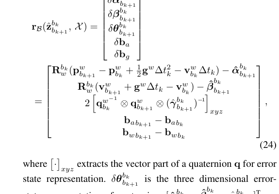

**图 6.** 单位球上视觉残差的示意。$\hat{\bar{\mathbf{P}}}^{c_j}_l$ 为第 $l$ 个特征在第 $j$ 帧中观测的单位向量。$\mathbf{P}^{c_j}_l$ 为通过将其在第 $i$ 帧中的首次观测变换到第 $j$ 帧而在单位球上预测的特征测量。残差定义在 $\hat{\bar{\mathbf{P}}}^{c_j}_l$ 的切平面上。

> **💡 疑问解答：视觉测量是什么？视觉测量残差到底是什么？请详细讲解公式 (25) 的每一行含义。**
>
> *   **什么是视觉测量：** 假设空间中第 $l$ 个特征点，首次是在第 $i$ 幅图像中被看到的（像素坐标为 $[u^{c_i}_l, v^{c_i}_l]^\top$）。随着相机移动，我们在第 $j$ 幅图像中又用 KLT 光流跟踪到了同一特征，此时光流实际测出来的像素位置 $[\hat{u}^{c_j}_l, \hat{v}^{c_j}_l]^\top$ 就是**视觉测量**！
> *   **什么是视觉测量残差（单位球面重投影误差）：** 既然我们在状态向量 $\mathcal{X}$ 里猜了这个点在第 $i$ 帧下的逆深度 $\lambda_l$（即距离为 $1/\lambda_l$），并且猜了第 $i$ 帧和第 $j$ 帧的位姿以及相机外参，那我就能利用纯粹的 3D 空间坐标变换，算出这个点如果变换到第 $j$ 帧的相机坐标系里，**理论上应该落在单位球的哪个方向上（预测值）**。把这个**理论预测方向**和光流**实际测到的方向**相减，就是视觉测量残差！
> *   **逐行拆解公式 (25)（从第 3 行往上读最顺畅）：**
>     1.  **看第 3 行 $\mathbf{P}^{c_j}_l$（算 3D 预测坐标，剥洋葱式的 5 步坐标变换）：**
>         我们要把第 $i$ 帧相机看到的 2D 像素，变换成第 $j$ 帧相机坐标系下的 3D 点。请从最里面的括号往外看（注意看旋转矩阵上下标的对消规律：$\mathbf{R}^A_B \mathbf{v}^B = \mathbf{v}^A$）：
>         *   **① 反投影并乘深度（得 $c_i$ 系 3D 点）：** $\frac{1}{\lambda_l}\pi_c^{-1}([u^{c_i}_l, v^{c_i}_l]^\top)$。其中 $\pi_c^{-1}$ 是反投影函数，使用相机内参将像素位置转为单位向量，再乘上深度 $\frac{1}{\lambda_l}$，就得到了该特征点在**第 $i$ 帧相机系 ($c_i$) 下的 3D 坐标**。
>         *   **② 相机系转 IMU 系（$c_i \to b_i$）：** 左乘外参旋转 $\mathbf{R}^b_c$ 并加上外参平移 $\mathbf{p}^b_c$，得到了该点在**第 $i$ 帧 IMU 体坐标系 ($b_i$) 下的 3D 坐标**。
>         *   **③ 第 $i$ 帧 IMU 系转世界系（$b_i \to w$）：** 左乘第 $i$ 帧姿态 $\mathbf{R}^w_{b_i}$ 并加上第 $i$ 帧位置 $\mathbf{p}^w_{b_i}$，得到了该特征点在**绝对世界坐标系 ($w$) 下的 3D 坐标**。
>         *   **④ 世界系转第 $j$ 帧 IMU 系（$w \to b_j$）：** 减去第 $j$ 帧的世界位置 $\mathbf{p}^w_{b_j}$，再左乘 $\mathbf{R}^{b_j}_w$，把世界系 3D 点转到了**第 $j$ 帧的 IMU 体坐标系 ($b_j$) 下**。
>         *   **⑤ 第 $j$ 帧 IMU 系转第 $j$ 帧相机系（$b_j \to c_j$）：** 减去外参平移 $\mathbf{p}^b_c$，再左乘 $\mathbf{R}^c_b$，最终得到了该特征点在**第 $j$ 帧相机系 ($c_j$) 下的理论预测 3D 坐标 $\mathbf{P}^{c_j}_l$**！
>     2.  **看第 2 行 $\hat{\bar{\mathbf{P}}}^{c_j}_l$（算单位球面上的实际测量射线）：**
>         把第 $j$ 帧光流实际跟踪到的像素坐标 $[\hat{u}^{c_j}_l, \hat{v}^{c_j}_l]^\top$ 通过反投影函数 $\pi_c^{-1}$，变成连接**单位球表面（Unit Sphere）**的一个单位射线向量（见图 6）。几乎所有类型相机（包括广角、鱼眼或全向相机）的光学都可建模为单位球面上的单位射线。
>     3.  **看第 1 行 $\mathbf{r}_{\mathcal{C}}$（在球面切平面上算二维残差）：**
>         把第 3 行算出来的预测 3D 点 $\mathbf{P}^{c_j}_l$ 除以它自己的模长 $\|\mathbf{P}^{c_j}_l\|$，也归一化到单位球面上。然后用球面上的测量向量减去预测向量：$\left(\hat{\bar{\mathbf{P}}}^{c_j}_l-\frac{\mathbf{P}^{c_j}_l}{\|\mathbf{P}^{c_j}_l\|}\right)$。
>         由于视觉残差的自由度为二，我们用“算法 1”在 $\hat{\bar{\mathbf{P}}}^{c_j}_l$ 的切平面上任意选取两个张成切平面的正交基 $\mathbf{b}_1, \mathbf{b}_2$（见图 6），左乘 $[\mathbf{b}_1, \mathbf{b}_2]^\top$ 将残差向量投影到切平面上，得到最终的 **2 维视觉残差向量**！公式 (22) 中使用的 $\mathbf{P}^{c_j}_l$ 即为切空间中固定长度的标准协方差。
>     
>     疑问：左乘 $[\mathbf{b}_1, \mathbf{b}_2]^\top$ 将残差向量投影到切平面上，为什么能投影到切平面上？

---

### 4.4 边缘化与舒尔补（第 VI-D 节，对应论文图 7）

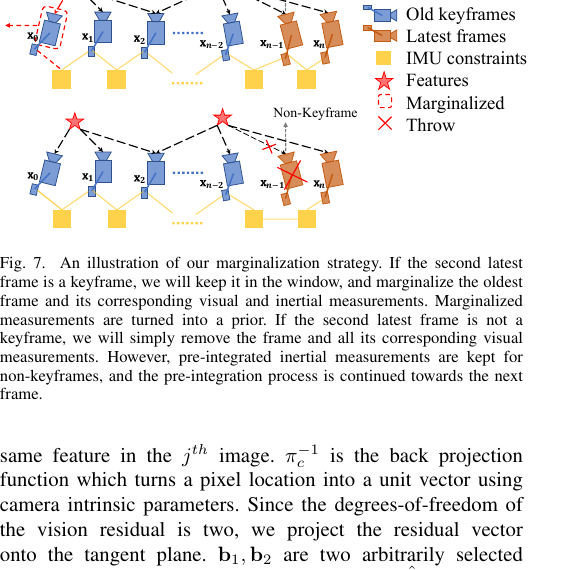

**图 7.** 我们的边缘化策略示意。若次新帧为关键帧，我们将其保留在窗口中，并边缘化最老帧及其对应的视觉与惯性测量。被边缘化的测量转为先验。若次新帧不是关键帧，我们简单地移除该帧及其所有对应视觉测量。然而，对非关键帧保留预积分惯性测量，并继续向下一帧进行预积分过程。

> **💡 疑问解答：边缘化（Marginalization）是什么意思？被边缘化的测量转为先验（Prior）是什么意思？舒尔补（Schur complement）具体是怎么执行的？**
> 这是滑动窗口 VIO 最核心的机制，我们分三层彻底讲透：
>
> #### 1. 什么是边缘化与先验？（为什么不能直接删掉老帧？）
> 为限制基于优化的 VIO 的计算复杂度，滑动窗口最多只保留固定数量的关键帧（比如 $\mathbf{x}_0 \dots \mathbf{x}_n$）。当新的一帧进来时，根据图 7 的策略：
> *   **若次新帧为关键帧：** 它将留在窗口中，确保特征三角化的充分视差并最大化维持具有大激励的加速度计测量；此时**最老帧 $\mathbf{x}_0$ 及其对应测量被边缘化**。
> *   **若次新帧为非关键帧：** 直接丢弃该帧及其所有视觉测量（不对非关键帧边缘化所有测量，以维持系统矩阵的稀疏性），但保留连接到该非关键帧的预积分 IMU 测量并继续向下一帧预积分。
>
> 当我们把最老帧 $\mathbf{x}_0$ 移出窗口时，如果直接粗暴地把 $\mathbf{x}_0$ 和它关联的 IMU 残差、视觉残差全部丢弃，就会丢失历史约束，导致滑动窗口在空间中自由漂移且尺度退化。
> **正确的做法——边缘化（Marginalization）：**
> 我们选择性地从滑动窗口中移除 IMU 状态 $\mathbf{x}_k$ 与特征 $\lambda_l$（以后不再更新它们的值），但同时将与被移除状态相关的所有被边缘化测量，通过数学消元**转换为一个只针对留存状态的约束项（新先验）**，并加到现有先验 $\|\mathbf{r}_p - \mathbf{H}_p \mathcal{X}\|^2$ 上！
> *(注：边缘化会导致线性化点的过早固定，可能造成次优估计结果；但由于对 VIO 可接受小漂移，这种负面影响并不关键。)*
>
> 疑问：但同时将与被移除状态相关的所有被边缘化测量，通过数学消元**转换为一个只针对留存状态的约束项（新先验）**，并加到现有先验 $\|\mathbf{r}_p - \mathbf{H}_p \mathcal{X}\|^2$ 上！这里看不明白。
>
> #### 2. 舒尔补（Schur Complement）具体是怎么做这个“消元构造先验”的？
> 舒尔补其实就是你在初中解多元一次方程组时用的**“高斯加减消元法”的矩阵版**！
> 在非线性最小二乘优化中，每一轮迭代的核心都是把残差对状态求导（雅可比矩阵 $\mathbf{J}$），构建线性增量方程来求状态更新步长 $\delta \mathbf{x}$：
> $$
> \mathbf{H} \delta \mathbf{x} = \mathbf{b} \qquad (\text{其中信息矩阵 } \mathbf{H} = \mathbf{J}^\top \mathbf{P}^{-1} \mathbf{J}, \quad \text{梯度项 } \mathbf{b} = -\mathbf{J}^\top \mathbf{P}^{-1} \mathbf{r})
> $$
> 现在，我们把窗口里的状态分成两组：
> *   $\delta \mathbf{x}_m$（Marginalized）：**马上要被边缘化移除的老状态**（如最老帧 $\mathbf{x}_0$ 及其携带的特征逆深度）；
> *   $\delta \mathbf{x}_r$（Remaining）：**留在窗口里、但和 $\mathbf{x}_m$ 有共同测量关联的状态**（如次老帧 $\mathbf{x}_1, \mathbf{x}_2$）。
>
> 把所有与 $\delta \mathbf{x}_m$ 相关的测量残差拿出来，构建它们的线性增量方程，按分块矩阵写成两行：
> $$
> \begin{bmatrix} \mathbf{H}_{mm} & \mathbf{H}_{mr} \\ \mathbf{H}_{rm} & \mathbf{H}_{rr} \end{bmatrix}
> \begin{bmatrix} \delta \mathbf{x}_m \\ \delta \mathbf{x}_r \end{bmatrix}
> =
> \begin{bmatrix} \mathbf{b}_m \\ \mathbf{b}_r \end{bmatrix}
> $$
> **我们的目标：消掉第一行的未知数 $\delta \mathbf{x}_m$，只留下一个纯粹关于留存状态 $\delta \mathbf{x}_r$ 的方程！**
> 怎么做加减消元？
> 1. 把第一行方程两边同时左乘 $\mathbf{H}_{rm} \mathbf{H}_{mm}^{-1}$；
> 2. 用第二行方程减去变形后的第一行方程！
> 左边关于 $\delta \mathbf{x}_m$ 的系数变成了 $\mathbf{H}_{rm} - \mathbf{H}_{rm} \mathbf{H}_{mm}^{-1} \mathbf{H}_{mm} = \mathbf{0}$，**$\delta \mathbf{x}_m$ 被彻底消掉了！**
> 剩下的第二行独立方程变成了：
> $$
> \underbrace{(\mathbf{H}_{rr} - \mathbf{H}_{rm} \mathbf{H}_{mm}^{-1} \mathbf{H}_{mr})}_{\text{新的先验信息矩阵 } \mathbf{H}_p^{\text{new}}} \delta \mathbf{x}_r = \underbrace{\mathbf{b}_r - \mathbf{H}_{rm} \mathbf{H}_{mm}^{-1} \mathbf{b}_m}_{\text{新的先验梯度项 } \mathbf{b}_p^{\text{new}}}
> $$
> 看！左边括号里的 $\mathbf{H}_{rr} - \mathbf{H}_{rm} \mathbf{H}_{mm}^{-1} \mathbf{H}_{mr}$ 在矩阵代数中就叫**舒尔补（Schur Complement）**！
> 通过这一步矩阵减法，被移除的状态 $\delta \mathbf{x}_m$ 彻底消失了，而它生前携带的所有测量信息（$\mathbf{H}_{mm}, \mathbf{H}_{mr}, \mathbf{b}_m$）全部构造进了新的先验矩阵 $\mathbf{H}_p^{\text{new}}$ 和 $\mathbf{b}_p^{\text{new}}$ 里，直接叠加到窗口现有的先验项 $\|\mathbf{r}_p - \mathbf{H}_p \mathcal{X}\|^2$ 上！
>
> 疑问：这里的1,2两个步骤，再详细给出，我想看推导过程。

---

### 4.5 实时性加速与故障恢复（第 VI-E, F, G 节，对应论文图 8）

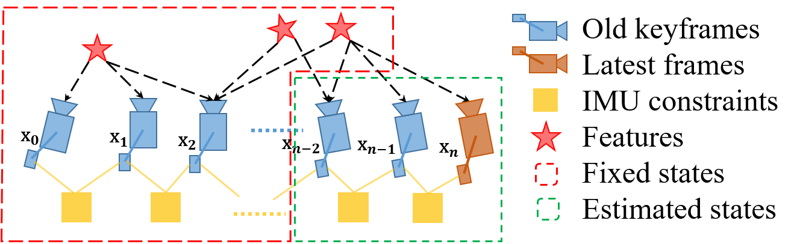

**图 8.** 面向相机频率输出的仅运动光束法平差示意。

> **💡 疑问解答：面向相机频率状态估计的仅运动视觉惯性光束法平差（Motion-only BA），具体是如何计算的？**
> *   **为什么要搞这个：** 对计算能力较低的设备（如手机），完整紧耦合单目 VIO（第 VI-A 节）因非线性优化的沉重计算需求可能耗费超过 **50ms**，无法达到相机频率（约 30Hz）输出。
> *   **Motion-only BA（30Hz 相机频率输出）是怎么计算的（见图 8）：**
>     直接类比深度学习里的 **Freeze Backbone（冻结主干网络微调）**！
>     仅运动视觉惯性光束法平差的代价函数与公式 (22) 完全相同，使用所有视觉与惯性测量。然而，**我们不是优化滑动窗口中的所有状态，而是将不想优化的特征深度 $\lambda_l$、外参 $\mathbf{x}^b_c$、偏置 $\mathbf{b}$ 与旧 IMU 状态全部视为固定常值（图 8 中虚线框 Fixed states），只优化固定数量最新 IMU 状态的位姿与速度（图 8 中点线框 Estimated states）！**
>     因为待优化变量的维数极小，计算仅需约 **5ms**，比单帧 PnP 方法产生平滑得多的低延迟 30Hz 状态估计，对无人机与 AR 应用尤其有益。
> *   **IMU 前向传播（第 VI-F 节，100Hz+ IMU 频率输出）：**
>     IMU 测量速率远高于视觉。我们用最近一组 IMU 测量直接前向积分传播最新 VIO 估计，以达到 IMU 频率性能，直接用作无人机闭环控制的高频状态反馈。
> *   **故障检测与恢复（第 VI-G 节）：**
>     当遇到剧烈光照变化或激进运动导致：①最新帧被跟踪特征数低于阈值；②最近两次输出间位置或旋转出现大间断；③偏置或外参估计出现大变化时，主动判定故障，系统切换回初始化阶段。一旦重新初始化成功，将创建位姿图的一个新的独立片段。

---

## 第五章：重定位与全局位姿图优化（对应论文第 VII ~ VIII 节）—— 消除累积漂移

滑动窗口与边缘化方案限制了计算复杂度，但也引入了累积漂移。得益于 IMU 使滚转（Roll）与俯仰（Pitch）角完全可观，累积漂移仅发生在 **4 个自由度（4-DOF）**：全局三维位置 $(x, y, z)$ 以及绕重力方向的旋转（偏航角 Yaw, $\psi$）。
为消除漂移，VINS-Mono 设计了“回环检测 $\to$ 紧耦合重定位 $\to$ 4-DOF 全局位姿图优化”流水线（对应论文图 9 与图 10）。      

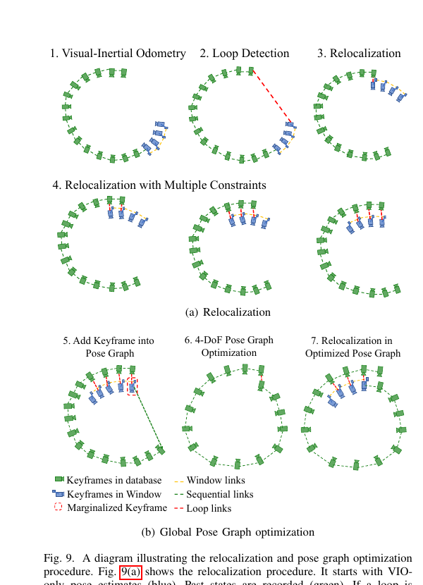

**图 9.** 重定位与位姿图优化流程示意。图 9(a) 显示重定位流程。它从仅 VIO 位姿估计（蓝）开始。过去状态被记录（绿）。若最新关键帧检测到回环（第 VII-A 节），如第二图红线所示，则发生重定位。注意由于使用特征级对应进行重定位，我们能够纳入来自多个过去关键帧的回环闭合约束（第 VII-C 节），如最后三图所示。位姿图优化如图 9(b) 所示。关键帧从滑动窗口边缘化时被加入位姿图。若该关键帧与任一过去关键帧存在回环，则将表述为 4-DOF 相对刚体变换的回环闭合约束也加入位姿图。位姿图使用所有相对位姿约束（第 VIII-B 节）在独立线程中优化，重定位模块始终相对于最新位姿图配置运行。

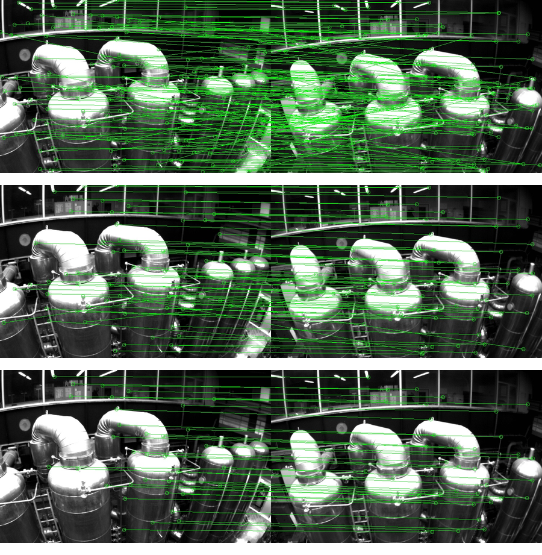

**图 10.** 回环闭合期间用于特征检索的描述子匹配与外点剔除。(a) BRIEF 描述子匹配结果；(b) 第一步：2D-2D 外点剔除结果；(c) 第二步：3D-2D 外点剔除结果。

### 5.1 核心概念辨析：回环检测 vs. 重定位 vs. 全局位姿图优化

> **💡 疑问解答（解答你在第 VII、VIII 节的三个核心疑问）：**
>
> *   *“重定位是修正当前帧的位姿，回环检测则会修正当前与全部历史帧的位姿，是这样吗？”*
> *   *“全局位姿图优化是将过去的位姿全部进行优化修正是吗？”*
> *   *“我理解，只要做了重定位，就应该做回环检测优化，这样整个轨迹才会更精确，是这样吗？”*
>
> **你的直觉非常敏锐！为了让你建立最严谨的 SLAM 架构认知，我们把这三个模块在流水线中的严格分工和先后顺序彻底理清：**
>
> 1.  **第一步：回环检测与特征检索（Loop Detection & Feature Retrieval，第 VII-A/B 节）—— 只负责“认出老地方并匹配特征点”，不修改任何位姿！**
>
>     *   **回环检测（VII-A）：** 利用先进的词袋（Bag-of-Words）地点识别方法 **DBoW2**。除用于单目 VIO 的角点外，额外检测 500 个角点并用 **BRIEF 描述子**描述（因为滚转和俯仰角可观，不需要像 ORB-SLAM 那样使用旋转不变的 ORB 特征）。描述子作为视觉词查询视觉数据库，返回回环闭合候选（保留 BRIEF 描述子但丢弃原始图像以省内存）。
>     *   **特征检索与两步几何外点剔除（VII-B，见图 10）：** 通过 BRIEF 描述子匹配建立当前滑动窗口与回环候选帧的特征连接。因直接匹配会产生大量外点（图 10a），执行两步 RANSAC 剔除：① **2D-2D**：带 RANSAC 的基础矩阵检验（图 10b）；② **3D-2D**：基于滑动窗口中已知的 3D 特征位置与回环候选图像中的 2D 观测，执行带 RANSAC 的 PnP 检验（图 10c）。当内点数超过阈值时，确认为正确回环并启动重定位。
> 2.  **第二步：紧耦合重定位（Tightly-Coupled Relocalization，第 VII-C 节，见图 9a）—— 负责在几毫秒内把“当前滑动窗口（最近10帧）”瞬间对齐到过去位姿图上！**
>
>     *   **重定位怎么做（公式 26）：** 将所有回环闭合帧 $v$ 的位姿 $(\hat{\mathbf{q}}^w_v,\hat{\mathbf{p}}^w_v)$（取自位姿图或过去里程计输出）**视为固定常数**，在原有的 VIO 代价函数（公式 22）中加入额外的回环特征重投影项，联合优化当前滑动窗口**公式 (26)**：
>     $$
>     \min_{\mathcal{X}}\left\{\left\|\mathbf{r}_p-\mathbf{H}_p\mathcal{X}\right\|^2+\sum_{k\in\mathcal{B}}\left\|\mathbf{r}_{\mathcal{B}}(\hat{\mathbf{z}}^{b_k}_{b_{k+1}},\mathcal{X})\right\|^2_{\mathbf{P}^{b_k}_{b_{k+1}}}+\sum_{(l,j)\in\mathcal{C}}\rho\left(\left\|\mathbf{r}_{\mathcal{C}}(\hat{\mathbf{z}}^{c_j}_l,\mathcal{X})\right\|^2_{\mathbf{P}^{c_j}_l}\right)+\underbrace{\sum_{(l,v)\in\mathcal{L}}\rho\left(\left\|\mathbf{r}_{\mathcal{C}}(\hat{\mathbf{z}}^{v}_l,\mathcal{X},\hat{\mathbf{q}}^w_v,\hat{\mathbf{p}}^w_v)\right\|^2_{\mathbf{P}^{c_v}_l}\right)}_{\text{新增：多视图回环特征重投影约束}}\right\},
>     \tag{26}
>     $$
>     *   **意义：** 待求解状态的维数保持不变！以最小计算开销将当前局部滑动窗口瞬间拽回无漂移的历史位置，且同时融合多个回环帧的特征对应，具有极高的精度与平滑性。
> 3.  **第三步：全局位姿图优化（Global Pose Graph Optimization，第 VIII 节，见图 9b）—— 负责在后台独立线程中把“全部过去的历史关键帧位姿”配准到全局一致配置中！**
>     *   重定位发生在前，仅将当前的局部滑动窗口拉回了过去位姿；紧接着在重定位之后，利用重定位结果启动全局位姿图优化，将过去所有的历史位姿全部进行优化修正，填平历史轨迹的累积漂移断崖。
> *   **总结你的第 3 个问题：** 完全正确！在 VINS-Mono 中，只要检测到回环，**重定位（修当前滑动窗口，快，线程2）**和**全局位姿图优化（修全部历史帧，慢，线程3）**是异步并发配合运行的（图 9b）：一旦最新优化的位姿图可用，重定位立即相对于最新位姿图配置运行；即便当前位姿图优化尚未完成，重定位仍可使用现有位姿图配置无缝进行！

---

### 5.2 4-DOF 全局位姿图公式精解（第 VIII-A, B, C 节，公式 27 ~ 29）

当关键帧从滑动窗口边缘化时，它作为顶点（Vertex）加入位姿图，并通过两类边（Edge）与其他顶点连接：**1) 顺序边（Sequential Edge，直接取自 VIO 的相邻关键帧相对变换）**与 **2) 回环闭合边（Loop Closure Edge，使用重定位结果获得的回环相对变换）**。
考虑新边缘化的关键帧 $i$ 及其先前关键帧（或回环帧）$j$，边仅包含相对位置 $\hat{\mathbf{p}}^i_{ij}$ 与偏航角 $\hat{\psi}_{ij}$，由**公式 (27)** 定义：
$$
\begin{aligned}
\hat{\mathbf{p}}^i_{ij}&=\hat{\mathbf{R}}^{w\,-1}_i(\hat{\mathbf{p}}^w_j-\hat{\mathbf{p}}^w_i) \\
\hat{\psi}_{ij}&=\hat{\psi}_j-\hat{\psi}_i.
\end{aligned}
\tag{27}
$$
我们将帧 $i$ 与 $j$ 之间边的 4-DOF 残差最小地定义为**公式 (28)**，并通过最小化代价函数**公式 (29)** 优化整个图：
$$
\mathbf{r}_{i,j}(\mathbf{p}^w_i,\psi_i,\mathbf{p}^w_j,\psi_j)=\begin{bmatrix}\mathbf{R}(\hat{\phi}_i,\hat{\theta}_i,\psi_i)^{-1}(\mathbf{p}^w_j-\mathbf{p}^w_i)-\hat{\mathbf{p}}^i_{ij}\\ \psi_j-\psi_i-\hat{\psi}_{ij}\end{bmatrix},
\tag{28}
$$
$$
\min_{\mathbf{p},\psi}\left\{\sum_{(i,j)\in\mathcal{S}}\left\|\mathbf{r}_{i,j}\right\|^2+\sum_{(i,j)\in\mathcal{L}}\rho\left(\left\|\mathbf{r}_{i,j}\right\|^2\right)\right\},
\tag{29}
$$

> **💡 疑问解答：公式 (27)、(28)、(29) 的含义是什么？**
>
> *   **公式 (27) 的物理含义（定义连接两帧“弹簧”的原始自然长度和水平夹角）：**
>     当第 $i$ 帧和第 $j$ 帧还在滑动窗口里（或者刚做完重定位）时，它们的局部相对关系是非常准的。我们把这一刻它们俩的相对位置和相对偏航角拓印保存下来，作为固定测量值 $(\hat{\mathbf{p}}^i_{ij}, \hat{\psi}_{ij})$：
>     *   第一行 $\hat{\mathbf{p}}^i_{ij}$：先算世界系下第 $j$ 帧相对于第 $i$ 帧的位置差 $(\hat{\mathbf{p}}^w_j-\hat{\mathbf{p}}^w_i)$，再左乘第 $i$ 帧姿态的逆矩阵 $\hat{\mathbf{R}}^{w\,-1}_i$，把它旋转投影到**第 $i$ 帧自己的局部坐标系下**。意思是：“站在第 $i$ 帧的视角看，第 $j$ 帧在我的正前方多少米、左方多少米、上方多少米”。
>     *   第二行 $\hat{\psi}_{ij}$：从第 $i$ 帧到第 $j$ 帧，绕重力轴的水平偏航角（Yaw）转过了多少度。
> *   **公式 (28) 的物理含义（算弹簧被拉变形了多少——边的残差）：**
>     在全局优化时，每一帧无漂移的滚转角 $\hat{\phi}_i$ 和俯仰角 $\hat{\theta}_i$ 直接取自单目 VIO 并锁死为常数，只调整所有历史帧的 3D 位置 $\mathbf{p}^w_i$ 和偏航角 $\psi_i$（共 4-DOF）。公式 (28) 就是用当前待优化的世界位置和偏航角算出的相对变换，减去公式 (27) 保存的原始测量值 $(\hat{\mathbf{p}}^i_{ij}, \hat{\psi}_{ij})$。
>
> 疑问：残差是预测值和真实值的差值，但是这里预测值是什么，真实值是什么？这里好像并没有真值呢，为什么残差公式是这个，优化函数为什么是(29)?
>
> *   **公式 (29) 的物理含义（让整张弹簧网的总势能最小）：**
>     把所有顺序边集合 $\mathcal{S}$ 和回环闭合边集合 $\mathcal{L}$ 的残差平方和加起来最小化。对顺序边不使用鲁棒范数（因为 VIO 已包含充分的外点剔除），而对回环边额外加上 Huber 范数 $\rho(\cdot)$ 以进一步降低任何可能错误回环的影响。
> *   **位姿图管理（第 VIII-C 节）：** 为防止位姿图随行驶距离无界增长，实现下采样过程将位姿图数据库维持在有限大小（如 2000 帧）：保留所有具有回环闭合约束的关键帧，而按空间密度成正比的概率移除与邻居过近或姿态非常相似的冗余关键帧。

---

## 第六章：实验结果与真实应用（对应论文第 IX ~ X 节）

作者通过公开数据集、室内外大尺度场景以及无人机、手机 AR 两大真实应用，全面验证了 VINS-Mono 的性能。

### 6.1 公开数据集对比（EuRoC MAV 数据集，第 IX-A 节）
在微型飞行器采集的 EuRoC 数据集（含 20 FPS 双目图像、200 Hz IMU 及真值轨迹）上，将 VINS-Mono（仅用左目图像，分无回环的 `VINS` 和带回环的 `VINS_loop`）与另一先进的基于优化的滑动窗口算法 **OKVIS**（分单目版 `OKVIS_mono` 和双目版 `OKVIS_stereo`）进行对比。

> **💡 疑问解答：文中提到的“立体图像（Stereo images）”是什么？**
> *   **立体图像（Stereo Images）** 指的就是**双目相机（Stereo Camera）**同步拍摄的左、右两路图像（就像人的左右双眼）。
> *   双目相机因为天生知道左右两个镜头的物理间距（固定基线 $B$），在单帧之内就能直接通过左右图像的视差三角化算出所有物体的真实物理距离（米），完全不存在单目相机的“尺度不确定性”和“初始化难题”。
> *   **实验亮点：** 尽管数据集提供立体图像且 `OKVIS_stereo` 使用了双目，**VINS-Mono 仅使用左相机单目图像**，在 `MH_03_median`（图 11、图 12）和 `MH_05_difficult`（图 13、图 14）以及包含激进运动与光照变化的 `V1_03_difficult` 上均能快速初始化，且带回环的 `VINS_loop` 取得了最小的平移误差（甚至超越了双目 `OKVIS_stereo`）！OKVIS 仅在滚转与俯仰角估计上略好，原因是 VINS-Mono 使用了作为一阶近似的预积分技术来节省计算资源。

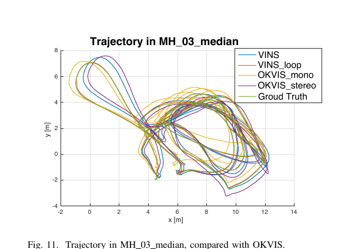

**图 11.** MH_03_median 中的轨迹，与 OKVIS 对比。

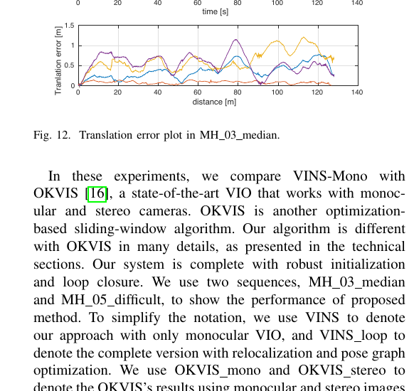

**图 12.** MH_03_median 中的平移误差图。

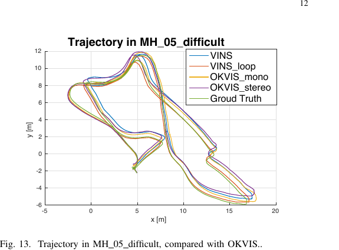

**图 13.** MH_05_difficult 中的轨迹，与 OKVIS 对比。

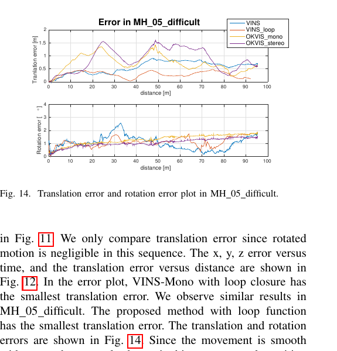

**图 14.** MH_05_difficult 中的平移误差与旋转误差图。

---

### 6.2 室内挑战性实验与大尺度环境测试（第 IX-B & C 节）

1.  **室内复杂场景测试（图 15 ~ 图 17）：**
    手持包含 20Hz 全局快门单目相机与 DJI A3 飞控内置 100Hz IMU 的传感器套件（图 15），在遇到走动行人、白墙无纹理区、低光照、玻璃反射（图 16）的实验室中绕圈行走。如图 17 所示，重定位与回环闭合模块有效消除了单目 VIO 在 $x, y, z$ 与偏航角上的显著累积漂移。

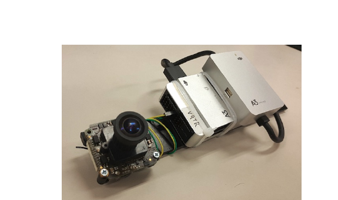

**图 15.** 室内实验所用设备。它包含一台前视全局快门相机（MatrixVision mvBlueFOX-MLC200w），分辨率为 752×480。我们使用 DJI A3 飞控内置 IMU（ADXL278 与 ADXRS290，100 Hz）。

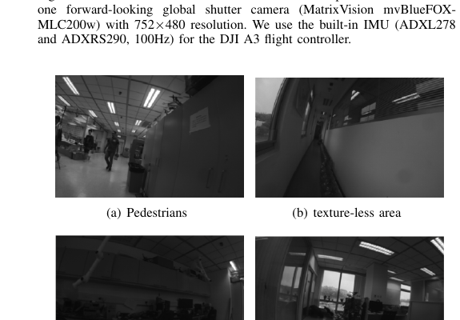

**图 16.** 挑战性室内实验的样本图像。(a) 行人；(b) 无纹理区域；(c) 低光照条件；(d) 玻璃与反射。

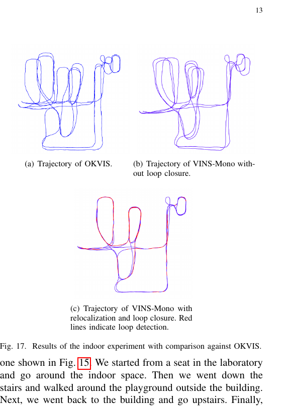

**图 17.** 室内实验结果并与 OKVIS 对比。(a) OKVIS 轨迹；(b) 无回环闭合的 VINS-Mono 轨迹；(c) 带重定位与回环闭合的 VINS-Mono 轨迹。红线表示回环检测。

2.  **走出实验室（700米室内外混合测试，图 18 ~ 图 19）：**
    从实验室座位出发，下楼梯绕室外操场行走，再上楼梯回到同一座位（全长超 700 米）。如图 19(a) 所示，OKVIS 在无纹理楼梯间发生特征跟踪不稳定，看不出楼梯形状，最终漂移达 $[13.80, -5.26, 7.23]\text{ m}$（占总长 2.36%）；而 VINS-Mono 清晰还原出螺旋形上下楼梯轨迹（图 19b/c），无回环漂移仅 0.88%，开启回环校正后最终漂移被限制到惊人的 **$[-0.032, 0.09, -0.07]\text{ m}$**，与卫星图精确对齐（图 18）。

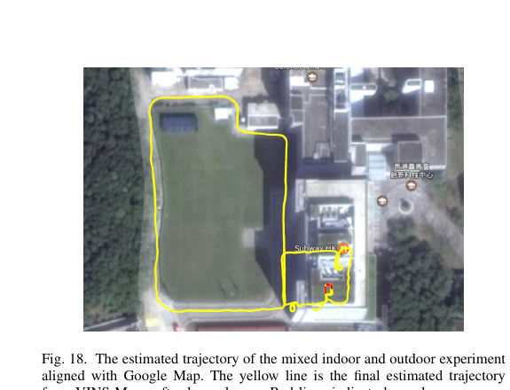

**图 18.** 室内外混合实验估计轨迹与 Google Map 对齐。黄线为带回环闭合后 VINS-Mono 的最终估计轨迹。红线表示回环闭合。

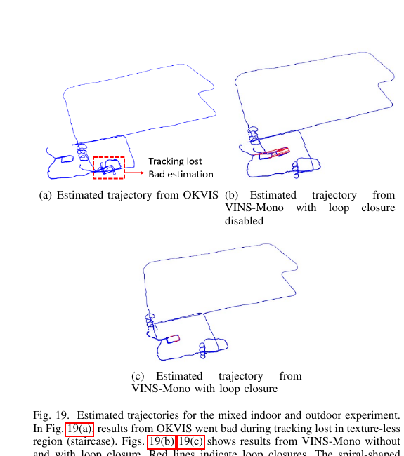

**图 19.** 室内外混合实验的估计轨迹。图 19(a) 中，OKVIS 结果在无纹理区域（楼梯）跟踪丢失期间变差。图 19(b)(c) 显示无/有回环闭合的 VINS-Mono 结果。红线表示回环闭合。螺旋形蓝线显示上下楼时的轨迹。可以看到即使无回环闭合，VINS-Mono 仍表现良好（存在可接受漂移）。

3.  **绕香港科技大学校园行走（5.62 公里超长耐久测试，表 I 与图 20）：**
    手持 VI-Sensor（25Hz 图像 + 200Hz IMU）环绕整个港科大校园（长 710m、宽 240m、高差 60m），总路径长 **5.62 km**，耗时 **1 小时 34 分钟**。将关键帧数据库大小设为 2000，在桌面级 CPU（Intel i7-4790 @ 3.60GHz）上各线程运行时间如表 I 所示，全程实时且几乎无漂移（图 20）。

**表 I　时间统计（TIMING STATISTICS）**

| 线程 (Thread) | 模块 (Modules)                        | 时间 Time (ms) | 速率 Rate (Hz) |
| :-----------: | :------------------------------------ | -------------: | -------------: |
|       1       | Feature detector（特征检测）          |             15 |             25 |
|       1       | KLT tracker（KLT 跟踪）               |              5 |             25 |
|       2       | Window optimization（窗口优化）       |             50 |             10 |
|       3       | Loop detection（回环检测）            |            100 |              — |
|       3       | Pose graph optimization（位姿图优化） |            130 |              — |

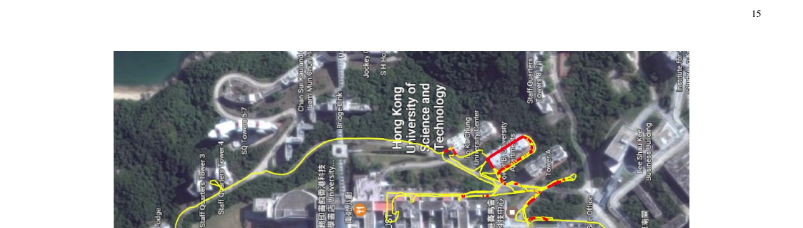

**图 20.** 与 Google map 对齐的超大尺度环境估计轨迹。黄线为 VINS-Mono 的估计轨迹。红线表示回环闭合。

---

### 6.3 两大真实应用：无人机自主飞行与手机移动端 AR（第 IX-D & E 节）

1.  **应用 I：空中机器人的机载闭环反馈控制（图 21 ~ 图 23）：**
    在配备 190° 鱼眼相机（使用 MEI 球面相机模型标定，正好发挥单位球面视觉残差的优势）、DJI A3 飞控和机载 i7-5500U CPU 的自研四旋翼无人机上（图 21a），禁用回环闭合，直接利用 100Hz 的 VINS-Mono 状态输出作为实时位置反馈，控制无人机绕四个障碍物连续跟踪半径 1 米的 8 字形轨迹四圈（图 21b）。与 OptiTrack 动捕真值对比（图 22、图 23），总长 61.97m 的飞行最终漂移仅 0.18m（位置漂移率仅 **0.29%**）。

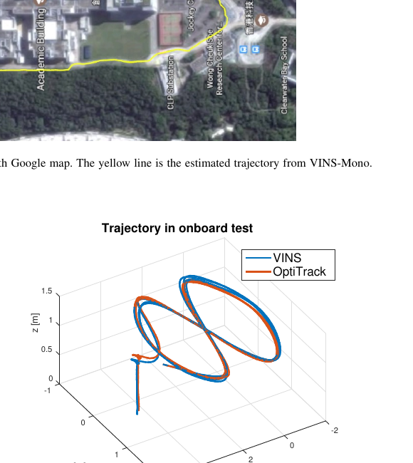

**图 21.** 图 21(a)：自研空中机器人，配备前视鱼眼相机（MatrixVision mvBlueFOX-MLC200w，190° FOV）与 DJI A3 飞控（ADXL278 与 ADXRS290，100 Hz）。图 21(b)：设计轨迹。放置四个已知障碍物。黄线为航空机器人应跟踪的预定义 8 字形图案。机器人在禁用回环闭合的情况下跟踪轨迹四次。实验视频见多媒体附件。

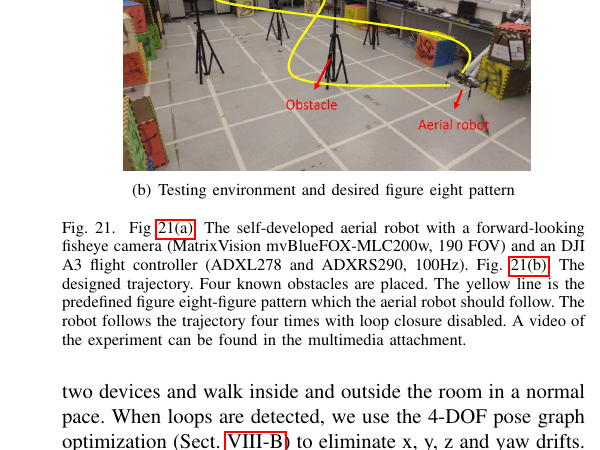

**图 22.** MAV 平台上禁用回环闭合的 VINS-Mono 轨迹及其与真值的对比。机器人跟踪轨迹四次。VINS-Mono 估计用作控制器的实时位置反馈。真值使用 OptiTrack 获得。总长度 61.97 m。最终漂移 0.18 m。

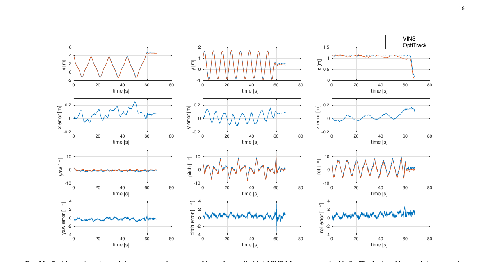

**图 23.** 禁用回环闭合的 VINS-Mono 相对 OptiTrack 的位置、姿态及其对应误差。60 s 处俯仰误差的突变由设计轨迹末端的激进制动引起，以及 VINS-Mono 与 OptiTrack 之间可能的时间未对齐误差。

2.  **应用 II：iOS 移动设备 AR 与 Google Tango 对比（图 24 ~ 图 25）：**
    将算法移植到普通 iPhone 7 Plus（30Hz 图像 + 100Hz 内置 IMU，命名为 **VINS-Mobile**），并与搭载专用全局快门鱼眼相机硬件的商用标杆 **Google Tango**（联想 Phab 2 Pro）固定在一起对比（图 24）。在起始位置提取的平面上插入一个虚拟立方体（图 25a），手持绕房间内外行走约 264m。当推开移动的房门时，Tango 的偏航角估计发生了大角度跳变崩溃（图 25b），而 VINS-Mobile 依然稳健；回到起点后，经 4-DOF 位姿图优化消除漂移，虚拟立方体依然精准地配准在图像最开始的桌面上（图 25c）。

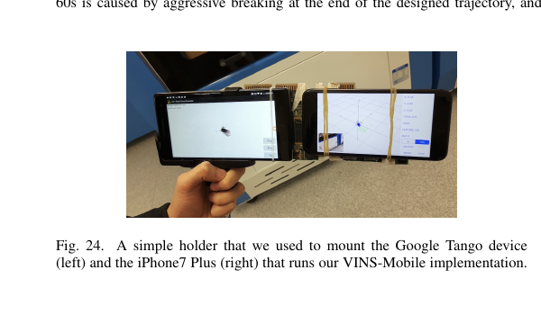

**图 24.** 我们用来固定 Google Tango 设备（左）与运行 VINS-Mobile 实现的 iPhone 7 Plus（右）的简易支架。

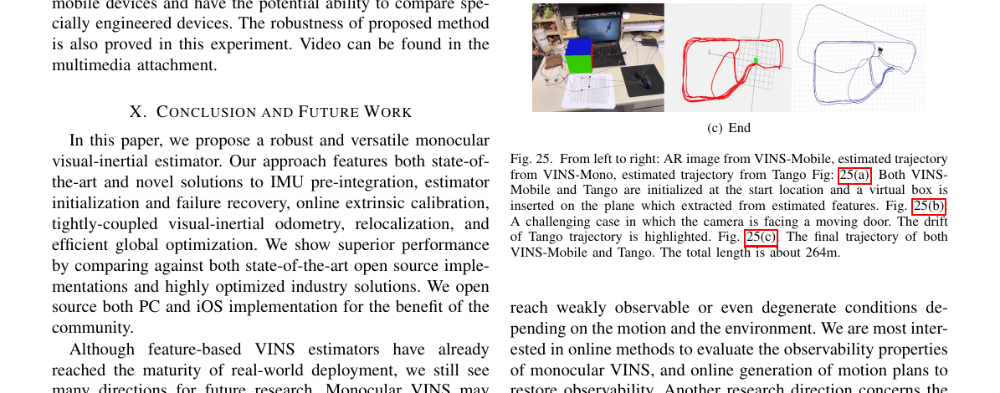

**图 25.** 从左到右：来自 VINS-Mobile 的 AR 图像、来自 VINS-Mono 的估计轨迹、来自 Tango 的估计轨迹。图 25(a)：VINS-Mobile 与 Tango 均在起始位置初始化，并在从估计特征提取的平面上插入虚拟盒子。图 25(b)：相机面向移动门的挑战情况。突出显示了 Tango 轨迹的漂移。图 25(c)：VINS-Mobile 与 Tango 的最终轨迹。总长度约 264 m。

---

## 终极总结：感知工程师的 VINS-Mono 知识图谱速查表

| 流水线阶段                            | 核心模块                                 | 解决的核心痛点                                               | 关键数学/算法武器                                            | 感知工程师类比记忆                                           |
| :------------------------------------ | :--------------------------------------- | :----------------------------------------------------------- | :----------------------------------------------------------- | :----------------------------------------------------------- |
| **1. 前端预处理**<br>(Sect. IV-A)     | 视觉特征跟踪与关键帧选择                 | 如何以毫秒级速度稳定跟踪特征，且保证几何分布良好、无外点、可三角化？ | • Shi-Tomasi角点 + KLT光流<br>• Mask画圆屏蔽法（均匀分布）<br>• 8点法基础矩阵 RANSAC<br>• 陀螺仪旋转补偿算平移视差 | 2D 多目标跟踪 (MOT) + NMS 空间均匀采样 + 几何后处理滤波      |
| **2. 前端预处理**<br>(Sect. IV-B)     | **IMU 预积分**<br>(Pre-integration)      | 优化器每次微调世界位姿，难道都要把成百上千个高频 IMU 重新积分一遍？ | • 转换到第 $k$ 帧局部系 $b_k$ 积分 (5-7)<br>• 误差状态线性化递推协方差 $\mathbf{P}$ (9-10)<br>• **偏置微调的一阶泰勒近似 (公式12)** | 把高频时序原始信号预先提取成固定特征向量，并用一阶导数近似替代反向传播时的重复前向计算 |
| **3. 系统启动**<br>(Sect. V)          | **松耦合视觉惯性初始化** (Bootstrapping) | 单目没尺度、IMU 没扣重力且有零偏，如何在运动中从零算出所有状态初值？ | • 5点法 + PnP + 纯视觉 SfM (14)<br>• 旋转对齐标定陀螺仪 Bias (公式15)<br>• 线性最小二乘解速度/重力/尺度 (16-20)<br>• 半径9.81球面切空间 2-DOF 重力精化 | 深度非凸网络训练前的两阶段 Warm-up / 预训练权重初始化，防止主优化器直接发散 |
| **4. 后端核心**<br>(Sect. VI)         | **紧耦合滑动窗口 VIO 与边缘化**          | 如何融合多模态数据得最优估计，同时在踢走老帧时不丢失历史约束且保持实时？ | • 单位球面切空间视觉重投影残差 (25)<br>• **舒尔补 (Schur Complement) 消元转先验**<br>• Motion-only BA (冻结老状态只训最新帧) | 多任务联合 Loss 在线微调 + 历史知识蒸馏 (Prior) + 冻结 Backbone 的极速推理分支 |
| **5. 全局一致**<br>(Sect. VII & VIII) | **紧耦合重定位与 4-DOF 位姿图优化**      | 滑动窗口存在长期累积漂移，回到老地方如何瞬间纠偏并修好全部历史轨迹？ | • DBoW2 词袋检索 + 两步 RANSAC<br>• 固定老帧位姿的滑动窗口重定位 (26)<br>• 锁死 Roll/Pitch 的 **4-DOF 位姿图优化** (27-29) | 跨时空记忆库检索 (Memory Bank) + 局部锚点强对齐 + 全局图网络平滑后处理 |


# 问题整理

## 1. 解释双目视差测距公式，并解释每个变量的含义是什么

为了让你彻底看懂这个公式，我们用**人眼看东西的直觉**加上**初中几何的“相似三角形”**，三分钟就能把它推导并理解透彻！

---

### 一、 4个变量的物理含义（是什么 & 单位是什么）

在公式 $Z = \frac{f \cdot B}{d}$ 中：

1.  **$Z$ —— 深度 / 真实距离（Depth）**
    *   **含义：** 空间中那个特征点（比如一棵树、一个墙角）到相机镜头的**垂直物理距离**。
    *   **单位：** **米（m）**。这就是我们要算出来的目标值。
2.  **$f$ —— 相机焦距（Focal Length）**
    *   **含义：** 相机镜头光心到成像平面（CMOS传感器）的距离。它是相机的固有内参（出厂标定好的常数，比如 $f = 500$ 像素）。
    *   **单位：** 在计算机视觉公式里，通常已经换算成了**像素（pixel）**。
3.  **$B$ —— 基线长度（Baseline）**
    *   **含义：** 两次观察之间，**两个相机镜头中心（光心）相隔的物理距离**。
        *   在**双目相机**里：$B$ 是左、右两个摄像头之间固定的硬件间距（比如 $0.12\text{ m}$）。
        *   在**单目 VINS** 里：因为只有一个摄像头，所以 $B$ 是**相机从第 1 帧移动到第 2 帧所走过的平移距离**（比如你拿着手机往右平移了 $0.5\text{ m}$）。
    *   **单位：** **米（m）**。
4.  **$d$ —— 视差（Disparity / Parallax）**
    *   **含义：** 同一个 3D 物体，在左、右两张照片（或前、后两帧照片）里的**像素位置坐标之差**：$d = u_1 - u_2$。
    *   **直观感受：** 你把一根手指放在鼻尖前 10 厘米，交替闭上左眼和右眼，会发现手指在视野里大幅度左右跳动（视差 $d$ 很大）；但如果你看远处的月亮，交替闭左右眼，月亮在视野里几乎纹丝不动（视差 $d \approx 0$）。
    *   **单位：** **像素（pixel）**。

*(你看单位换算：分子是 $f(\text{像素}) \times B(\text{米})$，分母是 $d(\text{像素})$，像素和像素约掉了，算出来的 $Z$ 自然就是**米**！)*

---

### 二、 这个公式是怎么来的？（10秒钟初中几何推导）

我们可以画一个俯视图（从头顶往下看两个相机看同一个点 $P$）：

```text
                  P (真实3D特征点)
                 / \
                /   \
               /     \
              /       \       ↑
             /         \      | 深度 Z (米)
            /           \     |
   成像面1  /----     ----\ 成像面2
   -------*-------  ------*-------  <-- 像素位置 u1 和 u2 (焦距为 f)
         /                 \  ↓ f (像素)
        O1 ---------------- O2
        |<--- 基线 B (米) --->|
```

在上面的几何图里：
*   $O_1$ 和 $O_2$ 是两个相机的光心，它们之间的距离是**基线 $B$**。
*   点 $P$ 在第一个相机成像面上的投影偏移是 $u_1$，在第二个相机成像面上的投影偏移是 $-u_2$。两个投影点之间的像素移动总量就是**视差 $d = u_1 - u_2$**。
*   根据初中数学的**相似三角形定理**（大三角形 $\triangle PO_1O_2$ 的高和底，与缩在里面的小三角形的高和底成正比）：
    $$
    \frac{\text{大三角形的高 } Z}{\text{小三角形的高 } f} = \frac{\text{大三角形的底 } B}{\text{小三角形的底 } (u_1 - u_2)}
    $$
    即：
    $$
    \frac{Z}{f} = \frac{B}{d}
    $$
    把 $f$ 乘到右边去，就得到了大名鼎鼎的双目视差测距公式：
    $$
    Z = \frac{f \cdot B}{d}
    $$

---

### 三、 用真实数字算一笔账：为什么“特征点太远”会让 VINS 初始化崩溃？

现在我们代入一组真实的相机参数，让你直观感受一下什么叫**“0.5个像素的误差引发几十米的灾难”**：

假设你的手机相机焦距 **$f = 500\text{ 像素}$**，开机初始化时你拿着手机晃动了 **$B = 0.2\text{ 米}$（20厘米）**，那么分子固定为 $f \cdot B = 500 \times 0.2 = \mathbf{100}\text{ (像素}\cdot\text{米)}$。
现在，我们知道前端 KLT 光流算法跟踪角点时，不可避免会有大约 **$0.5\text{ 像素}$ 的图像噪声误差**。我们来看看看近处和看远处的区别：

#### 场景 1：特征点在近处（比如室内桌面，$Z = 2\text{ 米}$）
*   **理论视差：** $d = \frac{f \cdot B}{Z} = \frac{100}{2} = \mathbf{50\text{ 像素}}$。
*   **加入 0.5 像素光流误差后：** 实际测出来的视差变成了 $d' = 50.5\text{ 像素}$。
*   **算出来的深度：** $Z' = \frac{100}{50.5} \approx \mathbf{1.98\text{ 米}}$。
*   **结论：** 误差只有 **$2\text{ 厘米}$（相对误差仅 1%）**！3D 点算得非常准，拿去和 IMU 对齐，初始化完美成功！

#### 场景 2：特征点在远处（比如室外空旷场地看远处的大楼，$Z = 50\text{ 米}$）
*   **理论视差：** $d = \frac{f \cdot B}{Z} = \frac{100}{50} = \mathbf{2\text{ 像素}}$。（哪怕你移动了 20 厘米，50米外的大楼在画面里只挪动了区区 2 个像素！）
*   **加入同样的 0.5 像素光流误差后：** 实际测出来的视差变成了 $d' = 2 - 0.5 = 1.5\text{ 像素}$（或者 $2 + 0.5 = 2.5\text{ 像素}$）。
*   **算出来的深度：** $Z' = \frac{100}{1.5} = \mathbf{66.7\text{ 米}}$（或者 $\frac{100}{2.5} = \mathbf{40\text{ 米}}$）！
*   **结论：** 区区 0.5 个像素的正常视觉跟踪抖动，算出来的 3D 距离直接从 50 米跳到了 66.7 米，**误差高达 $16.7\text{ 米}$（相对误差超过 33%）**！如果特征点在 100 米外（理论视差 1 像素），0.5 像素的误差甚至会让算出来的距离翻倍（变成 200 米）！

**总结：**
因为分母是视差 $d$，根据反比例函数 $Z \propto \frac{1}{d}$ 的性质，**当物体很远（$Z$ 很大）且相机移动距离 $B$ 很小时，分母 $d$ 接近于 0。此时分母上极其微小的一点点像素噪声，都会被反比例函数放大成三维空间里几十米的深度巨浪！** 这就是论文里说的“当视觉特征远离传感器套件时，会导致不可靠的初始化”。