# VINS-Mono: A Robust and Versatile Monocular Visual-Inertial State Estimator

# VINS-Mono：一种鲁棒且通用的单目视觉惯性状态估计器

**作者：** Tong Qin（秦通）、Peiliang Li（李沛良）、Shaojie Shen（沈劭劼）

**单位：** Department of Electronic and Computer Engineering, Hong Kong University of Science and Technology（香港科技大学电子与计算机工程学系）
**邮箱：** {tqinab, pliap}@connect.ust.hk, eeshaojie@ust.hk

**文献信息：** arXiv:1708.03852v1 [cs.RO] 13 Aug 2017（后续亦发表于 IEEE Transactions on Robotics）

**开源代码：**

1. PC / ROS 版：https://github.com/HKUST-Aerial-Robotics/VINS-Mono
2. iOS 移动版：https://github.com/HKUST-Aerial-Robotics/VINS-Mobile

---

## 摘要

由一台相机与低成本惯性测量单元（IMU）组成的单目视觉惯性系统（VINS），构成了度量六自由度（DOF）状态估计的最小传感器套件。然而，缺乏直接距离测量会在 IMU 处理、估计器初始化、外参标定以及非线性优化等方面带来显著挑战。本文提出 **VINS-Mono**：一种鲁棒且通用的单目视觉惯性状态估计器。我们的方法首先采用鲁棒的估计器初始化与故障恢复流程；随后使用紧耦合、基于非线性优化的方法，通过融合预积分 IMU 测量与特征观测，获得高精度视觉惯性里程计。结合紧耦合公式的回环检测模块能够以最小计算开销实现重定位。此外，我们还执行四自由度位姿图优化以强制全局一致性。我们在公开数据集与真实世界实验上验证了系统性能，并与其他先进算法进行了对比。我们还在微型飞行器（MAV）平台上完成了机载闭环自主飞行，并将算法移植到基于 iOS 的演示中。我们强调，本文工作是一个可靠、完整且通用的系统，适用于需要高精度定位的不同应用。我们开源了面向 PC¹ 与 iOS 移动设备² 的实现。

疑问：然而，缺乏直接距离测量会在 IMU 处理、估计器初始化、外参标定以及非线性优化等方面带来显著挑战。这个问题，如果采用深度估计给出距离，会提升效果吗？会改善哪些问题？

**索引词**—单目视觉惯性系统、状态估计、传感器融合、同时定位与地图构建（SLAM）

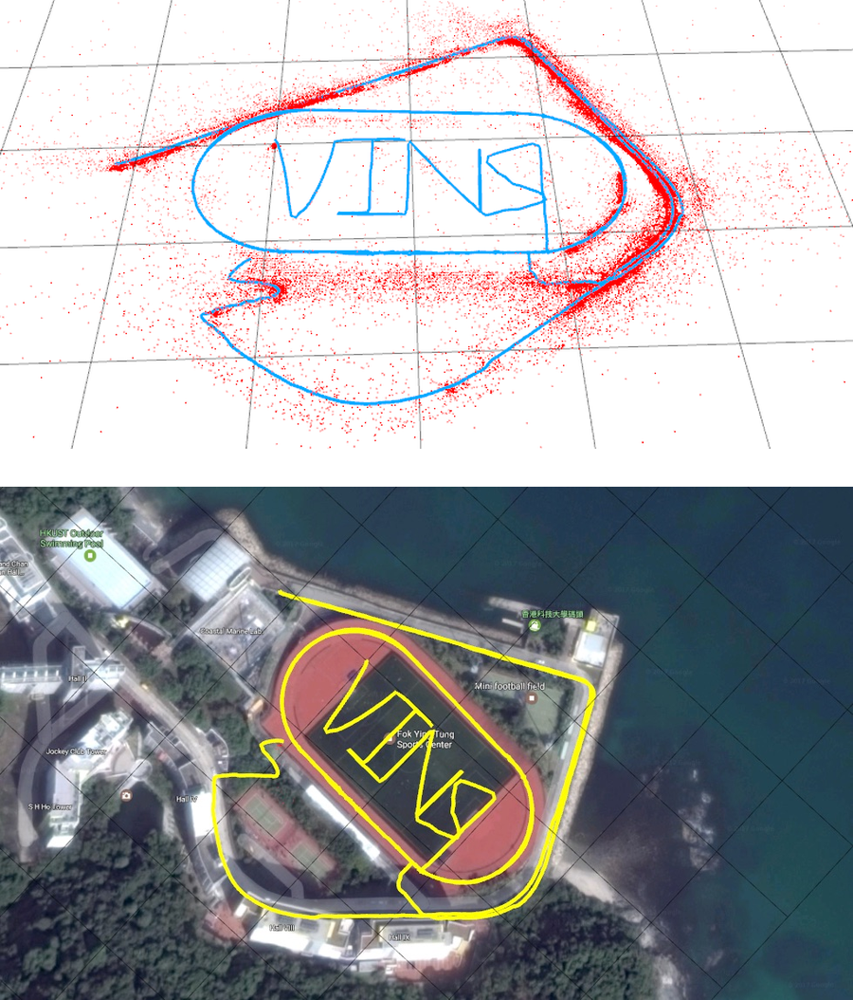

**图 1.** 所提出单目视觉惯性状态估计器的室外实验结果。数据由手持单目相机-IMU 套件在正常步行条件下采集。轨迹包含场地内两圈完整圆周以及附近车道上的两段半圆，总长度 2.5 km。实验视频见多媒体附件。(a) 轨迹（蓝）与特征位置（红）；(b) 叠加在 Google Map 上以便视觉对比的轨迹。

---

## I. 引言

状态估计无疑是机器人导航、自动驾驶、虚拟现实（VR）与增强现实（AR）等广泛应用中最基础的模块。仅使用单目相机的方法因其体积小、成本低、硬件配置简便而受到学界广泛关注 [1]–[5]。然而，纯单目视觉系统无法恢复度量尺度，因而限制了其在真实机器人应用中的使用。近来，我们看到一种日益增长的趋势：用低成本惯性测量单元（IMU）辅助单目视觉系统。该单目视觉惯性系统（VINS）的主要优势是度量尺度以及滚转角与俯仰角均可观。这使得需要度量状态估计的导航任务成为可能。此外，IMU 测量的积分可在光照变化、无纹理区域或运动模糊导致视觉跟踪丢失时弥合间隙，从而显著提升运动跟踪性能。事实上，单目 VINS 不仅广泛存在于移动机器人、无人机与移动设备上，也是充分进行自身与环境感知的最小传感器配置。

然而，所有这些优势都有代价。对单目 VINS 而言，众所周知需要加速度激励才能使度量尺度可观。<u>这意味着单目 VINS 估计器不能从静止条件启动</u>，而必须从未知运动状态启动。同时认识到视觉惯性系统高度非线性，估计器初始化面临重大挑战。两种传感器的存在也使相机-IMU 外参标定至关重要。最后，为了在可接受的处理窗口内消除长期漂移，必须开发包含视觉惯性里程计、回环检测、重定位与全局优化的完整系统。

为解决上述全部问题，我们提出 **VINS-Mono**，一种鲁棒且通用的单目视觉惯性状态估计器。我们的方案以在线（on-the-fly）估计器初始化开始；同一初始化模块也用于故障恢复。方案的核心是基于紧耦合滑动窗口非线性优化的鲁棒单目视觉惯性里程计（VIO）。该单目 VIO 模块不仅提供准确的局部位姿、速度与姿态估计，还在线执行相机-IMU 外参标定与 IMU 偏置校正。回环使用 DBoW2 [6] 检测。重定位在紧耦合设定下通过与单目 VIO 的特征级融合完成，从而以最小计算开销实现鲁棒准确的重定位。最后，几何验证通过的回环被加入位姿图；得益于单目 VIO 可观的滚转与俯仰角，我们执行四自由度（DOF）位姿图优化以确保全局一致性。

VINS-Mono 整合并改进了我们此前在单目视觉惯性融合方面的工作 [7]–[10]。它建立在我们紧耦合、基于优化的单目 VIO 公式 [7]、[8] 之上，并纳入了 [9] 中提出的改进初始化流程。移植到移动设备的首次尝试见 [10]。相对先前工作，VINS-Mono 的进一步改进包括：带偏置校正的改进 IMU 预积分、紧耦合重定位、全局位姿图优化、广泛的实验评估，以及鲁棒通用的开源实现。

整个系统完整且易于使用。它已成功应用于小尺度 AR 场景、中尺度无人机导航以及大尺度状态估计任务，并相对其他先进方法展现出更优性能。为此，我们将贡献总结如下：

- 能够从未知初始状态自举系统的鲁棒初始化流程。
- 带相机-IMU 外参标定与 IMU 偏置估计的紧耦合、基于优化的单目视觉惯性里程计。
- 在线回环检测与紧耦合重定位。
- 四自由度全局位姿图优化。
- 面向无人机导航、大尺度定位与移动 AR 应用的实时性能演示。
- 开源发布：与 ROS 完全集成的 PC 版本，以及可在 iPhone 6s 及以上运行的 iOS 版本。

本文其余部分结构如下。第 II 节讨论相关文献。第 III 节给出完整系统流水线概览。第 IV 节介绍视觉与预积分 IMU 测量的预处理步骤。第 V 节讨论估计器初始化流程。第 VI 节给出紧耦合、自标定、基于非线性优化的单目 VIO。紧耦合重定位与全局位姿图优化分别在第 VII 节与第 VIII 节给出。实现细节与实验结果见第 IX 节。最后，第 X 节给出结论与可能的未来研究方向。

---

## II. 相关工作

基于单目视觉的状态估计/里程计/SLAM 的学术工作十分广泛。引人注目的方法包括 PTAM [1]、SVO [2]、LSD-SLAM [3]、DSO [5] 以及 ORB-SLAM [4]。显然，任何试图给出完整相关综述的努力都会不完整。然而，本节我们将跳过对纯视觉方法的讨论，只关注与单目视觉惯性状态估计最相关的结果。

处理视觉与惯性测量的最简单方式是松耦合传感器融合 [11]、[12]，其中 IMU 被视为独立模块，用于辅助由视觉运动恢复结构得到的纯视觉位姿估计。融合通常由扩展卡尔曼滤波（EKF）完成：<u>IMU 用于状态传播，纯视觉位姿用于更新</u>。进一步地，紧耦合视觉惯性算法基于 EKF [13]–[15] 或图优化 [7]、[8]、[16]、[17]，从原始测量层面联合优化相机与 IMU 测量。一种流行的基于 EKF 的 VIO 方法是 MSCKF [13]、[14]。MSCKF 在状态向量中维护若干先前相机位姿，并利用同一特征跨多个相机视图的视觉测量形成多约束更新。SR-ISWF [18]、[19] 是 MSCKF 的扩展。它使用平方根形式 [20] 以实现单精度表示并避免不良数值性质。该方法采用<u>逆滤波器进行迭代重线性化</u>，使其等同于基于优化的算法。批量图优化或光束法平差技术维护并优化所有测量以获得最优状态估计。为达到恒定处理时间，流行的基于图的 VIO 方法 [8]、[16]、[17] 通常通过对过去状态与测量进行边缘化，在有界大小的最近状态滑动窗口上优化。由于迭代求解非线性系统的高计算需求，很少有基于图的方法能在资源受限平台（如手机）上达到实时性能。

对于视觉测量处理，可根据视觉残差模型的定义将算法分为直接法或间接法。直接方法 [2]、[3]、[21] <u>最小化光度误差</u>，而间接方法 [8]、[14]、[16] 最小化几何位移。直接法因其吸引域较小而需要良好初值，间接法则在提取与匹配特征上消耗额外计算资源。间接法因其成熟与鲁棒性更常见于真实工程部署；但直接法因直接在像素级操作而更易扩展到稠密建图。

疑问：最小化光度误差是什么？

实践中，IMU 通常以远高于相机的速率采集数据。已提出多种方法处理高速率 IMU 测量。最直接的方法是在基于 EKF 的方法 [11]、[13] 中用 IMU 做状态传播。在图优化公式中，一种称为 **IMU 预积分**的高效技术被发展出来，以避免重复的 IMU 再积分。该技术首先在 [22] 中引入，其用欧拉角参数化旋转误差。我们先前工作 [7] 发展了面向 IMU 预积分的流形上旋转公式。该工作使用连续时间 IMU 误差状态动力学推导协方差传播，但忽略了 IMU 偏置。预积分理论在 [23] 中通过加入后验 IMU 偏置校正得到进一步改进。

准确初值对自举任何单目 VINS 至关重要。[8]、[24] 提出了利用短期 IMU 预积分相对旋转的线性估计器初始化方法。然而，该方法不建模陀螺仪偏置，且未能在原始投影方程中建模传感器噪声。在真实应用中，当视觉特征远离传感器套件时，这会导致不可靠的初始化。[25] 引入了单目视觉惯性初始化问题的闭式解。随后，[26] 提出通过加入陀螺仪偏置标定对该闭式解的扩展。这些方法依赖对扩展时间段 IMU 测量的双重积分，因而未能建模惯性积分中的不确定性。[27] 提出了基于 SVO [2] 的再初始化与故障恢复算法。这是基于松耦合融合框架的实用方法，但需要额外的朝下距离传感器以恢复度量尺度。[17] 引入了建立在流行 ORB-SLAM [4] 之上的初始化算法。给定来自 ORB-SLAM 的一组关键帧，为视觉惯性完整 BA 计算尺度、重力方向、速度与 IMU 偏置的初始估计。然而，据报告尺度收敛所需时间可能长于 10 秒。这对一开始就需要尺度估计的机器人导航任务可能构成问题。

疑问：准确初值对自举任何单目 VINS 至关重要。自举是什么？

疑问：当视觉特征远离传感器套件时，这会导致不可靠的初始化。这是什么意思？

无论依赖何种底层数学公式，VIO 方法都会在全局平移与姿态上遭受长期漂移。为此，回环闭合对长期运行至关重要。ORB-SLAM [4] 能够闭合回环并复用地图，其利用了词袋（Bag-of-Words）[6]。回环检测之后跟随 7 DOF [28]（位置、姿态与尺度）位姿图优化。相比之下，对单目 VINS，得益于 IMU 的加入，漂移仅发生在 4 DOF，即三维平移以及绕重力方向的旋转（偏航角）。因此，本文选择在最小 4 DOF 设定下用回环约束优化位姿图。

---

## III. 系统概览

所提出单目视觉惯性状态估计器的结构如图 2 所示。系统从测量预处理（第 IV 节）开始，其中提取并跟踪特征，并对两连续帧之间的 IMU 测量进行预积分。初始化流程（第 V 节）提供自举后续基于非线性优化的 VIO 所需的全部数值，包括位姿、速度、重力向量、陀螺仪偏置以及三维特征位置。带重定位（第 VII 节）的 VIO（第 VI 节）模块紧耦合地融合预积分 IMU 测量、特征观测以及来自回环闭合的再检测特征。最后，位姿图优化模块（第 VIII 节）接收几何验证的重定位结果，并执行全局优化以消除漂移。VIO、重定位与位姿图优化模块在多线程设定下并发运行。各模块具有不同运行速率与实时性保证，以确保始终可靠运行。

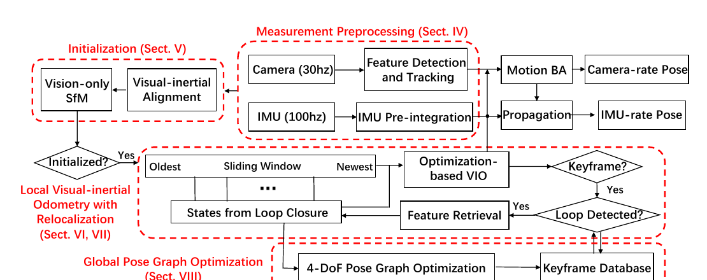

**图 2.** 所提出单目视觉惯性状态估计器完整流水线的框图。

我们现在定义全文使用的记号与坐标系定义。我们将 $(\cdot)^w$ 视为世界坐标系。重力方向与世界坐标系的 $z$ 轴对齐。$(\cdot)^b$ 为体坐标系，我们将其定义为与 IMU 坐标系相同。$(\cdot)^c$ 为相机坐标系。我们同时使用旋转矩阵 $\mathbf{R}$ 与哈密顿四元数 $\mathbf{q}$ 表示旋转。状态向量中主要使用四元数，但旋转矩阵也用于方便地对三维向量做旋转。$\mathbf{q}^w_b$、$\mathbf{p}^w_b$ 为从体坐标系到世界坐标系的旋转与平移。$b_k$ 为拍摄第 $k$ 幅图像时的体坐标系。$c_k$ 为拍摄第 $k$ 幅图像时的相机坐标系。$\otimes$ 表示两个四元数之间的乘法运算。$\mathbf{g}^w = [0, 0, g]^\top$ 为世界坐标系中的重力向量。最后，我们用 $(\hat{\cdot})$ 表示某量的带噪测量或估计。

---

## IV. 测量预处理

本节给出惯性与单目视觉测量的预处理步骤。对视觉测量，我们在连续帧之间跟踪特征并在最新帧中检测新特征。对 IMU 测量，我们在两连续帧之间对其进行预积分。注意，我们使用的低成本 IMU 测量同时受偏置与噪声影响。因此我们在 IMU 预积分过程中特别考虑偏置。

疑问：好的IMU是否能自动校准偏置？

### A. 视觉处理前端

对每幅新图像，现有特征由 <u>KLT 稀疏光流算法</u> [29] 跟踪。同时，检测新的角点特征 [30]，以在每幅图像中维持最少数量（100–300）的特征。<u>检测器通过在两相邻特征之间设置最小像素间隔来强制均匀特征分布</u>。二维特征首先去畸变，然后在通过外点剔除后投影到单位球上。<u>外点剔除使用带基础矩阵模型的 RANSAC</u> [31] 执行。

疑问：现有特征具体是什么，角点特征吗？

疑问： KLT 稀疏光流算法怎么实现的？它的作用是什么？

疑问：检测器通过在两相邻特征之间设置最小像素间隔来强制均匀特征分布。这是什么意思，怎么做？

疑问：外点剔除使用带基础矩阵模型的 RANSAC。具体怎么做的？

关键帧也在此步骤中选择。我们有两个关键帧选择准则。第一个是相对先前关键帧的平均<u>视差</u>。若当前帧与最新关键帧之间被跟踪特征的平均视差超过某阈值，则将该帧视为新关键帧。注意不仅平移而且旋转也会造成视差。然而，<u>特征在纯旋转运动中无法被三角化</u>。为避免该情况，我们在计算视差时使用陀螺仪测量的短期积分来补偿旋转。注意该旋转补偿仅用于关键帧选择，不参与 VINS 公式中的旋转计算。因此，即使陀螺仪含有大噪声或有偏置，也只会带来次优的关键帧选择结果，而不会直接影响估计质量。另一准则是跟踪质量。<u>若被跟踪特征数量低于某阈值，我们将该帧视为新关键帧</u>。该准则旨在避免特征轨迹完全丢失。

疑问：视差是什么？

疑问：特征在纯旋转运动中无法被三角化。为什么？

### B. IMU 预积分

IMU 预积分首先在 [22] 中提出，其用欧拉角参数化旋转误差。我们先前工作 [7] 发展了面向 IMU 预积分的流形上旋转公式。该工作使用连续时间 IMU 误差状态动力学推导协方差传播。然而，IMU 偏置被忽略。预积分理论在 [23] 中通过加入后验 IMU 偏置校正得到进一步改进。本文中，**我们扩展先前工作 [7] 提出的 IMU 预积分，纳入 IMU 偏置校正**。

来自 IMU 的原始陀螺仪与加速度计测量 $\hat{\boldsymbol{\omega}}$ 与 $\hat{\mathbf{a}}$ 由下式给出：

$$
\begin{aligned}
\hat{\mathbf{a}}_t &= \mathbf{a}_t + \mathbf{b}_{a_t} + \mathbf{R}^t_w \mathbf{g}^w + \mathbf{n}_a \\
\hat{\boldsymbol{\omega}}_t &= \boldsymbol{\omega}_t + \mathbf{b}_{w_t} + \mathbf{n}_w .
\end{aligned}
\tag{1}
$$

在体坐标系中测量的 IMU 测量，结合了抵消重力的力与平台动力学，并受加速度偏置 $\mathbf{b}_a$、陀螺仪偏置 $\mathbf{b}_w$ 以及加性噪声影响。我们假设加速度与陀螺仪测量中的加性噪声为高斯，$\mathbf{n}_a \sim \mathcal{N}(\mathbf{0}, \sigma_a^2)$，$\mathbf{n}_w \sim \mathcal{N}(\mathbf{0}, \sigma_w^2)$。加速度偏置与陀螺仪偏置建模为随机游走，其导数为高斯，$\mathbf{n}_{b_a} \sim \mathcal{N}(\mathbf{0}, \sigma_{b_a}^2)$，$\mathbf{n}_{b_w} \sim \mathcal{N}(\mathbf{0}, \sigma_{b_w}^2)$：

$$
\dot{\mathbf{b}}_{a_t} = \mathbf{n}_{b_a}, \qquad \dot{\mathbf{b}}_{w_t} = \mathbf{n}_{b_w}.
\tag{2}
$$

给定对应于图像帧 $b_k$ 与 $b_{k+1}$ 的两个时刻，位置、速度与姿态状态可由时间区间 $[t_k, t_{k+1}]$ 内的惯性测量在世界坐标系中传播：

$$
\begin{aligned}
\mathbf{p}^w_{b_{k+1}} &= \mathbf{p}^w_{b_k} + \mathbf{v}^w_{b_k}\Delta t_k \\
&\quad + \iint_{t\in[t_k,t_{k+1}]}\big(\mathbf{R}^w_t(\hat{\mathbf{a}}_t - \mathbf{b}_{a_t} - \mathbf{n}_a) - \mathbf{g}^w\big)\,dt^2 \\
\mathbf{v}^w_{b_{k+1}} &= \mathbf{v}^w_{b_k} + \int_{t\in[t_k,t_{k+1}]}\big(\mathbf{R}^w_t(\hat{\mathbf{a}}_t - \mathbf{b}_{a_t} - \mathbf{n}_a) - \mathbf{g}^w\big)\,dt \\
\mathbf{q}^w_{b_{k+1}} &= \mathbf{q}^w_{b_k} \otimes \int_{t\in[t_k,t_{k+1}]}\frac{1}{2}\boldsymbol{\Omega}(\hat{\boldsymbol{\omega}}_t - \mathbf{b}_{w_t} - \mathbf{n}_w)\mathbf{q}^w_{b_t}\,dt,
\end{aligned}
\tag{3}
$$

其中

$$
\boldsymbol{\Omega}(\boldsymbol{\omega})=\begin{bmatrix}-\lfloor\boldsymbol{\omega}\rfloor_\times & \boldsymbol{\omega}\\ -\boldsymbol{\omega}^\top & 0\end{bmatrix},\quad
\lfloor\boldsymbol{\omega}\rfloor_\times=\begin{bmatrix}0 & -\omega_z & \omega_y\\ \omega_z & 0 & -\omega_x\\ -\omega_y & \omega_x & 0\end{bmatrix}.
\tag{4}
$$

$\Delta t_k$ 为时间区间 $[t_k, t_{k+1}]$ 的时长。可以看到，IMU 状态传播需要帧 $b_k$ 的旋转、位置与速度。**当这些起始状态改变时，我们需要重新传播 IMU 测量。尤其在基于优化的算法中，每次调整位姿时，都需要在它们之间重新传播 IMU 测量。这种传播策略计算代价高昂。为避免再传播，我们采用预积分算法。**

将参考坐标系从世界坐标系改为局部坐标系 $b_k$ 后，我们仅预积分与线加速度 $\hat{\mathbf{a}}$ 与角速度 $\hat{\boldsymbol{\omega}}$ 相关的部分如下：

$$
\begin{aligned}
\mathbf{R}^{b_k}_w\mathbf{p}^w_{b_{k+1}} &= \mathbf{R}^{b_k}_w\big(\mathbf{p}^w_{b_k}+\mathbf{v}^w_{b_k}\Delta t_k-\frac{1}{2}\mathbf{g}^w\Delta t_k^2\big)+\boldsymbol{\alpha}^{b_k}_{b_{k+1}} \\
\mathbf{R}^{b_k}_w\mathbf{v}^w_{b_{k+1}} &= \mathbf{R}^{b_k}_w\big(\mathbf{v}^w_{b_k}-\mathbf{g}^w\Delta t_k\big)+\boldsymbol{\beta}^{b_k}_{b_{k+1}} \\
\mathbf{q}^{b_k}_w\otimes\mathbf{q}^w_{b_{k+1}} &= \boldsymbol{\gamma}^{b_k}_{b_{k+1}},
\end{aligned}
\tag{5}
$$

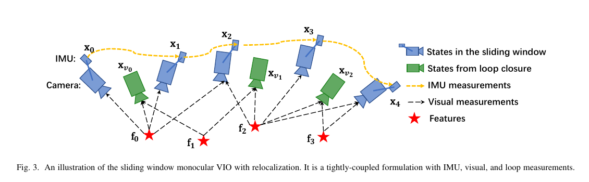

**图 3.** 带重定位的滑动窗口单目 VIO 示意。它是与 IMU、视觉与回环测量紧耦合的公式。

其中，

$$
\begin{aligned}
\boldsymbol{\alpha}^{b_k}_{b_{k+1}} &= \iint_{t\in[t_k,t_{k+1}]}\mathbf{R}^{b_k}_t(\hat{\mathbf{a}}_t-\mathbf{b}_{a_t}-\mathbf{n}_a)\,dt^2 \\
\boldsymbol{\beta}^{b_k}_{b_{k+1}} &= \int_{t\in[t_k,t_{k+1}]}\mathbf{R}^{b_k}_t(\hat{\mathbf{a}}_t-\mathbf{b}_{a_t}-\mathbf{n}_a)\,dt \\
\boldsymbol{\gamma}^{b_k}_{b_{k+1}} &= \int_{t\in[t_k,t_{k+1}]}\frac{1}{2}\boldsymbol{\Omega}(\hat{\boldsymbol{\omega}}_t-\mathbf{b}_{w_t}-\mathbf{n}_w)\boldsymbol{\gamma}^{b_k}_t\,dt.
\end{aligned}
\tag{6}
$$

可以看到，预积分项 (6) 仅通过以 $b_k$ 为参考坐标系的 IMU 测量即可获得。$\boldsymbol{\alpha}^{b_k}_{b_{k+1}}$、$\boldsymbol{\beta}^{b_k}_{b_{k+1}}$、$\boldsymbol{\gamma}^{b_k}_{b_{k+1}}$ 仅与 IMU 偏置相关，而不与 $b_k$ 与 $b_{k+1}$ 中的其他状态相关。当偏置估计改变时，若改变较小，我们通过它们关于偏置的一阶近似调整 $\boldsymbol{\alpha}^{b_k}_{b_{k+1}}$、$\boldsymbol{\beta}^{b_k}_{b_{k+1}}$、$\boldsymbol{\gamma}^{b_k}_{b_{k+1}}$，否则做再传播。该策略为基于优化的算法节省了大量计算资源，因为我们不需要反复传播 IMU 测量。

对离散时间实现，可应用欧拉、中点、RK4 积分等不同数值积分方法。这里选择欧拉积分以演示流程便于理解（实现代码中我们使用中点积分）。

开始时，$\boldsymbol{\alpha}^{b_k}_{b_k}$、$\boldsymbol{\beta}^{b_k}_{b_k}$ 为 0，$\boldsymbol{\gamma}^{b_k}_{b_k}$ 为恒等四元数。(6) 中 $\boldsymbol{\alpha}$、$\boldsymbol{\beta}$、$\boldsymbol{\gamma}$ 的均值逐步传播如下。注意加性噪声项 $\mathbf{n}_a$、$\mathbf{n}_w$ 未知，在实现中视为零。这导致预积分项的估计值，记为 $(\hat{\cdot})$：

$$
\begin{aligned}
\hat{\boldsymbol{\alpha}}^{b_k}_{i+1} &= \hat{\boldsymbol{\alpha}}^{b_k}_{i}+\hat{\boldsymbol{\beta}}^{b_k}_{i}\delta t+\frac{1}{2}\mathbf{R}(\hat{\boldsymbol{\gamma}}^{b_k}_{i})(\hat{\mathbf{a}}_i-\mathbf{b}_{a_i})\delta t^2 \\
\hat{\boldsymbol{\beta}}^{b_k}_{i+1} &= \hat{\boldsymbol{\beta}}^{b_k}_{i}+\mathbf{R}(\hat{\boldsymbol{\gamma}}^{b_k}_{i})(\hat{\mathbf{a}}_i-\mathbf{b}_{a_i})\delta t \\
\hat{\boldsymbol{\gamma}}^{b_k}_{i+1} &= \hat{\boldsymbol{\gamma}}^{b_k}_{i}\otimes\begin{bmatrix}1\\ \tfrac{1}{2}(\hat{\boldsymbol{\omega}}_i-\mathbf{b}_{w_i})\delta t\end{bmatrix}.
\end{aligned}
\tag{7}
$$

疑问：公式(7)中计算出来的3个变量是什么？

$i$ 为对应于区间 $[t_k,t_{k+1}]$ 内一次 IMU 测量的离散时刻。$\delta t$ 为两次 IMU 测量 $i$ 与 $i+1$ 之间的时间间隔。

接着处理协方差传播。由于四维旋转四元数 $\boldsymbol{\gamma}^{b_k}_t$ 过参数化，我们将其误差项定义为均值附近的扰动：

$$
\boldsymbol{\gamma}^{b_k}_t \approx \hat{\boldsymbol{\gamma}}^{b_k}_t \otimes\begin{bmatrix}1\\ \tfrac{1}{2}\delta\boldsymbol{\theta}^{b_k}_t\end{bmatrix},
\tag{8}
$$

其中 $\delta\boldsymbol{\theta}^{b_k}_t$ 为三维小扰动。

我们可以推导 (6) 误差项的连续时间线性化动力学：

$$
\begin{bmatrix}
\delta\dot{\boldsymbol{\alpha}}^{b_k}_t \\
\delta\dot{\boldsymbol{\beta}}^{b_k}_t \\
\delta\dot{\boldsymbol{\theta}}^{b_k}_t \\
\delta\dot{\mathbf{b}}_{a_t} \\
\delta\dot{\mathbf{b}}_{w_t}
\end{bmatrix}
=
\begin{bmatrix}
\mathbf{0} & \mathbf{I} & \mathbf{0} & \mathbf{0} & \mathbf{0} \\
\mathbf{0} & \mathbf{0} & -\mathbf{R}^{b_k}_t\lfloor\hat{\mathbf{a}}_t-\mathbf{b}_{a_t}\rfloor_\times & -\mathbf{R}^{b_k}_t & \mathbf{0} \\
\mathbf{0} & \mathbf{0} & -\lfloor\hat{\boldsymbol{\omega}}_t-\mathbf{b}_{w_t}\rfloor_\times & \mathbf{0} & -\mathbf{I} \\
\mathbf{0} & \mathbf{0} & \mathbf{0} & \mathbf{0} & \mathbf{0} \\
\mathbf{0} & \mathbf{0} & \mathbf{0} & \mathbf{0} & \mathbf{0}
\end{bmatrix}
\begin{bmatrix}
\delta\boldsymbol{\alpha}^{b_k}_t \\
\delta\boldsymbol{\beta}^{b_k}_t \\
\delta\boldsymbol{\theta}^{b_k}_t \\
\delta\mathbf{b}_{a_t} \\
\delta\mathbf{b}_{w_t}
\end{bmatrix}
+
\begin{bmatrix}
\mathbf{0} & \mathbf{0} & \mathbf{0} & \mathbf{0} \\
-\mathbf{R}^{b_k}_t & \mathbf{0} & \mathbf{0} & \mathbf{0} \\
\mathbf{0} & -\mathbf{I} & \mathbf{0} & \mathbf{0} \\
\mathbf{0} & \mathbf{0} & \mathbf{I} & \mathbf{0} \\
\mathbf{0} & \mathbf{0} & \mathbf{0} & \mathbf{I}
\end{bmatrix}
\begin{bmatrix}
\mathbf{n}_a \\ \mathbf{n}_w \\ \mathbf{n}_{b_a} \\ \mathbf{n}_{b_w}
\end{bmatrix}
= \mathbf{F}_t\delta\mathbf{z}^{b_k}_t + \mathbf{G}_t\mathbf{n}_t.
\tag{9}
$$

$\mathbf{P}^{b_k}_{b_{k+1}}$ 可通过一阶离散时间协方差更新递归计算，初始协方差 $\mathbf{P}^{b_k}_{b_k}=\mathbf{0}$：

$$
\mathbf{P}^{b_k}_{t+\delta t}=(\mathbf{I}+\mathbf{F}_t\delta t)\mathbf{P}^{b_k}_t(\mathbf{I}+\mathbf{F}_t\delta t)^\top+(\mathbf{G}_t\delta t)\mathbf{Q}(\mathbf{G}_t\delta t)^\top,\quad t\in[k,k+1],
\tag{10}
$$

其中 $\mathbf{Q}$ 为噪声 $(\sigma_a^2,\sigma_w^2,\sigma_{b_a}^2,\sigma_{b_w}^2)$ 的对角协方差矩阵。

同时，$\delta\mathbf{z}^{b_k}_{b_{k+1}}$ 关于 $\delta\mathbf{z}^{b_k}_{b_k}$ 的一阶雅可比矩阵 $\mathbf{J}_{b_{k+1}}$ 也可递归计算，初始雅可比 $\mathbf{J}_{b_k}=\mathbf{I}$，

$$
\mathbf{J}_{t+\delta t}=(\mathbf{I}+\mathbf{F}_t\delta t)\mathbf{J}_t,\quad t\in[k,k+1].
\tag{11}
$$

使用该递归公式，我们得到协方差矩阵 $\mathbf{P}^{b_k}_{b_{k+1}}$ 与雅可比 $\mathbf{J}_{b_{k+1}}$。$\boldsymbol{\alpha}^{b_k}_{b_{k+1}}$、$\boldsymbol{\beta}^{b_k}_{b_{k+1}}$、$\boldsymbol{\gamma}^{b_k}_{b_{k+1}}$ 关于偏置的一阶近似可写为：

$$
\begin{aligned}
\boldsymbol{\alpha}^{b_k}_{b_{k+1}} &\approx \hat{\boldsymbol{\alpha}}^{b_k}_{b_{k+1}}+\mathbf{J}^\alpha_{b_a}\delta\mathbf{b}_{a_k}+\mathbf{J}^\alpha_{b_w}\delta\mathbf{b}_{w_k} \\
\boldsymbol{\beta}^{b_k}_{b_{k+1}} &\approx \hat{\boldsymbol{\beta}}^{b_k}_{b_{k+1}}+\mathbf{J}^\beta_{b_a}\delta\mathbf{b}_{a_k}+\mathbf{J}^\beta_{b_w}\delta\mathbf{b}_{w_k} \\
\boldsymbol{\gamma}^{b_k}_{b_{k+1}} &\approx \hat{\boldsymbol{\gamma}}^{b_k}_{b_{k+1}}\otimes\begin{bmatrix}1\\ \tfrac{1}{2}\mathbf{J}^\gamma_{b_w}\delta\mathbf{b}_{w_k}\end{bmatrix},
\end{aligned}
\tag{12}
$$

其中 $\mathbf{J}^\alpha_{b_a}$ 是 $\mathbf{J}_{b_{k+1}}$ 中位置对应于 $\frac{\delta\boldsymbol{\alpha}^{b_k}_{b_{k+1}}}{\delta\mathbf{b}_{a_k}}$ 的子块矩阵。$\mathbf{J}^\alpha_{b_w}$、$\mathbf{J}^\beta_{b_a}$、$\mathbf{J}^\beta_{b_w}$、$\mathbf{J}^\gamma_{b_w}$ 含义相同。当偏置估计略微改变时，我们使用 (12) 近似校正预积分结果，而不是再传播。

现在我们能够写出带有对应协方差 $\mathbf{P}^{b_k}_{b_{k+1}}$ 的 IMU 测量模型：

$$
\begin{bmatrix}
\hat{\boldsymbol{\alpha}}^{b_k}_{b_{k+1}} \\
\hat{\boldsymbol{\beta}}^{b_k}_{b_{k+1}} \\
\hat{\boldsymbol{\gamma}}^{b_k}_{b_{k+1}} \\
\mathbf{0} \\
\mathbf{0}
\end{bmatrix}
=
\begin{bmatrix}
\mathbf{R}^{b_k}_w\big(\mathbf{p}^w_{b_{k+1}}-\mathbf{p}^w_{b_k}+\tfrac{1}{2}\mathbf{g}^w\Delta t_k^2-\mathbf{v}^w_{b_k}\Delta t_k\big) \\
\mathbf{R}^{b_k}_w\big(\mathbf{v}^w_{b_{k+1}}+\mathbf{g}^w\Delta t_k-\mathbf{v}^w_{b_k}\big) \\
\mathbf{q}^{b_k}_w\otimes\mathbf{q}^w_{b_{k+1}} \\
\mathbf{b}_{a_{b_{k+1}}}-\mathbf{b}_{a_{b_k}} \\
\mathbf{b}_{w_{b_{k+1}}}-\mathbf{b}_{w_{b_k}}
\end{bmatrix}.
\tag{13}
$$

疑问：预积分要解决的问题是什么，输入输出是什么，怎么实现的，为什么能解决这个问题？有什么优点和缺点？

---

## V. 估计器初始化

单目紧耦合视觉惯性里程计是高度非线性系统。由于尺度不能由单目相机直接观测，在没有良好初值时很难直接融合这两种测量。有人可能假设静止初始条件以启动单目 VINS 估计器。然而，该假设不合适，因为运动中初始化在真实应用中经常遇到。当 IMU 测量被大偏置污染时，情况变得更加复杂。事实上，初始化通常是单目 VINS 最脆弱的步骤。需要鲁棒的初始化流程以确保系统的适用性。

疑问：由于尺度不能由单目相机直接观测，在没有良好初值时很难直接融合这两种测量。初始值有哪些？如果能用单目深度估计进行估计出尺度，能否解决这个问题？

疑问：初始化要解决的问题是什么？这里怎么做的？

我们采用松耦合传感器融合方法获取初值。我们发现纯视觉 SLAM，或运动恢复结构（SfM），具有良好的初始化性质。在大多数情况下，纯视觉系统可通过相对运动方法（如八点 [32] 或五点 [33] 算法）或估计齐次矩阵导出初值来自举。**通过将度量 IMU 预积分与纯视觉 SfM 结果对齐，我们可粗略恢复尺度、重力、速度甚至偏置。**这足以自举非线性单目 VINS 估计器，如图 4 所示。

疑问：这里的自举是什么意思？

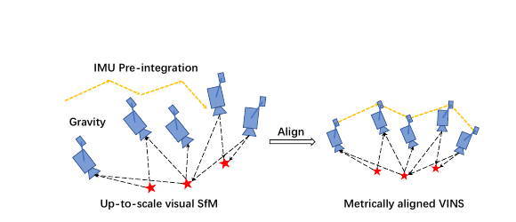

**图 4.** 用于估计器初始化的视觉惯性对齐过程示意。

与 [17] 在初始化阶段同时估计陀螺仪与加速度计偏置不同，**我们选择在初始步骤忽略加速度计偏置项。**加速度计偏置与重力耦合，且由于重力向量相对平台动力学幅度很大，以及初始化阶段相对较短，这些偏置项很难被观测。加速度计偏置标定的详细分析见我们先前工作 [34]。

### A. 滑动窗口纯视觉 SfM

初始化流程从纯视觉 SfM 开始，以估计尺度不确定的相机位姿图与特征位置。

我们维护帧的滑动窗口以限制计算复杂度。首先，检查最新帧与所有先前帧之间的特征对应。若我们能在最新帧与滑动窗口中任一其他帧之间找到稳定特征跟踪（超过 30 个被跟踪特征）与<u>充分视差</u>（超过 20 个旋转补偿像素），则使用五点算法 [33] 恢复这两帧之间的相对旋转与尺度不确定平移。否则，我们将最新帧保留在窗口中并等待新帧。若五点算法成功，我们任意设定尺度并三角化这两帧中观测到的所有特征。基于这些三角化特征，执行透视 $n$ 点（PnP）方法 [35] 以估计窗口中所有其他帧的位姿。最后，应用全局完整光束法平差 [36] 以最小化所有特征观测的总重投影误差。由于我们尚不知晓世界坐标系，我们将第一相机帧 $(\cdot)^{c_0}$ 设为 SfM 的参考坐标系。所有帧位姿 $(\bar{\mathbf{p}}^{c_0}_{c_k},\mathbf{q}^{c_0}_{c_k})$ 与特征位置均相对于 $(\cdot)^{c_0}$ 表示。假设我们有相机与 IMU 之间的粗略外参测量 $(\mathbf{p}^b_c, \mathbf{q}^b_c)$，可将位姿从相机坐标系变换到体（IMU）坐标系，

$$
\mathbf{q}^{c_0}_{b_k}=\mathbf{q}^{c_0}_{c_k}\otimes(\mathbf{q}^b_c)^{-1}
\tag{14}
$$

$$
s\bar{\mathbf{p}}^{c_0}_{b_k}=s\bar{\mathbf{p}}^{c_0}_{c_k}-\mathbf{R}^{c_0}_{b_k}\mathbf{p}^b_c,
$$

其中 $s$ 为将视觉结构对齐到度量尺度的尺度参数。求解该尺度参数是实现成功初始化的关键。

疑问：视差是什么？

疑问：五点算法是什么？

疑问：能否用单目深度估计得到尺度？这个尺度是什么尺度？

### B. 视觉惯性对齐

#### 1) 陀螺仪偏置标定

考虑窗口中两连续帧 $b_k$ 与 $b_{k+1}$，我们从视觉 SfM 得到旋转 $\mathbf{q}^{c_0}_{b_k}$ 与 $\mathbf{q}^{c_0}_{b_{k+1}}$，以及来自 IMU 预积分的相对约束 $\hat{\boldsymbol{\gamma}}^{b_k}_{b_{k+1}}$。我们将 IMU 预积分项关于陀螺仪偏置线性化，并最小化如下代价函数：

$$
\min_{\delta\mathbf{b}_w}\sum_{k\in\mathcal{B}}\left\|\mathbf{q}^{c_0\,-1}_{b_{k+1}}\otimes\mathbf{q}^{c_0}_{b_k}\otimes\boldsymbol{\gamma}^{b_k}_{b_{k+1}}\right\|^2
$$

$$
\boldsymbol{\gamma}^{b_k}_{b_{k+1}}\approx\hat{\boldsymbol{\gamma}}^{b_k}_{b_{k+1}}\otimes\begin{bmatrix}1\\ \tfrac{1}{2}\mathbf{J}^\gamma_{b_w}\delta\mathbf{b}_w\end{bmatrix},
\tag{15}
$$

其中 $\mathcal{B}$ 索引窗口中的所有帧。我们使用第 IV-B 节导出的偏置雅可比，得到 $\hat{\boldsymbol{\gamma}}^{b_k}_{b_{k+1}}$ 关于陀螺仪偏置的一阶近似。以此方式，我们得到陀螺仪偏置 $\mathbf{b}_w$ 的初始标定。然后我们使用新的陀螺仪偏置重新传播所有 IMU 预积分项 $\hat{\boldsymbol{\alpha}}^{b_k}_{b_{k+1}}$、$\hat{\boldsymbol{\beta}}^{b_k}_{b_{k+1}}$ 与 $\hat{\boldsymbol{\gamma}}^{b_k}_{b_{k+1}}$。

疑问：公式(15)是在做什么，公式含意是什么？

疑问：偏置具体指的是什么？

#### 2) 速度、重力向量与度量尺度初始化

陀螺仪偏置初始化后，我们继续初始化导航所需的其他基本状态，即速度、重力向量与度量尺度：

$$
\mathcal{X}_I=\left[\mathbf{v}^{b_0}_{b_0},\mathbf{v}^{b_1}_{b_1},\cdots,\mathbf{v}^{b_n}_{b_n},\mathbf{g}^{c_0},s\right],
\tag{16}
$$

其中 $\mathbf{v}^{b_k}_{b_k}$ 为拍摄第 $k$ 幅图像时体坐标系中的速度，$\mathbf{g}^{c_0}$ 为 $c_0$ 坐标系中的重力向量，$s$ 将单目 SfM 缩放到度量单位。

考虑窗口中两连续帧 $b_k$ 与 $b_{k+1}$，则 (5) 可写为：

$$
\begin{aligned}
\boldsymbol{\alpha}^{b_k}_{b_{k+1}}&=\mathbf{R}^{b_k}_{c_0}\Big(s(\bar{\mathbf{p}}^{c_0}_{b_{k+1}}-\bar{\mathbf{p}}^{c_0}_{b_k})+\mathbf{g}^{c_0}\Delta t_k^2-\mathbf{R}^{c_0}_{b_k}\mathbf{v}^{b_k}_{b_k}\Delta t_k\Big) \\
\boldsymbol{\beta}^{b_k}_{b_{k+1}}&=\mathbf{R}^{b_k}_{c_0}\Big(\mathbf{R}^{c_0}_{b_{k+1}}\mathbf{v}^{b_{k+1}}_{b_{k+1}}+\mathbf{g}^{c_0}\Delta t_k-\mathbf{R}^{c_0}_{b_k}\mathbf{v}^{b_k}_{b_k}\Big).
\end{aligned}
\tag{17}
$$

我们可将 (14) 与 (17) 组合成如下线性测量模型：

$$
\hat{\mathbf{z}}^{b_k}_{b_{k+1}}=\begin{bmatrix}\hat{\boldsymbol{\alpha}}^{b_k}_{b_{k+1}}-\mathbf{p}^b_c+\mathbf{R}^{b_k}_{c_0}\mathbf{R}^{c_0}_{b_{k+1}}\mathbf{p}^b_c\\\hat{\boldsymbol{\beta}}^{b_k}_{b_{k+1}}\end{bmatrix}=\mathbf{H}^{b_k}_{b_{k+1}}\mathcal{X}_I+\mathbf{n}^{b_k}_{b_{k+1}}
\tag{18}
$$

$$
\mathbf{H}^{b_k}_{b_{k+1}}=\begin{bmatrix}
-\mathbf{I}\Delta t_k & \mathbf{0} & \tfrac{1}{2}\mathbf{R}^{b_k}_{c_0}\Delta t_k^2 & \mathbf{R}^{b_k}_{c_0}(\bar{\mathbf{p}}^{c_0}_{c_{k+1}}-\bar{\mathbf{p}}^{c_0}_{c_k}) \\
-\mathbf{I} & \mathbf{R}^{b_k}_{c_0}\mathbf{R}^{c_0}_{b_{k+1}} & \mathbf{R}^{b_k}_{c_0}\Delta t_k & \mathbf{0}
\end{bmatrix}.
\tag{19}
$$

可以看到，$\mathbf{R}^{c_0}_{b_k}$、$\mathbf{R}^{c_0}_{b_{k+1}}$、$\bar{\mathbf{p}}^{c_0}_{c_k}$、$\bar{\mathbf{p}}^{c_0}_{c_{k+1}}$ 来自尺度不确定的单目视觉 SfM。$\Delta t_k$ 为两连续帧之间的时间间隔。通过求解该线性最小二乘问题：

$$
\min_{\mathcal{X}_I}\sum_{k\in\mathcal{B}}\left\|\hat{\mathbf{z}}^{b_k}_{b_{k+1}}-\mathbf{H}^{b_k}_{b_{k+1}}\mathcal{X}_I\right\|^2,
\tag{20}
$$

我们可以得到窗口中每一帧的体坐标系速度、视觉参考坐标系 $(\cdot)^{c_0}$ 中的重力向量，以及尺度参数。

疑问：速度、重力向量与度量尺度初始化。这部分计算公式到底是怎么做的，我看不懂这些公式，请讲解(16)-(20)的公式到底在做什么，含义是什么？

#### 3) 重力精化

由先前线性初始化步骤得到的重力向量可通过约束其幅度加以精化。在大多数情况下，重力向量的幅度已知。这导致重力向量仅剩 2 DOF。因此我们在其切空间上用两个变量重新参数化重力。我们的参数化将重力向量表示为 $g\cdot\hat{\bar{\mathbf{g}}}+w_1\mathbf{b}_1+w_2\mathbf{b}_2$，其中 $g$ 为已知的重力幅度，$\hat{\bar{\mathbf{g}}}$ 为表示重力方向的单位向量。$\mathbf{b}_1$ 与 $\mathbf{b}_2$ 为张成切平面的两个正交基，如图 5 所示。$w_1$ 与 $w_2$ 分别为朝 $\mathbf{b}_1$ 与 $\mathbf{b}_2$ 的对应位移。我们可通过叉积运算用算法 1 找到一组 $\mathbf{b}_1$、$\mathbf{b}_2$。然后将 (17) 中的 $\mathbf{g}$ 替换为 $g\cdot\hat{\bar{\mathbf{g}}}+w_1\mathbf{b}_1+w_2\mathbf{b}_2$，并与其他状态变量一起求解 $w_1$ 与 $w_2$。该过程迭代直至 $\hat{\mathbf{g}}$ 收敛。

疑问：重力不是一直垂直于地面吗，这里为什么还要重新估计其方向？这导致重力向量仅剩 2 DOF，这里的2 DOF是哪些方向？

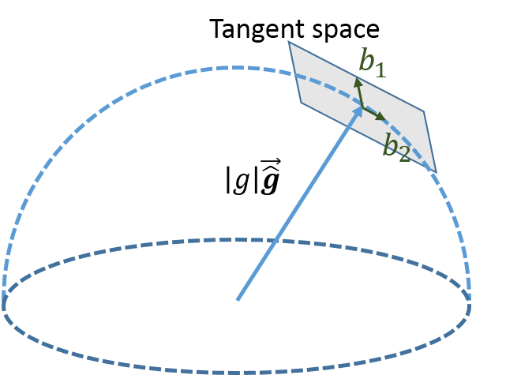

**图 5.** 重力的 2 DOF 参数化示意。由于重力幅度已知，$\mathbf{g}$ 位于半径 $g\approx 9.81\,\mathrm{m/s}^2$ 的球面上。重力在当前估计附近参数化为 $g\cdot\hat{\bar{\mathbf{g}}}+w_1\mathbf{b}_1+w_2\mathbf{b}_2$，其中 $\mathbf{b}_1$ 与 $\mathbf{b}_2$ 为张成切空间的两个正交基。

**算法 1：寻找 $\mathbf{b}_1$ 与 $\mathbf{b}_2$**

```
if ĝ̄ ≠ [1, 0, 0] then
    b₁ ← normalize(ĝ̄ × [1, 0, 0]);
else
    b₁ ← normalize(ĝ̄ × [0, 0, 1]);
end
b₂ ← ĝ̄ × b₁;
```

疑问：这里的算法1表示什么意思？

#### 4) 完成初始化

精化重力向量后，我们可通过将重力旋转到 $z$ 轴得到世界坐标系与相机坐标系 $c_0$ 之间的旋转 $\mathbf{q}^w_{c_0}$。然后将所有变量从参考坐标系 $(\cdot)^{c_0}$ 旋转到世界坐标系 $(\cdot)^w$。体坐标系速度也将旋转到世界坐标系。来自视觉 SfM 的平移分量将缩放到度量单位。至此，初始化流程完成，所有这些度量值将馈入紧耦合单目 VIO。

---

## VI. 紧耦合单目 VIO

估计器初始化之后，我们继续使用基于滑动窗口的紧耦合单目 VIO 进行高精度鲁棒状态估计。滑动窗口公式的示意如图 3 所示。

### A. 问题表述

滑动窗口中的完整状态向量定义为：

$$
\mathcal{X}=\left[\mathbf{x}_0,\mathbf{x}_1,\cdots,\mathbf{x}_n,\mathbf{x}^b_c,\lambda_0,\lambda_1,\cdots,\lambda_m\right]
\tag{21}
$$

其中，

$$
\begin{aligned}
\mathbf{x}_k&=\left[\mathbf{p}^w_{b_k},\mathbf{v}^w_{b_k},\mathbf{q}^w_{b_k},\mathbf{b}_a,\mathbf{b}_g\right],\quad k\in[0,n] \\
\mathbf{x}^b_c&=\left[\mathbf{p}^b_c,\mathbf{q}^b_c\right],
\end{aligned}
$$

其中 $\mathbf{x}_k$ 为捕获第 $k$ 幅图像时的 IMU 状态。它包含世界坐标系中 IMU 的位置、速度与姿态，以及 IMU 体坐标系中的加速度偏置与陀螺仪偏置。$n$ 为关键帧总数，$m$ 为滑动窗口中特征总数。$\lambda_l$ 为第 $l$ 个特征从其首次观测起的逆深度。

我们使用视觉惯性光束法平差公式。我们最小化先验与所有测量残差的马氏范数之和，以获得最大后验估计：

$$
\min_{\mathcal{X}}\left\{\left\|\mathbf{r}_p-\mathbf{H}_p\mathcal{X}\right\|^2+\sum_{k\in\mathcal{B}}\left\|\mathbf{r}_{\mathcal{B}}(\hat{\mathbf{z}}^{b_k}_{b_{k+1}},\mathcal{X})\right\|^2_{\mathbf{P}^{b_k}_{b_{k+1}}}+\sum_{(l,j)\in\mathcal{C}}\rho\left(\left\|\mathbf{r}_{\mathcal{C}}(\hat{\mathbf{z}}^{c_j}_l,\mathcal{X})\right\|^2_{\mathbf{P}^{c_j}_l}\right)\right\},
\tag{22}
$$

其中 Huber 范数 [37] 定义为：

$$
\rho(s)=\begin{cases}1,& s\ge 1,\\ 2\sqrt{s}-1,& s \lt 1.\end{cases}
\tag{23}
$$

$\mathbf{r}_{\mathcal{B}}(\hat{\mathbf{z}}^{b_k}_{b_{k+1}},\mathcal{X})$ 与 $\mathbf{r}_{\mathcal{C}}(\hat{\mathbf{z}}^{c_j}_l,\mathcal{X})$ 分别为 IMU 与视觉测量的残差。残差项的详细定义将在第 VI-B 节与第 VI-C 节给出。$\mathcal{B}$ 为所有 IMU 测量的集合，$\mathcal{C}$ 为在当前滑动窗口中至少被观测两次的特征集合。$\{\mathbf{r}_p,\mathbf{H}_p\}$ 为来自边缘化的先验信息。使用 Ceres Solver [38] 求解该非线性问题。

疑问：自边缘化的先验信息是什么？怎么得到的？

疑问：VIO输出的到底是什么，是世界坐标系中 IMU 的位置、速度与姿态，以及 IMU 体坐标系中的加速度偏置与陀螺仪偏置。这些量吗？

### B. IMU 测量残差

考虑滑动窗口中两连续帧 $b_k$ 与 $b_{k+1}$ 之间的 IMU 测量，根据 (13) 定义的 IMU 测量模型，预积分 IMU 测量的残差可定义为：

$$
\mathbf{r}_{\mathcal{B}}(\hat{\mathbf{z}}^{b_k}_{b_{k+1}},\mathcal{X})=\begin{bmatrix}\delta\boldsymbol{\alpha}^{b_k}_{b_{k+1}}\\ \delta\boldsymbol{\beta}^{b_k}_{b_{k+1}}\\ \delta\boldsymbol{\theta}^{b_k}_{b_{k+1}}\\ \delta\mathbf{b}_a\\ \delta\mathbf{b}_g\end{bmatrix}
=
\begin{bmatrix}
\mathbf{R}^{b_k}_w\big(\mathbf{p}^w_{b_{k+1}}-\mathbf{p}^w_{b_k}+\tfrac{1}{2}\mathbf{g}^w\Delta t_k^2-\mathbf{v}^w_{b_k}\Delta t_k\big)-\hat{\boldsymbol{\alpha}}^{b_k}_{b_{k+1}} \\
\mathbf{R}^{b_k}_w\big(\mathbf{v}^w_{b_{k+1}}+\mathbf{g}^w\Delta t_k-\mathbf{v}^w_{b_k}\big)-\hat{\boldsymbol{\beta}}^{b_k}_{b_{k+1}} \\
2\left[\mathbf{q}^{w\,-1}_{b_k}\otimes\mathbf{q}^w_{b_{k+1}}\otimes(\hat{\boldsymbol{\gamma}}^{b_k}_{b_{k+1}})^{-1}\right]_{xyz} \\
\mathbf{b}_{a_{b_{k+1}}}-\mathbf{b}_{a_{b_k}} \\
\mathbf{b}_{w_{b_{k+1}}}-\mathbf{b}_{w_{b_k}}
\end{bmatrix}.
\tag{24}
$$

其中 $[\cdot]_{xyz}$ 提取四元数 $\mathbf{q}$ 的向量部分用于误差状态表示。$\delta\boldsymbol{\theta}^{b_k}_{b_{k+1}}$ 为四元数的三维误差状态表示。$[\hat{\boldsymbol{\alpha}}^{b_k}_{b_{k+1}},\hat{\boldsymbol{\beta}}^{b_k}_{b_{k+1}},\hat{\boldsymbol{\gamma}}^{b_k}_{b_{k+1}}]^\top$ 为仅使用两连续图像帧时间区间内带噪加速度计与陀螺仪测量得到的预积分 IMU 测量项。加速度计与陀螺仪偏置也包含在残差项中以进行在线校正。  

疑问：公式(24)表达什么含义，解释公式，我看不懂。

### C. 视觉测量残差

与在广义图像平面上定义重投影误差的传统针孔相机模型不同，**我们在单位球上定义相机测量残差**。几乎所有类型相机（包括广角、鱼眼或全向相机）的光学都可建模为连接单位球表面的单位射线。考虑首次在第 $i$ 幅图像中观测到的第 $l$ 个特征，该特征在第 $j$ 幅图像中的观测残差定义为：

$$
\begin{aligned}
\mathbf{r}_{\mathcal{C}}(\hat{\mathbf{z}}^{c_j}_l,\mathcal{X})&=\begin{bmatrix}\mathbf{b}_1&\mathbf{b}_2\end{bmatrix}^\top\cdot\left(\hat{\bar{\mathbf{P}}}^{c_j}_l-\frac{\mathbf{P}^{c_j}_l}{\|\mathbf{P}^{c_j}_l\|}\right) \\
\hat{\bar{\mathbf{P}}}^{c_j}_l&=\pi_c^{-1}\begin{bmatrix}\hat{u}^{c_j}_l\\ \hat{v}^{c_j}_l\end{bmatrix} \\
\mathbf{P}^{c_j}_l&=\mathbf{R}^b_c\Big(\mathbf{R}^w_{b_j}\big(\mathbf{R}^{b_i}_w\big(\mathbf{R}^c_b\frac{1}{\lambda_l}\pi_c^{-1}\begin{bmatrix}u^{c_i}_l\\ v^{c_i}_l\end{bmatrix}+\mathbf{p}^b_c\big)+\mathbf{p}^w_{b_i}-\mathbf{p}^w_{b_j}\big)-\mathbf{p}^b_c\Big),
\end{aligned}
\tag{25}
$$

其中 $[u^{c_i}_l,v^{c_i}_l]$ 为第 $l$ 个特征在第 $i$ 幅图像中的首次观测。$[\hat{u}^{c_j}_l,\hat{v}^{c_j}_l]$ 为同一特征在第 $j$ 幅图像中的观测。$\pi_c^{-1}$ 为反投影函数，使用相机内参将像素位置转为单位向量。由于视觉残差的自由度为二，我们将残差向量投影到切平面上。$\mathbf{b}_1$、$\mathbf{b}_2$ 为任意选取的张成 $\hat{\bar{\mathbf{P}}}^{c_j}_l$ 切平面的两个正交基，如图 6 所示。我们可轻松找到一组 $\mathbf{b}_1$、$\mathbf{b}_2$，如算法 1 所示。(22) 中使用的 $\mathbf{P}^{c_j}_l$ 为切空间中固定长度的标准协方差。

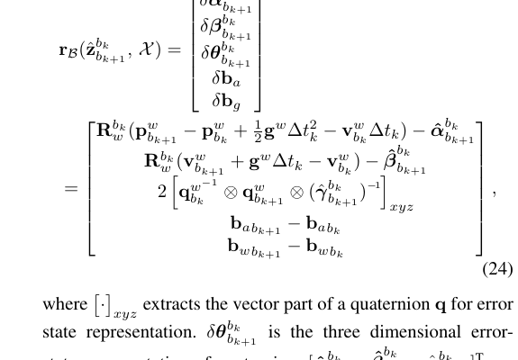

**图 6.** 单位球上视觉残差的示意。$\hat{\bar{\mathbf{P}}}^{c_j}_l$ 为第 $l$ 个特征在第 $j$ 帧中观测的单位向量。$\mathbf{P}^{c_j}_l$ 为通过将其在第 $i$ 帧中的首次观测变换到第 $j$ 帧而在单位球上预测的特征测量。残差定义在 $\hat{\bar{\mathbf{P}}}^{c_j}_l$ 的切平面上。

疑问：视觉测量是什么？视觉测量残差到底是什么？这里视觉测量残差的计算公式看不懂，请给我讲解这些公式的含义。

### D. 边缘化

**为限制基于优化的 VIO 的计算复杂度，引入了边缘化。我们选择性地从滑动窗口中边缘化 IMU 状态 $\mathbf{x}_k$ 与特征 $\lambda_l$，同时将对应于边缘化状态的测量转换为先验。**

如图 7 所示，当次新帧为关键帧时，它将留在窗口中，最老帧及其对应测量被边缘化。否则，若次新帧为非关键帧，我们丢弃视觉测量并保留连接到该非关键帧的 IMU 测量。我们不对非关键帧边缘化所有测量，以维持系统稀疏性。我们的边缘化方案旨在使空间上分离的关键帧保留在窗口中。这确保了特征三角化的充分视差，并最大化维持具有大激励的加速度计测量的概率。

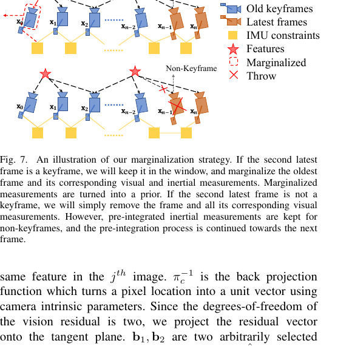

**图 7.** 我们的边缘化策略示意。若次新帧为关键帧，我们将其保留在窗口中，并边缘化最老帧及其对应的视觉与惯性测量。被边缘化的测量转为先验。若次新帧不是关键帧，我们简单地移除该帧及其所有对应视觉测量。然而，对非关键帧保留预积分惯性测量，并继续向下一帧进行预积分过程。

边缘化使用舒尔补 [39] 执行。我们基于与被移除状态相关的所有被边缘化测量构造新先验。新先验被加到现有先验上。

疑问：舒尔补 [39] 执行，具体怎么做？我们基于与被移除状态相关的所有被边缘化测量构造新先验。新先验被加到现有先验上。这是什么意思？

我们注意到边缘化导致线性化点的过早固定，可能造成次优估计结果。然而，由于对 VIO 可接受小漂移，我们认为边缘化造成的负面影响并不关键。

疑问：边缘化是什么意思？被边缘化的测量转为先验是什么意思？

### E. 面向相机频率状态估计的仅运动视觉惯性光束法平差

对计算能力较低的设备（如手机），紧耦合单目 VIO 因非线性优化的沉重计算需求而无法达到相机频率输出。为此，我们采用轻量仅运动视觉惯性光束法平差，将状态估计提升到相机频率（约 30 Hz）。

仅运动视觉惯性光束法平差的代价函数与 (22) 中单目 VIO 的相同。然而，**我们不是优化滑动窗口中的所有状态，而只优化固定数量最新 IMU 状态的位姿与速度**。我们将不想优化的特征深度、外参、偏置与旧 IMU 状态视为常值。我们确实用所有视觉与惯性测量做仅运动光束法平差。这比单帧 PnP 方法产生平滑得多的状态估计。所提出策略的示意如图 8 所示。与完整紧耦合单目 VIO（在先进嵌入式计算机上可能耗费超过 50 ms）相比，仅运动视觉惯性光束法平差仅需约 5 ms 计算。这使得低延迟相机频率位姿估计成为可能，对无人机与 AR 应用尤其有益。

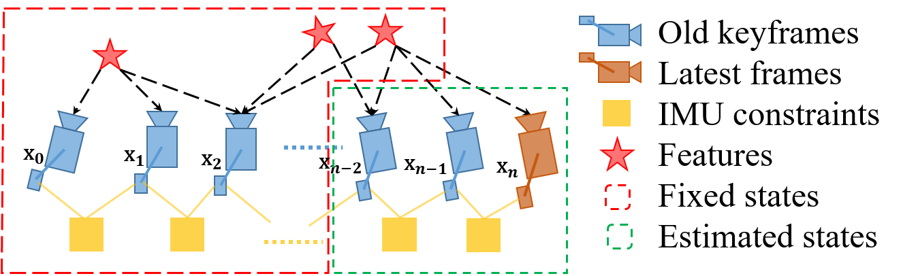

**图 8.** 面向相机频率输出的仅运动光束法平差示意。

疑问：面向相机频率状态估计的仅运动视觉惯性光束法平差。具体是如何计算的？

### F. 面向 IMU 频率状态估计的 IMU 前向传播

IMU 测量以远高于视觉测量的速率到来。尽管我们的 VIO 频率受图像捕获频率限制，我们仍可用最近一组 IMU 测量直接传播最新 VIO 估计，以达到 IMU 频率性能。高频状态估计可用作闭环控制的状态反馈。利用该 IMU 频率状态估计的自主飞行实验见第 IX-D 节。

### G. 故障检测与恢复

尽管我们的紧耦合单目 VIO 对各种挑战性环境与运动具有鲁棒性，由于剧烈光照变化或严重激进运动，故障仍不可避免。主动故障检测与恢复策略可提升所提系统的实用性。故障检测是检测估计器异常输出的独立模块。我们当前使用以下故障检测准则：

- 最新帧中被跟踪特征数量低于某阈值；
- 最近两次估计器输出之间位置或旋转出现大间断；
- 偏置或外参估计出现大变化。

一旦检测到故障，系统切换回初始化阶段。一旦单目 VIO 成功初始化，将创建位姿图的一个新的独立片段。

---

## VII. 重定位

我们的滑动窗口与边缘化方案限制了计算复杂度，但也给系统引入了累积漂移。更具体地说，漂移发生在全局三维位置 $(x,y,z)$ 以及绕重力方向的旋转（偏航）上。为消除漂移，提出了与单目 VIO 无缝集成的紧耦合重定位模块。重定位过程从识别已访问过地点的回环检测模块开始。随后建立回环闭合候选与当前帧之间的特征级连接。这些特征对应被紧耦合地集成到单目 VIO 模块中，从而以最小计算开销得到无漂移状态估计。多个特征的多次观测被直接用于重定位，带来更高精度与更好的状态估计平滑性。重定位流程的图示见图 9(a)。

### A. 回环检测

我们利用 DBoW2 [6]——一种先进的词袋地点识别方法——进行回环检测。除用于单目 VIO 的角点特征外，再检测 500 个角点并由 BRIEF 描述子 [40] 描述。额外角点特征用于在回环检测上达到更好召回率。描述子被视为视觉词以查询视觉数据库。DBoW2 在时间与几何一致性检查后返回回环闭合候选。我们保留所有 BRIEF 描述子用于特征检索，但丢弃原始图像以降低内存消耗。

我们注意到单目 VIO 能够使滚转与俯仰角可观。因此，我们不需要依赖旋转不变特征，例如 ORB-SLAM [4] 中使用的 ORB 特征。

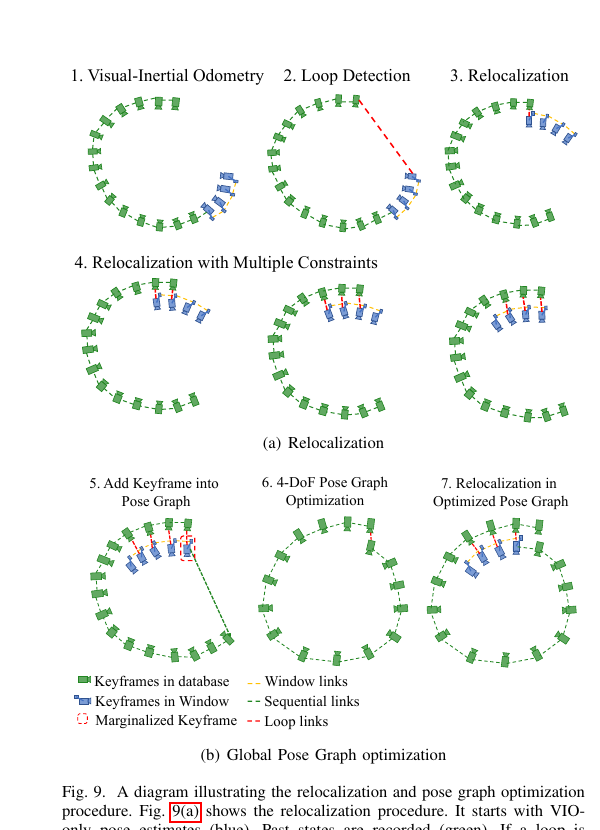

**图 9.** 重定位与位姿图优化流程示意。图 9(a) 显示重定位流程。它从仅 VIO 位姿估计（蓝）开始。过去状态被记录（绿）。若最新关键帧检测到回环（第 VII-A 节），如第二图红线所示，则发生重定位。注意由于使用特征级对应进行重定位，我们能够纳入来自多个过去关键帧的回环闭合约束（第 VII-C 节），如最后三图所示。位姿图优化如图 9(b) 所示。关键帧从滑动窗口边缘化时被加入位姿图。若该关键帧与任一过去关键帧存在回环，则将表述为 4-DOF 相对刚体变换的回环闭合约束也加入位姿图。位姿图使用所有相对位姿约束（第 VIII-B 节）在独立线程中优化，重定位模块始终相对于最新位姿图配置运行。

疑问：重定位是修正当前帧的位姿，回环检测则会修正当前与全部历史帧的位姿，是这样吗？

### B. 特征检索

当检测到回环时，通过检索特征对应建立局部滑动窗口与回环闭合候选之间的连接。对应由 BRIEF 描述子匹配找到。直接描述子匹配可能造成大量外点。为此，我们使用两步几何外点剔除，如图 10 所示。

- **2D-2D：** 带 RANSAC 的基础矩阵检验 [31]。我们使用当前图像与回环闭合候选图像中检索特征的二维观测执行基础矩阵检验。
- **3D-2D：** 带 RANSAC 的 PnP 检验 [35]。基于局部滑动窗口中特征的已知三维位置，以及回环闭合候选图像中的二维观测，我们执行 PnP 检验。

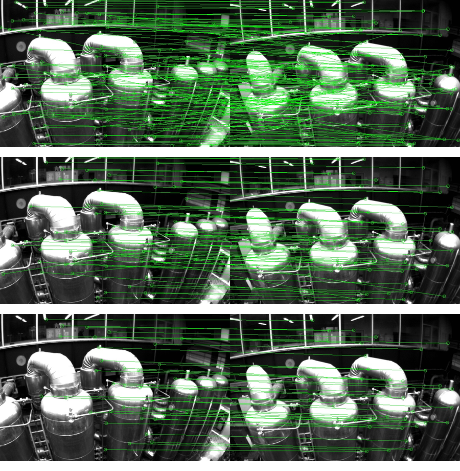

**图 10.** 回环闭合期间用于特征检索的描述子匹配与外点剔除。(a) BRIEF 描述子匹配结果；(b) 第一步：2D-2D 外点剔除结果；(c) 第二步：3D-2D 外点剔除结果。

当内点数超过某阈值时，我们将该候选视为正确回环检测并执行重定位。

### C. 紧耦合重定位

重定位过程有效地将单目 VIO（第 VI 节）维护的当前滑动窗口对齐到过去位姿图。在重定位期间，我们将所有回环闭合帧的位姿视为常数。我们使用所有 IMU 测量、局部视觉测量以及来自回环闭合的检索特征对应联合优化滑动窗口。我们可轻松写出回环闭合帧 $v$ 观测到的检索特征的视觉测量模型，使其与 VIO 中的视觉测量相同，如 (25) 所示。唯一区别是回环闭合帧的位姿 $(\hat{\mathbf{q}}^w_v,\hat{\mathbf{p}}^w_v)$——取自位姿图（第 VIII 节），或在首次重定位时直接取自过去里程计输出——被视为常数。为此，我们可对 (22) 中的非线性代价函数稍作修改，加入额外回环项：

$$
\min_{\mathcal{X}}\left\{\left\|\mathbf{r}_p-\mathbf{H}_p\mathcal{X}\right\|^2+\sum_{k\in\mathcal{B}}\left\|\mathbf{r}_{\mathcal{B}}(\hat{\mathbf{z}}^{b_k}_{b_{k+1}},\mathcal{X})\right\|^2_{\mathbf{P}^{b_k}_{b_{k+1}}}+\sum_{(l,j)\in\mathcal{C}}\rho\left(\left\|\mathbf{r}_{\mathcal{C}}(\hat{\mathbf{z}}^{c_j}_l,\mathcal{X})\right\|^2_{\mathbf{P}^{c_j}_l}\right)+\sum_{(l,v)\in\mathcal{L}}\rho\left(\left\|\mathbf{r}_{\mathcal{C}}(\hat{\mathbf{z}}^{v}_l,\mathcal{X},\hat{\mathbf{q}}^w_v,\hat{\mathbf{p}}^w_v)\right\|^2_{\mathbf{P}^{c_v}_l}\right)\right\},
\tag{26}
$$

其中 $\mathcal{L}$ 为回环闭合帧中检索特征观测的集合。$(l,v)$ 表示在回环闭合帧 $v$ 中观测到的第 $l$ 个特征。注意尽管代价函数与 (22) 略有不同，待求解状态的维数保持不变，因为回环闭合帧的位姿被视为常数。当与当前滑动窗口建立多个回环闭合时，我们同时使用来自所有帧的所有回环闭合特征对应进行优化。这为重定位提供多视图约束，带来更高精度与更好平滑性。注意过去位姿与回环闭合帧的全局优化发生在重定位之后，将在第 VIII 节讨论。

---

## VIII. 全局位姿图优化

重定位之后，局部滑动窗口发生偏移并与过去位姿对齐。利用重定位结果，开发了该额外位姿图优化步骤，以确保过去位姿集合被配准到全局一致配置中。

疑问：全局位姿图优化是将过去的位姿全部进行优化修正是吗？

疑问：我理解，只要做了重定位，就应该做回环检测优化，这样整个轨迹才会更精确，是这样吗？

由于我们的视觉惯性配置使滚转与俯仰角完全可观，累积漂移仅发生在四个自由度（$x$、$y$、$z$ 与偏航角）上。为此，我们忽略估计无漂移的滚转与俯仰状态，仅执行 4-DOF 位姿图优化。

### A. 将关键帧加入位姿图

当关键帧从滑动窗口边缘化时，它将被加入位姿图。该关键帧作为位姿图中的顶点，并通过两类边与其他顶点连接：

#### 1) 顺序边

关键帧将与其先前关键帧建立若干顺序边。顺序边表示局部滑动窗口中两关键帧之间的相对变换，其值直接取自 VIO。考虑新边缘化的关键帧 $i$ 及其先前关键帧之一 $j$，顺序边仅包含相对位置 $\hat{\mathbf{p}}^i_{ij}$ 与偏航角 $\hat{\psi}_{ij}$。

$$
\begin{aligned}
\hat{\mathbf{p}}^i_{ij}&=\hat{\mathbf{R}}^{w\,-1}_i(\hat{\mathbf{p}}^w_j-\hat{\mathbf{p}}^w_i) \\
\hat{\psi}_{ij}&=\hat{\psi}_j-\hat{\psi}_i.
\end{aligned}
\tag{27}
$$

疑问：公式(27)的含义是什么？

#### 2) 回环闭合边

若新边缘化的关键帧具有回环连接，它将在位姿图中通过回环闭合边与回环闭合帧连接。类似地，回环闭合边仅包含与 (27) 定义相同的 4-DOF 相对位姿变换。回环闭合边的值使用重定位结果获得。

### B. 4-DOF 位姿图优化

我们将帧 $i$ 与 $j$ 之间边的残差最小地定义为：

$$
\mathbf{r}_{i,j}(\mathbf{p}^w_i,\psi_i,\mathbf{p}^w_j,\psi_j)=\begin{bmatrix}\mathbf{R}(\hat{\phi}_i,\hat{\theta}_i,\psi_i)^{-1}(\mathbf{p}^w_j-\mathbf{p}^w_i)-\hat{\mathbf{p}}^i_{ij}\\ \psi_j-\psi_i-\hat{\psi}_{ij}\end{bmatrix},
\tag{28}
$$

其中 $\hat{\phi}_i$、$\hat{\theta}_i$ 为估计的滚转与俯仰角，直接取自单目 VIO。

顺序边与回环闭合边的整个图通过最小化如下代价函数进行优化：

$$
\min_{\mathbf{p},\psi}\left\{\sum_{(i,j)\in\mathcal{S}}\left\|\mathbf{r}_{i,j}\right\|^2+\sum_{(i,j)\in\mathcal{L}}\rho\left(\left\|\mathbf{r}_{i,j}\right\|^2\right)\right\},
\tag{29}
$$

其中 $\mathcal{S}$ 为所有顺序边的集合，$\mathcal{L}$ 为所有回环闭合边的集合。尽管紧耦合重定位已有助于消除错误回环闭合，我们另加 Huber 范数 $\rho(\cdot)$ 以进一步降低任何可能错误回环的影响。相比之下，我们对顺序边不使用任何鲁棒范数，因为这些边提取自 VIO，已包含充分的外点剔除机制。

位姿图优化与重定位（第 VII-C 节）在两个独立线程中异步运行。这使得一旦最新优化的位姿图可用即可立即用于重定位。类似地，即使当前位姿图优化尚未完成，重定位仍可使用现有位姿图配置进行。该过程如图 9(b) 所示。

### C. 位姿图管理

当行驶距离增加时，位姿图大小可能无界增长，从长远限制系统实时性能。为此，我们实现下采样过程，将位姿图数据库维持在有限大小。所有具有回环闭合约束的关键帧将被保留，而与邻居过近或姿态非常相似的其他关键帧可能被移除。关键帧被移除的概率与其相对邻居的空间密度成正比。

---

## IX. 实验结果

我们执行三项实验与两项应用以评估所提出的 VINS-Mono 系统。在第一项实验中，我们在公开数据集上将所提算法与另一先进算法对比。我们进行数值分析以展示系统精度。随后在室内环境测试系统以评估重复场景中的性能。执行大尺度实验以说明系统的长时间实用性。此外，我们将所提系统应用于两项应用。对空中机器人应用，我们使用 VINS-Mono 作为位置反馈控制无人机跟踪预定义轨迹。随后将方法移植到 iOS 移动设备并与 Google Tango 对比。

### A. 数据集对比

我们使用 EuRoC MAV 视觉惯性数据集 [41] 评估所提出的 VINS-Mono。数据集在微型飞行器上采集，包含立体图像（Aptina MT9V034 全局快门，WVGA 单色，20 FPS）、同步 IMU 测量（ADIS16448，200 Hz）以及真值状态（VICON 与 Leica MS50）。我们仅使用左相机图像。这些数据集中可观察到大 IMU 偏置与光照变化。

疑问：立体图像是什么？

在这些实验中，我们将 VINS-Mono 与 OKVIS [16] 对比，后者是可与单目与立体相机一起工作的先进 VIO。OKVIS 是另一基于优化的滑动窗口算法。我们的算法在许多细节上与 OKVIS 不同，如技术章节所述。我们的系统完整，具有鲁棒初始化与回环闭合。我们使用两个序列 MH_03_median 与 MH_05_difficult 展示所提方法的性能。为简化记号，我们用 **VINS** 表示仅含单目 VIO 的方法，用 **VINS_loop** 表示带重定位与位姿图优化的完整版本。我们用 **OKVIS_mono** 与 **OKVIS_stereo** 分别表示 OKVIS 使用单目与立体图像的结果。为公平对比，我们丢弃前 100 个输出，并用随后 150 个输出与真值对齐，再比较剩余估计器输出。

对序列 MH_03_median，轨迹如图 11 所示。我们仅比较平移误差，因为该序列中旋转运动可忽略。$x$、$y$、$z$ 误差随时间，以及平移误差随距离如图 12 所示。在误差图中，带回环闭合的 VINS-Mono 具有最小平移误差。我们在 MH_05_difficult 中观察到类似结果。带回环功能的所提方法具有最小平移误差。平移与旋转误差如图 14 所示。由于该序列运动平滑且偏航角变化不大，仅发生位置漂移。显然，回环闭合能力有效地限制了累积漂移。OKVIS 在滚转与俯仰角估计上表现更好。一个可能原因是 VINS-Mono 使用预积分技术——它是 IMU 传播的一阶近似——以节省计算资源。

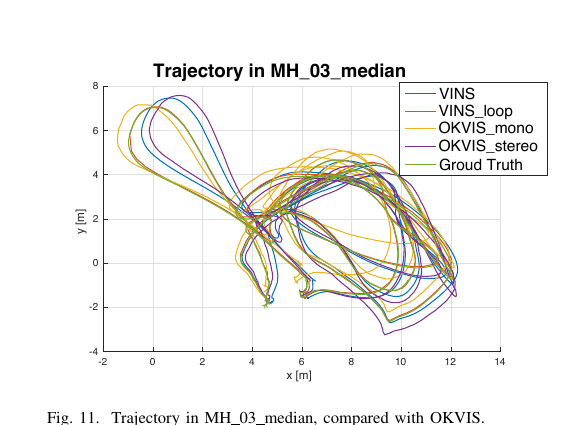

**图 11.** MH_03_median 中的轨迹，与 OKVIS 对比。

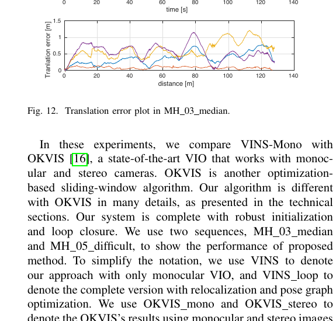

**图 12.** MH_03_median 中的平移误差图。

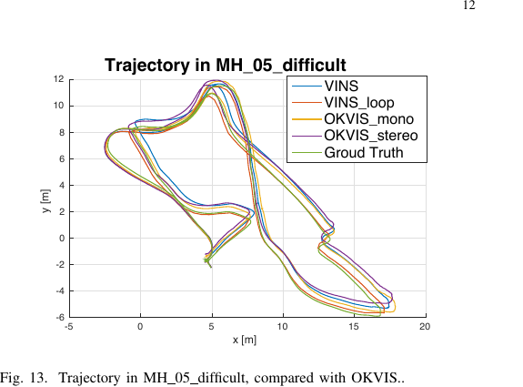

**图 13.** MH_05_difficult 中的轨迹，与 OKVIS 对比。

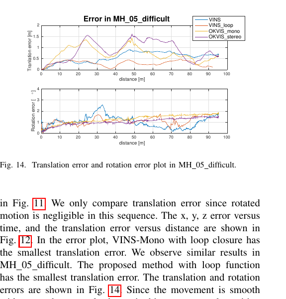

**图 14.** MH_05_difficult 中的平移误差与旋转误差图。

VINS-Mono 在所有 EuRoC 数据集上表现良好，即使在最具挑战性的序列 V1_03_difficult——该序列包含激进运动、无纹理区域与显著光照变化——中亦如此。所提方法可在 V1_03_difficult 中快速初始化，得益于专门的初始化流程。

对纯 VIO，VINS-Mono 与 OKVIS 具有相似精度，很难区分孰优孰劣。然而，VINS-Mono 在系统层面优于 OKVIS。它是带有鲁棒初始化与回环闭合功能以辅助单目 VIO 的完整系统。

### B. 室内实验

在室内实验中，我们选择实验室环境作为实验区域。所用传感器套件如图 15 所示。它包含单目相机（20 Hz）以及 DJI A3 控制器³ 内的 IMU（100 Hz）。我们手持传感器套件并以正常步伐在实验室中行走。我们遇到行人、低光照条件、无纹理区域、玻璃与反射，如图 16 所示。视频见多媒体附件。

³ http://www.dji.com/a3

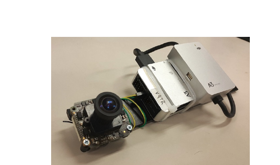

**图 15.** 室内实验所用设备。它包含一台前视全局快门相机（MatrixVision mvBlueFOX-MLC200w），分辨率为 752×480。我们使用 DJI A3 飞控内置 IMU（ADXL278 与 ADXRS290，100 Hz）。

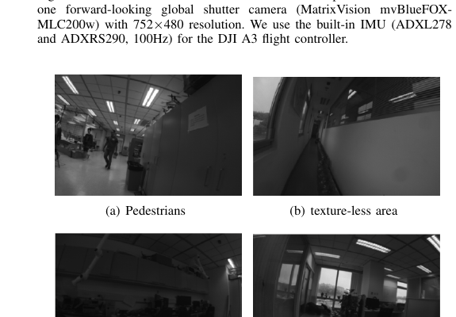

**图 16.** 挑战性室内实验的样本图像。(a) 行人；(b) 无纹理区域；(c) 低光照条件；(d) 玻璃与反射。

我们将结果与 OKVIS 对比，如图 17 所示。图 17(a) 为 OKVIS 的 VIO 输出。图 17(b) 为所提方法无回环闭合的仅 VIO 结果。图 17(c) 为所提方法带重定位与回环闭合的结果。当我们在室内绕圈时出现明显 VIO 漂移。OKVIS 与 VINS-Mono 的仅 VIO 版本均在 $x$、$y$、$z$ 与偏航角上累积显著漂移。我们的重定位与回环闭合模块有效消除了所有这些漂移。

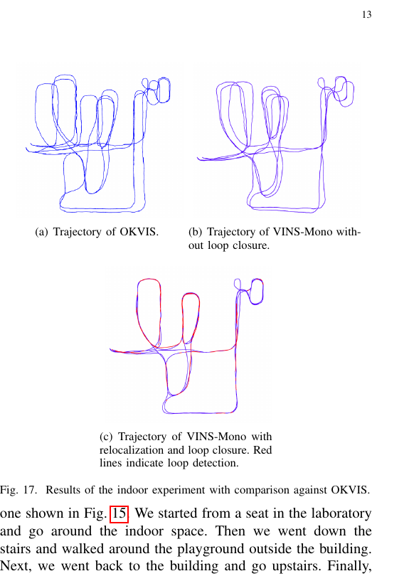

**图 17.** 室内实验结果并与 OKVIS 对比。(a) OKVIS 轨迹；(b) 无回环闭合的 VINS-Mono 轨迹；(c) 带重定位与回环闭合的 VINS-Mono 轨迹。红线表示回环检测。

### C. 大尺度环境

#### 1) 走出实验室

我们在室内外混合设定中测试 VINS-Mono。传感器套件与图 15 所示相同。我们从实验室座位出发并在室内空间走动。随后下楼并在建筑外操场周围行走。接着返回建筑并上楼。最后回到实验室同一座位。整条轨迹超过 700 米，持续约十分钟。实验视频见多媒体附件。

轨迹如图 19 所示。图 19(a) 为 OKVIS 的轨迹。当我们上楼时，OKVIS 显示不稳定特征跟踪，导致不良估计。我们无法在红框中看到楼梯形状。VINS-Mono 的仅 VIO 结果如图 19(b) 所示。带回环闭合的轨迹如图 19(c) 所示。楼梯形状在所提方法中清晰可见。闭合回环轨迹与 Google Map 对齐以验证精度，如图 18 所示。

OKVIS 的最终漂移在 $x$、$y$ 与 $z$ 轴为 $[13.80, -5.26, 7.23]$ m。无回环闭合的 VINS-Mono 最终漂移为 $[-5.47, 2.76, -0.29]$ m，相对于总轨迹长度占 0.88%，小于 OKVIS 的 2.36%。带回环校正后，最终漂移被限制到 $[-0.032, 0.09, -0.07]$ m，相对总轨迹长度可忽略。尽管我们没有真值，仍可直观检查优化轨迹平滑且可精确与卫星地图对齐。

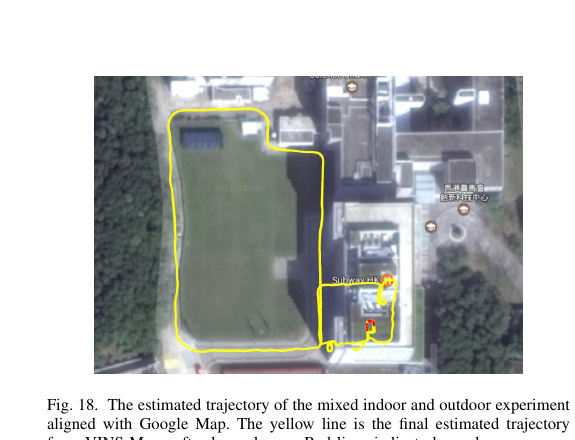

**图 18.** 室内外混合实验估计轨迹与 Google Map 对齐。黄线为带回环闭合后 VINS-Mono 的最终估计轨迹。红线表示回环闭合。

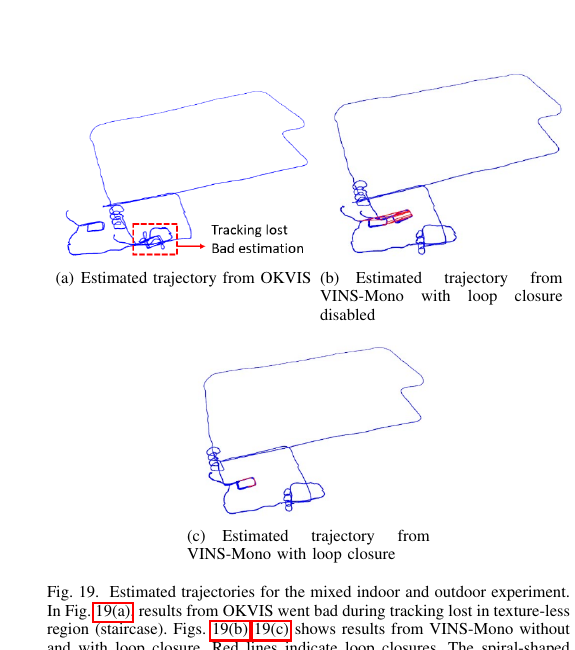

**图 19.** 室内外混合实验的估计轨迹。图 19(a) 中，OKVIS 结果在无纹理区域（楼梯）跟踪丢失期间变差。图 19(b)(c) 显示无/有回环闭合的 VINS-Mono 结果。红线表示回环闭合。螺旋形蓝线显示上下楼时的轨迹。可以看到即使无回环闭合，VINS-Mono 仍表现良好（存在可接受漂移）。

#### 2) 绕校园行走

该非常大尺度数据集环绕整个香港科技大学校园，用手持 VI-Sensor⁴ 记录。数据集覆盖约长 710 m、宽 240 m、高度变化 60 m 的地面。总路径长度 5.62 km。数据包含 25 Hz 图像与 200 Hz IMU，持续 1 小时 34 分钟。这是测试 VINS-Mono 稳定性与耐久性的非常重要实验。

⁴ http://www.skybotix.com/

在该大尺度测试中，我们将关键帧数据库大小设为 2000，以提供充分回环信息并达到实时性能。我们在以 3.60 GHz 运行的 Intel i7-4790 CPU 上运行该数据集。时间统计见表 I。估计轨迹与 Google map 对齐如图 20 所示。与 Google map 对比，可以看到我们的结果在该很长时长测试中几乎无漂移。

**表 I　时间统计（TIMING STATISTICS）**

| 线程 (Thread) | 模块 (Modules)                        | 时间 Time (ms) | 速率 Rate (Hz) |
| :-----------: | :------------------------------------ | -------------: | -------------: |
|       1       | Feature detector（特征检测）          |             15 |             25 |
|       1       | KLT tracker（KLT 跟踪）               |              5 |             25 |
|       2       | Window optimization（窗口优化）       |             50 |             10 |
|       3       | Loop detection（回环检测）            |            100 |             — |
|       3       | Pose graph optimization（位姿图优化） |            130 |             — |

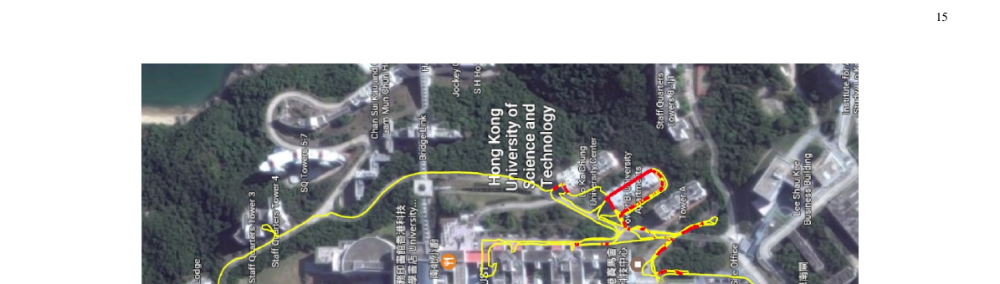

**图 20.** 与 Google map 对齐的超大尺度环境估计轨迹。黄线为 VINS-Mono 的估计轨迹。红线表示回环闭合。

### D. 应用 I：空中机器人的反馈控制

我们将 VINS-Mono 应用于空中机器人的自主反馈控制，如图 21(a) 所示。我们使用前视全局快门相机（MatrixVision mvBlueFOX-MLC200w），分辨率 752×480，并配备 190 度鱼眼镜头。DJI A3 飞控用于 IMU 测量与姿态稳定控制。机载计算资源为运行在 3.00 GHz 的 Intel i7-5500U CPU。传统针孔相机模型不适合大视场相机。我们对该相机使用 MEI [42] 模型，由 [43] 引入的工具包标定。

在该实验中，我们测试使用来自 VINS-Mono 的状态估计进行自主轨迹跟踪的性能。本实验禁用回环闭合。四旋翼被命令跟踪 8 字形图案，每个圆半径 1.0 米，如图 21(b) 所示。轨迹周围放置四个障碍物以验证无回环闭合时 VINS-Mono 的精度。实验期间四旋翼连续跟踪该轨迹四次。100 Hz 机载状态估计（第 VI-F 节）使四旋翼实时反馈控制成为可能。

真值使用 OptiTrack⁵ 获得。总轨迹长度 61.97 m。最终漂移为 $[0.08, 0.09, 0.13]$ m，位置漂移 0.29%。平移与旋转及其对应误差细节如图 23 所示。

⁵ http://optitrack.com/

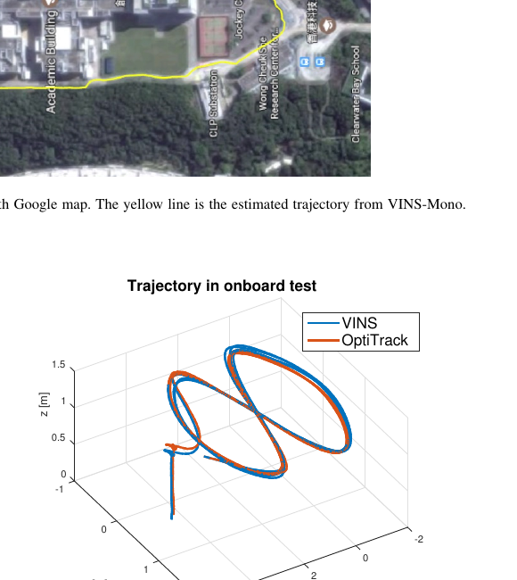

**图 21.** 图 21(a)：自研空中机器人，配备前视鱼眼相机（MatrixVision mvBlueFOX-MLC200w，190° FOV）与 DJI A3 飞控（ADXL278 与 ADXRS290，100 Hz）。图 21(b)：设计轨迹。放置四个已知障碍物。黄线为航空机器人应跟踪的预定义 8 字形图案。机器人在禁用回环闭合的情况下跟踪轨迹四次。实验视频见多媒体附件。

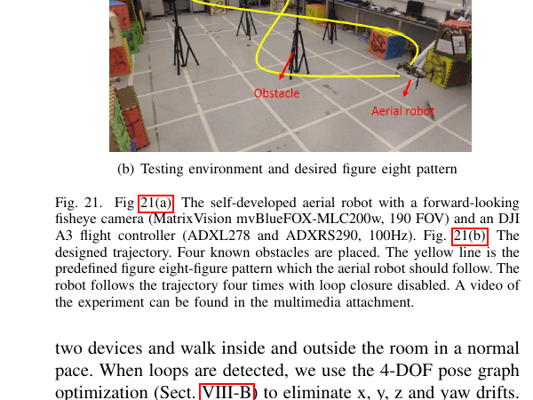

**图 22.** MAV 平台上禁用回环闭合的 VINS-Mono 轨迹及其与真值的对比。机器人跟踪轨迹四次。VINS-Mono 估计用作控制器的实时位置反馈。真值使用 OptiTrack 获得。总长度 61.97 m。最终漂移 0.18 m。

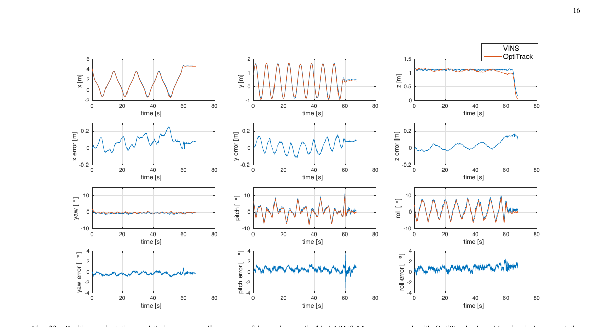

**图 23.** 禁用回环闭合的 VINS-Mono 相对 OptiTrack 的位置、姿态及其对应误差。60 s 处俯仰误差的突变由设计轨迹末端的激进制动引起，以及 VINS-Mono 与 OptiTrack 之间可能的时间未对齐误差。

### E. 应用 II：移动设备

我们将 VINS-Mono 移植到移动设备，并给出简单 AR 应用以展示其精度与鲁棒性。我们将移动实现命名为 VINS-Mobile⁶，并与 Google Tango 设备⁷ 对比，后者是移动平台上商业可用的最佳增强现实解决方案之一。

⁶ https://github.com/HKUST-Aerial-Robotics/VINS-Mobile
⁷ http://shopap.lenovo.com/hk/en/tango/

VINS-Mono 运行在 iPhone 7 Plus 上。我们使用 iPhone 捕获的 30 Hz、640×480 分辨率图像，以及内置 InvenSense MP67B 六轴陀螺仪与加速度计获得的 100 Hz IMU 数据。如图 24 所示，我们将 iPhone 与支持 Tango 的联想 Phab 2 Pro 一起固定。Tango 设备使用全局快门鱼眼相机与同步 IMU 进行状态估计。首先，我们在从估计视觉特征提取的平面上插入一个虚拟立方体，如图 25(a) 所示。随后我们手持这些设备并以正常步伐在房间内外行走。当检测到回环时，我们使用 4-DOF 位姿图优化（第 VIII-B 节）消除 $x$、$y$、$z$ 与偏航漂移。有趣的是，当我们开门时，Tango 的偏航估计跳变了一个大角度，如图 25(b) 所示。原因可能是不稳定特征跟踪导致的估计器崩溃，或主动故障检测与恢复。然而，VINS-Mono 在该挑战情况下仍工作良好。在行驶约 264 m 后，我们返回起点。最终结果见图 25(c)，Tango 轨迹在最后一圈遭受漂移，而我们的 VINS 返回起点。由于 4-DOF 位姿图优化，总轨迹中的漂移被消除。这也由立方体相对开始时配准到图像同一位置这一事实所证明。

诚然，Tango 尤其在局部状态估计上比我们的实现更精确。然而，该实验表明所提方法可在通用移动设备上运行，并具有与专门工程化设备比较的潜在能力。所提方法的鲁棒性也在该实验中得到证明。视频见多媒体附件。

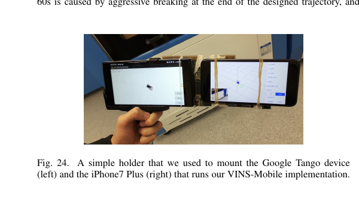

**图 24.** 我们用来固定 Google Tango 设备（左）与运行 VINS-Mobile 实现的 iPhone 7 Plus（右）的简易支架。

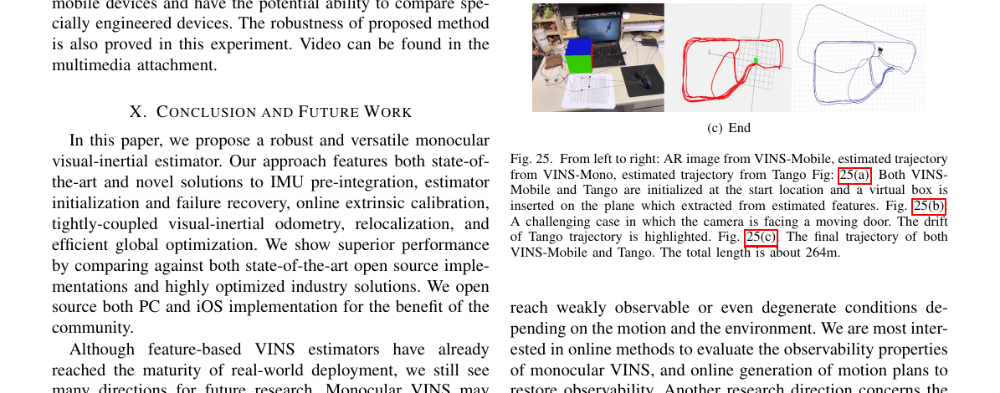

**图 25.** 从左到右：来自 VINS-Mobile 的 AR 图像、来自 VINS-Mono 的估计轨迹、来自 Tango 的估计轨迹。图 25(a)：VINS-Mobile 与 Tango 均在起始位置初始化，并在从估计特征提取的平面上插入虚拟盒子。图 25(b)：相机面向移动门的挑战情况。突出显示了 Tango 轨迹的漂移。图 25(c)：VINS-Mobile 与 Tango 的最终轨迹。总长度约 264 m。

---

## X. 结论与未来工作

本文提出一种鲁棒且通用的单目视觉惯性估计器。我们的方法在 IMU 预积分、估计器初始化与故障恢复、在线外参标定、紧耦合视觉惯性里程计、重定位以及高效全局优化等方面兼具先进与新颖的解决方案。通过与先进开源实现以及高度优化的工业方案对比，我们展示了更优性能。我们开源 PC 与 iOS 实现以惠及社区。

尽管基于特征的 VINS 估计器已达到真实世界部署的成熟度，我们仍看到许多未来研究方向。单目 VINS 可能取决于运动与环境达到弱可观甚至退化条件。我们最感兴趣的是在线评估单目 VINS 可观性性质的方法，以及在线生成运动规划以恢复可观性。另一研究方向涉及在大量消费设备（如手机）上大规模部署单目 VINS。该应用需要几乎所有传感器内参与外参的在线标定，以及对标定质量的在线识别。最后，我们有兴趣根据单目 VINS 结果生成稠密地图。我们在应用于无人机导航的单目视觉惯性稠密建图上的首批结果见 [44]。然而，仍需广泛研究以进一步提升系统精度与鲁棒性。

---

## 参考文献

[1] G. Klein and D. Murray, “Parallel tracking and mapping for small AR workspaces”（面向小型 AR 工作空间的并行跟踪与建图）, in *Mixed and Augmented Reality, 2007. ISMAR 2007. 6th IEEE and ACM International Symposium on*. IEEE, 2007, pp. 225–234.

[2] C. Forster, M. Pizzoli, and D. Scaramuzza, “SVO: Fast semi-direct monocular visual odometry”（SVO：快速半直接单目视觉里程计）, in *Proc. of the IEEE Int. Conf. on Robot. and Autom.*, Hong Kong, China, May 2014.

[3] J. Engel, T. Schöps, and D. Cremers, “LSD-SLAM: Large-scale direct monocular SLAM”（LSD-SLAM：大规模直接单目 SLAM）, in *European Conference on Computer Vision*. Springer International Publishing, 2014, pp. 834–849.

[4] R. Mur-Artal, J. Montiel, and J. D. Tardos, “ORB-SLAM: a versatile and accurate monocular SLAM system”（ORB-SLAM：通用精确的单目 SLAM 系统）, *IEEE Transactions on Robotics*, vol. 31, no. 5, pp. 1147–1163, 2015.

[5] J. Engel, V. Koltun, and D. Cremers, “Direct sparse odometry”（直接稀疏里程计）, *IEEE Transactions on Pattern Analysis and Machine Intelligence*, 2017.

[6] D. Gálvez-López and J. D. Tardós, “Bags of binary words for fast place recognition in image sequences”（用于图像序列快速地点识别的二进制词袋）, *IEEE Transactions on Robotics*, vol. 28, no. 5, pp. 1188–1197, October 2012.

[7] S. Shen, N. Michael, and V. Kumar, “Tightly-coupled monocular visual-inertial fusion for autonomous flight of rotorcraft MAVs”（面向旋翼 MAV 自主飞行的紧耦合单目视觉惯性融合）, in *Proc. of the IEEE Int. Conf. on Robot. and Autom.*, Seattle, WA, May 2015.

[8] Z. Yang and S. Shen, “Monocular visual–inertial state estimation with online initialization and camera–IMU extrinsic calibration”（带在线初始化与相机-IMU 外参标定的单目视觉惯性状态估计）, *IEEE Transactions on Automation Science and Engineering*, vol. 14, no. 1, pp. 39–51, 2017.

[9] T. Qin and S. Shen, “Robust initialization of monocular visual-inertial estimation on aerial robots”（空中机器人上单目视觉惯性估计的鲁棒初始化）, in *Proc. of the IEEE/RSJ Int. Conf. on Intell. Robots and Syst.*, Vancouver, Canada, 2017, accepted.

[10] P. Li, T. Qin, B. Hu, F. Zhu, and S. Shen, “Monocular visual-inertial state estimation for mobile augmented reality”（面向移动增强现实的单目视觉惯性状态估计）, in *Proc. of the IEEE Int. Sym. on Mixed and Augmented Reality*, Nantes, France, 2017, accepted.

[11] S. Weiss, M. W. Achtelik, S. Lynen, M. Chli, and R. Siegwart, “Real-time onboard visual-inertial state estimation and self-calibration of MAVs in unknown environments”（未知环境中 MAV 的实时机载视觉惯性状态估计与自标定）, in *Robotics and Automation (ICRA), 2012 IEEE International Conference on*. IEEE, 2012, pp. 957–964.

[12] S. Lynen, M. W. Achtelik, S. Weiss, M. Chli, and R. Siegwart, “A robust and modular multi-sensor fusion approach applied to MAV navigation”（应用于 MAV 导航的鲁棒模块化多传感器融合方法）, in *Proc. of the IEEE/RSJ Int. Conf. on Intell. Robots and Syst.* IEEE, 2013, pp. 3923–3929.

[13] A. I. Mourikis and S. I. Roumeliotis, “A multi-state constraint Kalman filter for vision-aided inertial navigation”（面向视觉辅助惯性导航的多态约束卡尔曼滤波）, in *Proc. of the IEEE Int. Conf. on Robot. and Autom.*, Roma, Italy, Apr. 2007, pp. 3565–3572.

[14] M. Li and A. Mourikis, “High-precision, consistent EKF-based visual-inertial odometry”（高精度一致的基于 EKF 的视觉惯性里程计）, *Int. J. Robot. Research*, vol. 32, no. 6, pp. 690–711, May 2013.

[15] M. Bloesch, S. Omari, M. Hutter, and R. Siegwart, “Robust visual inertial odometry using a direct EKF-based approach”（使用基于直接 EKF 方法的鲁棒视觉惯性里程计）, in *Proc. of the IEEE/RSJ Int. Conf. on Intell. Robots and Syst.* IEEE, 2015, pp. 298–304.

[16] S. Leutenegger, S. Lynen, M. Bosse, R. Siegwart, and P. Furgale, “Keyframe-based visual-inertial odometry using nonlinear optimization”（使用非线性优化的基于关键帧的视觉惯性里程计）, *Int. J. Robot. Research*, vol. 34, no. 3, pp. 314–334, Mar. 2014.

[17] R. Mur-Artal and J. D. Tardos, “Visual-inertial monocular SLAM with map reuse”（带地图复用的视觉惯性单目 SLAM）, *arXiv preprint arXiv:1610.05949*, 2016.

[18] K. Wu, A. Ahmed, G. A. Georgiou, and S. I. Roumeliotis, “A square root inverse filter for efficient vision-aided inertial navigation on mobile devices”（面向移动设备高效视觉辅助惯性导航的平方根逆滤波器）, in *Robotics: Science and Systems*, 2015.

[19] M. K. Paul, K. Wu, J. A. Hesch, E. D. Nerurkar, and S. I. Roumeliotis, “A comparative analysis of tightly-coupled monocular, binocular, and stereo VINS”（紧耦合单目、双目与立体 VINS 的对比分析）, in *Proc. of the IEEE Int. Conf. on Robot. and Autom.*, Singapore, May 2017.

[20] M. Kaess, H. Johannsson, R. Roberts, V. Ila, J. J. Leonard, and F. Dellaert, “iSAM2: Incremental smoothing and mapping using the Bayes tree”（iSAM2：使用贝叶斯树的增量平滑与建图）, *The International Journal of Robotics Research*, vol. 31, no. 2, pp. 216–235, 2012.

[21] V. Usenko, J. Engel, J. Stückler, and D. Cremers, “Direct visual-inertial odometry with stereo cameras”（带立体相机的直接视觉惯性里程计）, in *Proc. of the IEEE Int. Conf. on Robot. and Autom.* IEEE, 2016, pp. 1885–1892.

[22] T. Lupton and S. Sukkarieh, “Visual-inertial-aided navigation for high-dynamic motion in built environments without initial conditions”（无初始条件时建筑环境中高动态运动的视觉惯性辅助导航）, *IEEE Trans. Robot.*, vol. 28, no. 1, pp. 61–76, Feb. 2012.

[23] C. Forster, L. Carlone, F. Dellaert, and D. Scaramuzza, “IMU preintegration on manifold for efficient visual-inertial maximum-a-posteriori estimation”（流形上 IMU 预积分以实现高效视觉惯性最大后验估计）, in *Proc. of Robot.: Sci. and Syst.*, Rome, Italy, Jul. 2015.

[24] S. Shen, Y. Mulgaonkar, N. Michael, and V. Kumar, “Initialization-free monocular visual-inertial estimation with application to autonomous MAVs”（无需初始化的单目视觉惯性估计及其在自主 MAV 上的应用）, in *Proc. of the Int. Sym. on Exp. Robot.*, Marrakech, Morocco, Jun. 2014.

[25] A. Martinelli, “Closed-form solution of visual-inertial structure from motion”（视觉惯性运动恢复结构的闭式解）, *Int. J. Comput. Vis.*, vol. 106, no. 2, pp. 138–152, 2014.

[26] J. Kaiser, A. Martinelli, F. Fontana, and D. Scaramuzza, “Simultaneous state initialization and gyroscope bias calibration in visual inertial aided navigation”（视觉惯性辅助导航中的同时状态初始化与陀螺仪偏置标定）, *IEEE Robotics and Automation Letters*, vol. 2, no. 1, pp. 18–25, 2017.

[27] M. Faessler, F. Fontana, C. Forster, and D. Scaramuzza, “Automatic re-initialization and failure recovery for aggressive flight with a monocular vision-based quadrotor”（基于单目视觉四旋翼激进飞行的自动再初始化与故障恢复）, in *Proc. of the IEEE Int. Conf. on Robot. and Autom.* IEEE, 2015, pp. 1722–1729.

[28] H. Strasdat, J. Montiel, and A. J. Davison, “Scale drift-aware large scale monocular SLAM”（尺度漂移感知的大规模单目 SLAM）, *Robotics: Science and Systems VI*, 2010.

[29] B. D. Lucas and T. Kanade, “An iterative image registration technique with an application to stereo vision”（迭代图像配准技术及其在立体视觉中的应用）, in *Proc. of the Intl. Joint Conf. on Artificial Intelligence*, Vancouver, Canada, Aug. 1981, pp. 24–28.

[30] J. Shi and C. Tomasi, “Good features to track”（适合跟踪的好特征）, in *Computer Vision and Pattern Recognition, 1994. Proceedings CVPR’94., 1994 IEEE Computer Society Conference on*. IEEE, 1994, pp. 593–600.

[31] R. Hartley and A. Zisserman, *Multiple view geometry in computer vision*（计算机视觉中的多视几何）. Cambridge university press, 2003.

[32] A. Heyden and M. Pollefeys, “Multiple view geometry”（多视几何）, *Emerging Topics in Computer Vision*, 2005.

[33] D. Nistér, “An efficient solution to the five-point relative pose problem”（五点相对位姿问题的高效解）, *IEEE transactions on pattern analysis and machine intelligence*, vol. 26, no. 6, pp. 756–770, 2004.

[34] T. Liu and S. Shen, “Spline-based initialization of monocular visual-inertial state estimators at high altitude”（高海拔下基于样条的单目视觉惯性状态估计器初始化）, *IEEE Robotics and Automation Letters*, 2017, accepted.

[35] V. Lepetit, F. Moreno-Noguer, and P. Fua, “EPnP: An accurate O(n) solution to the PnP problem”（EPnP：PnP 问题的精确 O(n) 解）, *International journal of computer vision*, vol. 81, no. 2, pp. 155–166, 2009.

[36] B. Triggs, P. F. McLauchlan, R. I. Hartley, and A. W. Fitzgibbon, “Bundle adjustment — a modern synthesis”（光束法平差——现代综述）, in *International workshop on vision algorithms*. Springer, 1999, pp. 298–372.

[37] P. Huber, “Robust estimation of a location parameter”（位置参数的鲁棒估计）, *Annals of Mathematical Statistics*, vol. 35, no. 2, pp. 73–101, 1964.

[38] S. Agarwal, K. Mierle, and Others, “Ceres solver,” http://ceres-solver.org.

[39] G. Sibley, L. Matthies, and G. Sukhatme, “Sliding window filter with application to planetary landing”（滑动窗口滤波及其在行星着陆中的应用）, *J. Field Robot.*, vol. 27, no. 5, pp. 587–608, Sep. 2010.

[40] M. Calonder, V. Lepetit, C. Strecha, and P. Fua, “BRIEF: Binary robust independent elementary features”（BRIEF：二进制鲁棒独立基本特征）, *Computer Vision–ECCV 2010*, pp. 778–792, 2010.

[41] M. Burri, J. Nikolic, P. Gohl, T. Schneider, J. Rehder, S. Omari, M. W. Achtelik, and R. Siegwart, “The EuRoC micro aerial vehicle datasets”（EuRoC 微型飞行器数据集）, *The International Journal of Robotics Research*, 2016.

[42] C. Mei and P. Rives, “Single view point omnidirectional camera calibration from planar grids”（由平面网格标定单视点全向相机）, in *Robotics and Automation, 2007 IEEE International Conference on*. IEEE, 2007, pp. 3945–3950.

[43] L. Heng, B. Li, and M. Pollefeys, “CamOdoCal: Automatic intrinsic and extrinsic calibration of a rig with multiple generic cameras and odometry”（CamOdoCal：带多个通用相机与里程计的支架的自动内外参标定）, in *Intelligent Robots and Systems (IROS), 2013 IEEE/RSJ International Conference on*. IEEE, 2013, pp. 1793–1800.

[44] Y. Lin, F. Gao, T. Qin, W. Gao, T. Liu, W. Wu, Z. Yang, and S. Shen, “Autonomous aerial navigation using monocular visual-inertial fusion”（使用单目视觉惯性融合的自主空中导航）, *J. Field Robot.*, vol. 00, pp. 1–29, 2017.

---

*（全文翻译完。原文：Qin, Li, Shen — VINS-Mono: A Robust and Versatile Monocular Visual-Inertial State Estimator, arXiv:1708.03852v1, 2017。）*
