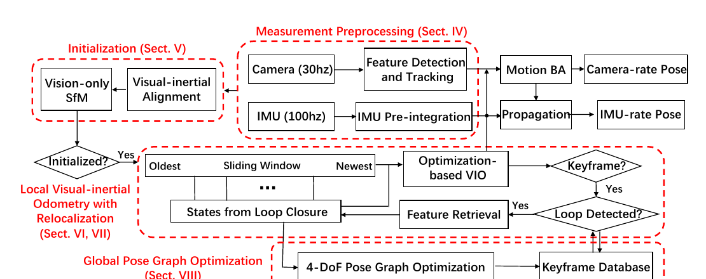
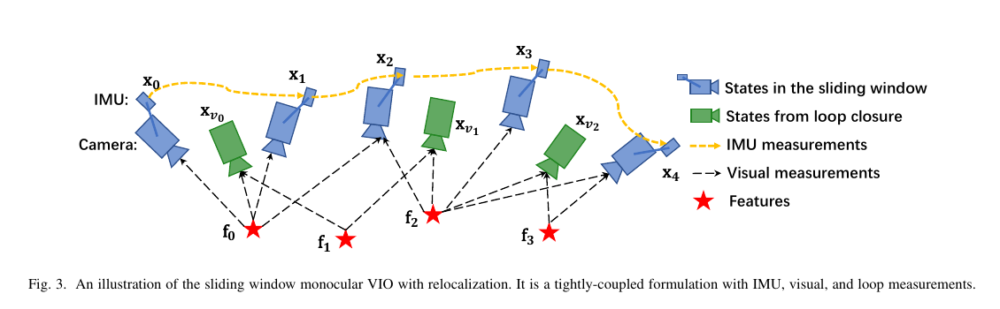
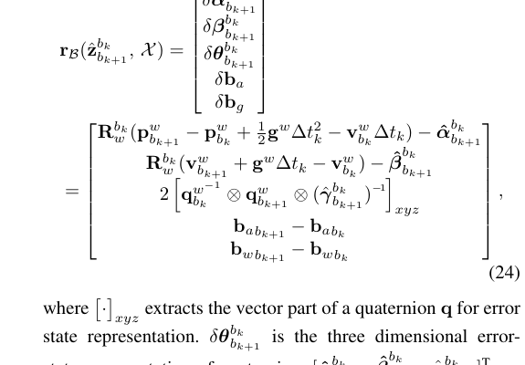
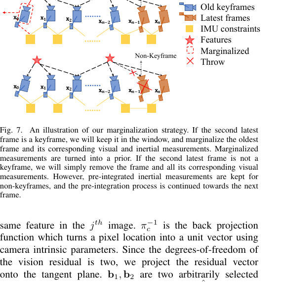

# VINS-Mono 核心方法与代码讲解

> 面向：想对着 HKUST [VINS-Mono](https://github.com/HKUST-Aerial-Robotics/VINS-Mono) 仓库，把论文核心步骤落到函数/类的人。  
> 背景假设：感知工程师；定位概念只补到能读代码。  
> 仓库对照版本：本机克隆 `/workspace/VINS-Mono`，`git` tip `90dabb5`（`add simulation data`）。路径一律写仓库相对路径。

---

## 1. 文档说明

| 文档 | 定位 |
|------|------|
| `VINS-Mono_中文全文翻译.md` | 论文全文；公式编号 (1)–(29)、Fig.1–25 与翻译稿一致 |
| `docs/VINS-Mono_OpenVINS_讲解_感知向.md`（另处） | 感知向概念讲解，偏「为什么」 |
| **本文** | **论文步骤 → 开源仓库落点**；摘关键代码，不替代读源码 |

**路径约定**

- 代码：`feature_tracker/`、`vins_estimator/`、`pose_graph/`、`camera_model/`
- 配图：优先同级 `figs/figXX.png`（与翻译稿共用）；没有就写「见论文 Fig.N」
- 配置：`config/*.yaml`（`estimate_extrinsic`、`estimate_td`、`max_cnt` 等）

**主路径一句话**：图像进 `feature_tracker` 出特征 → `vins_estimator` 做预积分/初始化/滑窗紧耦合优化 → 关键帧进 `pose_graph` 做回环与 4-DoF 位姿图；回环匹配点再喂回 estimator 做紧耦合重定位。

---

## 2. 仓库地图与数据流



| 包 | 干什么 | 主入口 |
|----|--------|--------|
| `camera_model` | 内参/畸变模型（pinhole、梅卡托鱼眼等），`liftProjective` 把像素抬到归一化射线 | 被 tracker / 标定工具调用 |
| `feature_tracker` | KLT 跟踪 + 角点补充 + 去畸变 + F 矩阵剔外点；按 `FREQ` 控发布频率 | `feature_tracker_node.cpp` → `img_callback` |
| `vins_estimator` | IMU 缓冲对齐、预积分、初始化、滑窗 BA、边缘化、失效重启；发里程计 | `estimator_node.cpp` → `process` 线程；核心类 `Estimator` |
| `pose_graph` | DBoW2+BRIEF 回环、几何验证、`optimize4DoF`、发 `match_points` 给重定位 | `pose_graph_node.cpp` |

**话题数据流（默认名，可被 yaml 改）**

```
IMAGE_TOPIC ──► feature_tracker ──► /feature_tracker/feature ──► vins_estimator
IMU_TOPIC   ─────────────────────────────────────────────────► vins_estimator
                                                                   │
                          /vins_estimator/odometry, keyframe_pose,  │
                          keyframe_point, imu_propagate, extrinsic  │
                                                                   ▼
                                                              pose_graph
                                                                   │
                                              /pose_graph/match_points
                                                                   ▼
                                                              vins_estimator（setReloFrame）
```

`estimator_node` 里：`imu_callback` 一边缓冲一边 `predict` 发高频 `imu_propagate`；`feature_callback` / `relocalization_callback` 入队；`process()` 按特征时间戳取齐 IMU 再调 `Estimator::processIMU` / `processImage`。

---

## 3. 按流水线逐模块

每节四块：**论文在做什么 → 关键公式/概念 → 代码落点 → 读代码注意点**。

### 3.1 测量预处理：视觉跟踪与 IMU 对齐

**论文在做什么（第 IV-A 节）**  
新图上用 KLT 跟踪旧特征；用角点检测补到足够数量；相邻特征最小像素间隔强制均匀；去畸变后投影到单位球；RANSAC + 基础矩阵剔外点。IMU 在连续图像帧之间预积分（下一节）。

**关键概念**  
跟踪质量决定后续视差与三角化；发布频率 `FREQ` 与图像原始频率解耦。

**代码落点**

- `feature_tracker/src/feature_tracker.cpp`：`FeatureTracker::readImage`  
  - `cv::calcOpticalFlowPyrLK` 跟踪  
  - `rejectWithF` → `liftProjective` + `findFundamentalMat`  
  - `setMask` / `goodFeaturesToTrack` / `addPoints`  
  - `undistortedPoints` 写出归一化坐标与速度（给 TD 因子用）
- `feature_tracker/src/feature_tracker_node.cpp`：`img_callback` 控频、`PUB_THIS_FRAME`、组 `PointCloud` 特征消息
- `vins_estimator/src/estimator_node.cpp`：`getMeasurements()` 按特征时间戳切 IMU；`process()` 里对每段 IMU 调 `processIMU`

```113:165:feature_tracker/src/feature_tracker.cpp
        cv::calcOpticalFlowPyrLK(cur_img, forw_img, cur_pts, forw_pts, status, err, cv::Size(21, 21), 3);
        // ... reduceVector by status / border ...
    if (PUB_THIS_FRAME)
    {
        rejectWithF();
        setMask();
        // ...
            cv::goodFeaturesToTrack(forw_img, n_pts, MAX_CNT - forw_pts.size(), 0.01, MIN_DIST, mask);
        addPoints();
    }
    // ...
    undistortedPoints();
```

**读代码注意点**

- 消息里每个点带 `id`、归一化 `x,y,z`、像素 `u,v`、速度；`Estimator::processImage` 收到的是 `map<feature_id, vector<pair<cam_id, 7×1>>>`。
- 相机模型来自 `camera_model`，yaml 的 `model_type` 决定 `liftProjective` 行为。

---

### 3.2 IMU 预积分（`IntegrationBase` / midpoint）与 bias 雅可比

**论文在做什么（第 IV-B 节）**  
把两帧之间的 IMU 积成相对量 \(\boldsymbol{\alpha},\boldsymbol{\beta},\boldsymbol{\gamma}\)，避免每次优化改位姿都从头再积。偏置变一点时用一阶雅可比修正（公式 (12)），大变则 `repropagate`。



**关键公式**  
均值递推对应公式 (7)；误差状态 / 协方差传播对应 (8)–(11)；偏置一阶修正对应 (12)；残差形式对应 (13)/(24)。

**代码落点**

- `vins_estimator/src/factor/integration_base.h`  
  - `push_back` → `propagate` → **`midPointIntegration`**（中点法 + 更新 `jacobian`/`covariance`）  
  - `repropagate`：换 `linearized_ba/bg` 后重放 `dt_buf`  
  - `evaluate`：按当前两帧状态算 15 维残差（含 bias 一阶修正）
- 调用链：`Estimator::processIMU` 对 `pre_integrations[frame_count]` 与 `tmp_pre_integration` 同步 `push_back`；同时用中点法前推 `Ps/Vs/Rs` 作初值

```54:125:vins_estimator/src/factor/integration_base.h
    void midPointIntegration(..., bool update_jacobian)
    {
        Vector3d un_acc_0 = delta_q * (_acc_0 - linearized_ba);
        Vector3d un_gyr = 0.5 * (_gyr_0 + _gyr_1) - linearized_bg;
        result_delta_q = delta_q * Quaterniond(1, un_gyr(0) * _dt / 2, ...);
        // ... result_delta_p / result_delta_v ...
        if(update_jacobian)
        {
            // 构造 F(15×15), V(15×18)
            jacobian = F * jacobian;
            covariance = F * covariance * F.transpose() + V * noise * V.transpose();
        }
    }
```

```160:185:vins_estimator/src/factor/integration_base.h
    Eigen::Matrix<double, 15, 1> evaluate(...)
    {
        // corrected_delta_* = delta_* + J * (Bai - linearized_ba) 等
        residuals.block<3, 1>(O_P, 0) = Qi.inverse() * (0.5 * G * sum_dt * sum_dt + Pj - Pi - Vi * sum_dt) - corrected_delta_p;
        residuals.block<3, 1>(O_R, 0) = 2 * (corrected_delta_q.inverse() * (Qi.inverse() * Qj)).vec();
        // ... O_V, O_BA, O_BG ...
    }
```

**读代码注意点**

- 成员名：`delta_p/q/v` ↔ 论文 \(\boldsymbol{\alpha}/\boldsymbol{\gamma}/\boldsymbol{\beta}\)（注意 β 对应速度预积分）。
- `IMUFactor::Evaluate`（`factor/imu_factor.h`）内部调 `pre_integration->evaluate`，并用 `covariance.inverse()` 做信息矩阵平方根。
- 文件里还留着未启用的 `eulerIntegration`；真正跑的是 midpoint。

---

### 3.3 视觉惯性初始化

**论文在做什么（第 V 节）**  
滑窗满后：纯视觉 SfM → 与 IMU 预积分对齐，恢复尺度、重力、速度、陀螺 bias（加速度 bias 初值常先当 0）。可选在线估相机–IMU 旋转外参。

**代码落点（顺序即调用链）**

1. **外参旋转（可选）**  
   `ESTIMATE_EXTRINSIC == 2` 时，`Estimator::processImage` 调  
   `InitialEXRotation::CalibrationExRotation`（`initial/initial_ex_rotation.*`），成功后改为 `1`（继续在 BA 里估）。

2. **相对位姿 + Global SfM**  
   `Estimator::initialStructure`：  
   - 粗查 IMU 激励方差  
   - `relativePose` → `MotionEstimator::solveRelativeRT`（五点）选有足够视差的帧 `l`  
   - `GlobalSFM::construct`（`initial/initial_sfm.*`）  
   - 非关键帧 `solvePnP`  
   - 再 `visualInitialAlign`

3. **视觉–IMU 对齐**  
   `Estimator::visualInitialAlign` → `VisualIMUAlignment`（`initial/initial_aligment.cpp`，文件名少了一个 `n`）：  
   - `solveGyroscopeBias`（对应公式 (15)）  
   - `LinearAlignment` + `RefineGravity`（重力 2-DoF，对应 Fig.5 / 算法 1）  
   - 回写尺度 `s`、`Vs`、重力方向对齐，`pre_integrations[i]->repropagate`

```158:186:vins_estimator/src/estimator.cpp
    if (solver_flag == INITIAL)
    {
        if (frame_count == WINDOW_SIZE)
        {
            // ...
               result = initialStructure();
            if(result)
            {
                solver_flag = NON_LINEAR;
                solveOdometry();
                slideWindow();
                // ...
            }
            else
                slideWindow();
        }
        else
            frame_count++;
    }
```

```3:36:vins_estimator/src/initial/initial_aligment.cpp
void solveGyroscopeBias(...)
{
    // A = Σ J_bg^T J_bg , b = Σ J_bg^T * 2*(Δq^{-1} * q_ij).vec()
    delta_bg = A.ldlt().solve(b);
    for (int i = 0; i <= WINDOW_SIZE; i++)
        Bgs[i] += delta_bg;
    // repropagate all pre_integrations with new bg
}
```

**读代码注意点**

- 初始化失败会 `slideWindow` 继续攒数据，不会卡死。
- `relativePose` 里视差阈值用了 `average_parallax * 460 > 30`（经验焦距缩放），和特征管理里的 `MIN_PARALLAX` 不是同一处。

---

### 3.4 滑窗状态与特征管理（逆深度）

**论文在做什么（第 VI-A 节）**  
状态向量公式 (21)：每帧 IMU 的 \(p,v,q,b_a,b_w\)，外参，以及特征逆深度 \(\lambda_l\)。

**代码落点**

- 状态数组：`Estimator` 成员 `Ps, Rs, Vs, Bas, Bgs`，长度 `WINDOW_SIZE+1`（`parameters.h` 里 `WINDOW_SIZE = 10`）
- Ceres 参数块：`para_Pose[i][7]`、`para_SpeedBias[i][9]`、`para_Feature[j][1]`、`para_Ex_Pose`、`para_Td`
- `feature_manager.*`：  
  - `FeaturePerId` / `FeaturePerFrame`  
  - `addFeatureCheckParallax`：视差够 → 关键帧（`MARGIN_OLD`），否则次新帧非关键帧（`MARGIN_SECOND_NEW`）  
  - `triangulate` / `setDepth` / `removeBack` / `removeFront` / `removeBackShiftDepth`

```124:127:vins_estimator/src/estimator.cpp
    if (f_manager.addFeatureCheckParallax(frame_count, image, td))
        marginalization_flag = MARGIN_OLD;
    else
        marginalization_flag = MARGIN_SECOND_NEW;
```

**读代码注意点**

- 逆深度存在 `FeaturePerId::estimated_depth`，优化变量是 `para_Feature` 里的标量；`vector2double` / `double2vector` 负责搬运。
- `used_num >= 2 && start_frame < WINDOW_SIZE - 2` 才进残差，太新或观测太少的点不进 BA。

---

### 3.5 紧耦合非线性优化与各类 factor

**论文在做什么（第 VI 节）**  
最小化公式 (22)：边缘化先验 + IMU 残差 + 视觉残差；论文写 Huber 范数 (23)。视觉残差可在单位球切平面上定义 (25)。



**代码落点**：`Estimator::optimization`（`estimator.cpp`）

| 残差 | Factor 类 | 参数块 |
|------|-----------|--------|
| 边缘化先验 | `MarginalizationFactor` | `last_marginalization_parameter_blocks` |
| IMU | `IMUFactor` | `Pose[i], SpeedBias[i], Pose[j], SpeedBias[j]` |
| 视觉（无 TD） | `ProjectionFactor` | `Pose[i], Pose[j], Ex_Pose[0], Feature` |
| 视觉（估时间偏移） | `ProjectionTdFactor` | 同上 + `para_Td` |
| 回环重定位 | 仍用 `ProjectionFactor`，第二位姿换成 `relo_Pose` | `setReloFrame` 填的匹配 |

```670:761:vins_estimator/src/estimator.cpp
void Estimator::optimization()
{
    // loss_function = new ceres::HuberLoss(1.0);  // 论文 (23) 写 Huber
    loss_function = new ceres::CauchyLoss(1.0);   // 仓库默认 Cauchy
    // ... AddParameterBlock para_Pose / SpeedBias / Ex_Pose / Td ...
    // MarginalizationFactor + IMUFactor + Projection(Td)Factor
    // relocalization_info 时再加 ProjectionFactor(..., relo_Pose, ...)
    options.linear_solver_type = ceres::DENSE_SCHUR;
    options.trust_region_strategy_type = ceres::DOGLEG;
    ceres::Solve(options, &problem, &summary);
    double2vector();
    // 随后按 marginalization_flag 做 Schur 边缘化
}
```

投影残差核心（默认 **未** 打开单位球宏时走针孔归一化平面）：

```35:47:vins_estimator/src/factor/projection_factor.cpp
    Eigen::Vector3d pts_camera_i = pts_i / inv_dep_i;
    // ... 变换到 j 相机系 pts_camera_j ...
#ifdef UNIT_SPHERE_ERROR 
    residual =  tangent_base * (pts_camera_j.normalized() - pts_j.normalized());
#else
    double dep_j = pts_camera_j.z();
    residual = (pts_camera_j / dep_j).head<2>() - pts_j.head<2>();
#endif
```

**读代码注意点**

- `parameters.h` 里 `#define UNIT_SPHERE_ERROR` **被注释掉**：论文主推单位球，开源默认是归一化平面残差；要复现论文行为需自行打开宏并重编译。
- 姿态用 `PoseLocalParameterization`（四元数流形扰动）。
- `ESTIMATE_EXTRINSIC==0` 时外参 `SetParameterBlockConstant`。

---

### 3.6 边缘化 / Schur（对应论文 Fig.7）



**论文在做什么**  
关键帧进窗 → 边缘化最老帧的 IMU+视觉，转成先验；非关键帧 → 丢掉该帧视觉，**保留 IMU 预积分接到下一帧**，维持稀疏性。

**代码落点**

- 判定：见 3.4 的 `marginalization_flag`
- 执行：`optimization()` 末尾组 `MarginalizationInfo` → `preMarginalize` / `marginalize`（`factor/marginalization_factor.*`，舒尔补）→ 得到新的 `last_marginalization_info`
- 窗口滑动：`Estimator::slideWindow` → `slideWindowOld` / `slideWindowNew`；特征侧 `removeBackShiftDepth` 或 `removeFront`

**读代码注意点**

- `MARGIN_SECOND_NEW` 时对次新帧主要是丢掉视觉观测并合并预积分，不要和「把最老帧 Schur 掉」混为一谈。
- 先验因子下一轮作为 `MarginalizationFactor` 残差块加入，对应公式 (22) 里的 \(\{\mathbf{r}_p,\mathbf{H}_p\}\)。

---

### 3.7 失效检测与恢复

**论文在做什么**  
鲁棒初始化 + 故障恢复；跟踪崩了要能重启。

**代码落点**

- `Estimator::failureDetection`：加计 bias 过大、陀螺 bias 过大、帧间平移/高度跳变等返回 true（部分角度阈值被注释掉）
- `processImage` 中若失败：`clearState()` + `setParameter()`，「system reboot」
- 前端：`feature_tracker_node` 发现时间戳断裂会发 `/feature_tracker/restart`；`estimator_node::restart_callback` 清空缓冲并重置 estimator

```621:666:vins_estimator/src/estimator.cpp
bool Estimator::failureDetection()
{
    if (Bas[WINDOW_SIZE].norm() > 2.5) return true;
    if (Bgs[WINDOW_SIZE].norm() > 1.0) return true;
    if ((Ps[WINDOW_SIZE] - last_P).norm() > 5) return true;
    if (abs(Ps[WINDOW_SIZE].z() - last_P.z()) > 1) return true;
    // delta_angle > 50 的分支默认注释掉未 return
    return false;
}
```

---

### 3.8 回环检测、重定位、4-DoF 位姿图

**论文在做什么（第 VII、VIII 节）**  
DBoW 找回环 → BRIEF 匹配 → 2D-2D / 3D-2D 剔外点 → 特征级约束塞进 VIO（紧耦合重定位）→ 边缘化出去的关键帧进位姿图，只优化 \(x,y,z,\mathrm{yaw}\)（重力对齐后 pitch/roll 可观测）。

**代码落点**

- `pose_graph/src/pose_graph.cpp`：`addKeyFrame` → `detectLoop` →（成功则）关键帧 `findConnection`  
- `pose_graph/src/keyframe.cpp`：`KeyFrame::findConnection`、`PnPRANSAC`、`HammingDis`  
- 发布 `match_points` → `estimator_node::relocalization_callback` → `Estimator::setReloFrame` → `optimization` 里加投影因子  
- 独立线程 `PoseGraph::optimize4DoF`；误差结构体 `FourDOFError` / `FourDOFWeightError`（`pose_graph.h`）

**读代码注意点**

- 位姿图与滑窗 VIO **多线程**：VIO 实时；4-DoF 优化可慢一点。
- 顺序边相对量来自 VIO；回环边来自重定位相对位姿（含 yaw）。

---

### 3.9 输出频率：优化关键帧 / IMU 前推

**论文在做什么（第 VI-E 节）**  
完整滑窗 BA 较慢；另述「仅运动 VI-BA」做相机频率输出。iOS/演示侧更强调低延迟。

**本仓库实际**

| 输出 | 机制 | 代码 |
|------|------|------|
| 关键帧/图像率里程计 | `process()` 里优化完 `pubOdometry` | `utility/visualization.cpp` |
| 接近 IMU 频率 | `imu_callback` 里 `predict` 中点积分前推，`pubLatestOdometry` → `imu_propagate` | `estimator_node.cpp` |
| 论文级 motion-only BA | **本 PC 仓库未见独立「只优化最近几帧位姿、冻深度」的模块** | 更接近移动端/论文描述；此处用 IMU 前推顶高频 |

```42:74:vins_estimator/src/estimator_node.cpp
void predict(const sensor_msgs::ImuConstPtr &imu_msg)
{
    // tmp_Q, tmp_P, tmp_V 中点积分；减 bias、减 g
    tmp_P = tmp_P + dt * tmp_V + 0.5 * dt * dt * un_acc;
    tmp_V = tmp_V + dt * un_acc;
}
```

---

## 4. 关键数据结构速查表

### 4.1 状态向量 ↔ 代码

| 论文 (21) | 代码 |
|-----------|------|
| \(\mathbf{p}^{w}_{b_k}, \mathbf{q}^{w}_{b_k}\) | `Ps[k]`, `Rs[k]` ↔ `para_Pose[k]` (txyz + qxqyqzqw) |
| \(\mathbf{v}^{w}_{b_k}\) | `Vs[k]` ↔ `para_SpeedBias[k][0:3]` |
| \(\mathbf{b}_a, \mathbf{b}_w\) | `Bas[k]`, `Bgs[k]` ↔ `para_SpeedBias[k][3:9]` |
| \(\mathbf{x}^b_c\) 外参 | `tic[]`, `ric[]` ↔ `para_Ex_Pose` |
| \(\lambda_l\) 逆深度 | `FeaturePerId::estimated_depth` ↔ `para_Feature[i][0]` |
| 时间偏移 \(t_d\)（实现扩展） | `td` ↔ `para_Td[0][0]`，开关 `ESTIMATE_TD` |
| 预积分量 | `IntegrationBase::{delta_p,delta_q,delta_v,jacobian,covariance}` |

### 4.2 残差块 ↔ Factor

| 残差 | 类 |
|------|-----|
| IMU (24) | `IMUFactor` |
| 视觉投影 (25) | `ProjectionFactor` / `ProjectionTdFactor` |
| 边缘化先验 | `MarginalizationFactor` |
| 姿态流形 | `PoseLocalParameterization` |
| 位姿图 4-DoF | `FourDOFError` / `FourDOFWeightError` |

---

## 5. 建议阅读顺序（≤10 步）

1. `config/euroc/euroc_config.yaml` — 弄清话题、外参、`estimate_extrinsic`、`estimate_td`  
2. `feature_tracker/src/feature_tracker.cpp` — `readImage` 全流程  
3. `vins_estimator/src/estimator_node.cpp` — `getMeasurements` + `process` + `predict`  
4. `vins_estimator/src/estimator.h` — 状态成员与枚举一眼扫完  
5. `factor/integration_base.h` — `midPointIntegration` / `evaluate`  
6. `estimator.cpp` — `processIMU` → `processImage` → `initialStructure` → `visualInitialAlign`  
7. `initial/initial_aligment.cpp` + `initial_sfm.cpp` — 对齐与 SfM  
8. `feature_manager.cpp` — 视差关键帧与 `triangulate`  
9. `estimator.cpp` 的 `optimization` + `factor/projection_factor.cpp` + `marginalization_factor.*`  
10. `pose_graph.cpp` / `keyframe.cpp` — `detectLoop` → `findConnection` → `optimize4DoF`

---

## 6. 未覆盖 / 与论文差异（如实）

1. **单位球残差**：论文 Fig.6 / 公式 (25) 主叙事是单位球；开源默认 `UNIT_SPHERE_ERROR` 关闭，走归一化平面。  
2. **鲁棒核**：论文公式 (23) 写 Huber；`optimization` 里 Huber 被注释，**实际用 `CauchyLoss(1.0)`**。  
3. **Motion-only BA**：论文 VI-E / Fig.8；本仓库高频输出主要是 **IMU `predict` 前推**，未见完整 motion-only BA 实现（移动端演示更相关）。  
4. **iOS 移植**：论文强调 PC + iOS 双端开源；本仓库是 ROS/PC 线，不含 App 工程。  
5. **文件名笔误**：`initial_aligment.cpp`（少字母 n）与头文件 `initial_alignment.h` 并存，搜代码时别漏。  
6. **仿真 / AR**：`data_generator`、`ar_demo` 等未在本文展开；主路径不依赖它们。

---

## 附：与翻译稿章节对照

| 论文章节 | 本文小节 |
|----------|----------|
| III 流水线 / Fig.2 | §2 |
| IV-A 视觉预处理 | §3.1 |
| IV-B 预积分 | §3.2 |
| V 初始化 | §3.3 |
| VI-A/B/C 状态与残差 | §3.4–3.5 |
| VI-D 边缘化 / Fig.7 | §3.6 |
| VI-E 输出频率 | §3.9 |
| VII–VIII 回环与位姿图 | §3.8 |

（完）
